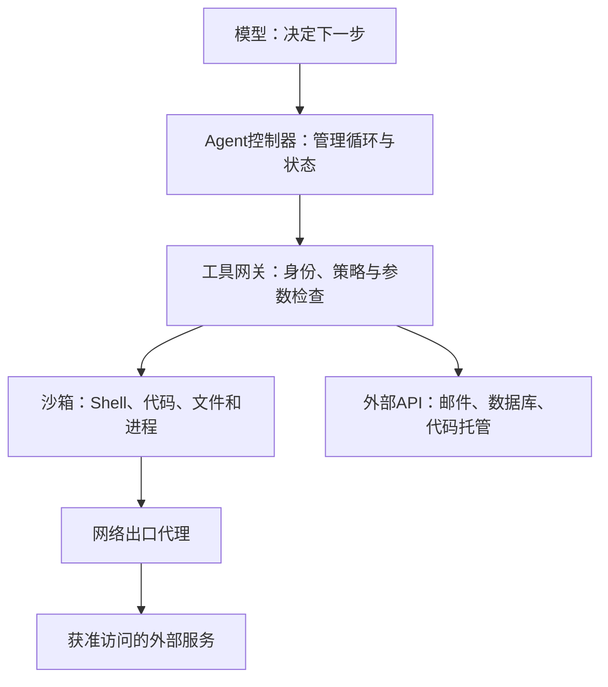

**Agent 的 sandbox（沙箱），是一个受约束的执行环境：Agent 可以在其中运行程序、修改文件、操作工具，但它能接触哪些资源、产生哪些影响，由外部系统强制限定。**

理解它，要同时看两件事：

- **安全边界**：限制错误操作、恶意代码、提示词注入造成的影响。
- **执行环境**：为任务提供依赖、文件、进程和状态，并支持重置、并行实验和结果检查。

它通常由操作系统隔离、虚拟化、权限策略、工具代理和环境生命周期管理共同组成。

下面沿着“为什么需要 → 系统位置 → 底层机制 → 工程设计 → 训练用途”展开。

**1．为什么 Agent 特别需要 sandbox**

普通聊天模型主要输出文字；Agent 会把输出转化成实际动作，例如：

```
读取项目 → 修改代码 → 安装依赖 → 运行测试 → 访问网络 → 提交结果
```

这使得模型的错误可能变成现实中的副作用。

| 风险来源   | 例子                         | 沙箱需要限制的能力      |
| ---------- | ---------------------------- | ----------------------- |
| 模型误判   | 错误删除目录                 | 文件写入、删除范围      |
| 不可信输入 | 网页诱导 Agent 上传密钥      | 文件读取与网络出口      |
| 不可信程序 | 安装脚本执行恶意逻辑         | 系统调用、进程权限      |
| 资源失控   | 无限循环、不断创建子进程     | CPU、内存、进程数、时长 |
| 多任务干扰 | 一个任务修改另一个任务的数据 | 工作区和租户隔离        |
| 外部副作用 | 测试时发送真实邮件           | 外部 API 的动作权限     |

关键是：**即使 Agent 作出了错误决定，执行环境仍然应该守住边界。**

所以，“在提示词里要求不要访问密钥”只是行为约束；让进程根本无法读取密钥文件，才是技术上的访问控制。

------

**2．sandbox 在 Agent 系统里处于什么位置**

一个典型架构是：




这里需要区分四个角色：

| 组件                       | 主要职责                               |
| -------------------------- | -------------------------------------- |
| 模型                       | 生成动作建议                           |
| Agent 控制器，也称 harness | 调用模型、执行工具、收集结果、管理任务 |
| 策略与工具网关             | 判断动作是否在授权范围内               |
| sandbox                    | 强制限制代码执行时能接触的资源         |

**模型通常不需要运行在 sandbox 里面。** 它可以通过远程推理服务产生工具调用，由控制器把代码送进沙箱执行。

还有一个容易忽略的问题：**Shell 被沙箱隔离，不代表其他工具也被隔离。** 如果 Agent 还能直接调用邮件 API，那么邮件权限必须由对应工具网关单独控制。

------

**3．究竟隔离什么：六个维度**

**① 文件系统**

需要回答：

- 哪些目录可读？
- 哪些目录可写？
- 能否看到宿主机文件？
- 哪些修改在任务结束后保留？

例如，一个编程任务可以配置为：

```
/workspace/project   可读写
/datasets            只读
/tmp                 临时可写
其他宿主机目录       不挂载或禁止访问
```

常见实现包括只读挂载、独立挂载视图、访问控制规则，以及写时复制文件系统。

**写时复制（Copy-on-Write）**意味着：多个任务共享同一份基础镜像，每个任务只保存自己的修改，因此创建和丢弃环境更便宜。

但“只读”不等于“保密”。密钥即使不能修改，只要能读取，仍可能被泄露。

**② 网络**

需要控制：

- 能连接哪些目标和端口？
- 能否访问内网、宿主机和云元数据服务？
- 能否监听端口？
- DNS、代理和直接连接是否都受约束？

常见做法是默认禁止出站，再通过代理允许指定服务。

文件与网络必须一起设计：只限制写文件挡不住数据外传；只限制网络，也挡不住本地文件破坏。Anthropic 的 Agent 沙箱设计明确强调了这两种边界的配合。[anthropic.com](https://www.anthropic.com/engineering/claude-code-sandboxing?utm_source=chatgpt.com)

**③ 进程与系统调用**

需要限制程序能否：

- 查看或调试其他任务的进程；
- 挂载文件系统；
- 修改系统配置；
- 访问设备；
- 提升权限；
- 创建过多子进程。

这里会涉及进程隔离、低权限用户、Linux capabilities、seccomp 等机制。

**④ 计算资源**

沙箱还必须处理“没有越权，但把机器耗尽”的情况：

| 资源     | 典型限制                 |
| -------- | ------------------------ |
| CPU      | 核数、配额               |
| 内存     | 最大使用量               |
| 磁盘     | 容量、文件数量           |
| 进程     | 最大进程数               |
| 执行时间 | 单次命令超时、任务总时限 |
| 输出     | 日志大小、工具返回长度   |

**隔离权限和限制资源，是两个不同问题。** 两者通常都需要。

**⑤ 身份与凭证**

程序可能因为持有凭证而获得能力。例如，即使运行在虚拟机中，只要拥有生产数据库的管理员令牌，就仍然可以删除生产数据。

因此应尽量使用：

- 短期凭证；
- 任务范围内的权限；
- 按需注入；
- 由代理保管凭证并代为调用。

**⑥ 外部动作**

付款、发邮件、部署、删除云资源等动作，不能只靠进程沙箱约束。

它们通常还需要业务层权限，例如：

```
允许读取草稿
允许创建草稿
禁止直接发送
```

这里的边界由 API 服务或工具网关执行。

------

**4．底层实现：从进程隔离到微型虚拟机**

这些方案的区别，主要在于：**不可信程序与宿主机之间，隔了什么。**

| 方案               | 隔离方式                          | 优点                           | 主要代价或局限                      |
| ------------------ | --------------------------------- | ------------------------------ | ----------------------------------- |
| 受限进程           | 操作系统访问控制、系统调用过滤    | 启动快，容易接入本地工具       | 规则组合与平台适配复杂              |
| 普通容器           | namespaces、权限控制、资源限制    | 环境打包和部署方便             | 与宿主机共享内核                    |
| gVisor             | 用户态内核处理大量 Linux 系统调用 | 减少应用直接接触宿主内核的机会 | 系统调用、网络和 I/O 可能有额外开销 |
| microVM            | 硬件虚拟化，独立客体内核          | 适合不可信代码和多租户隔离     | 镜像、内存和生命周期管理更复杂      |
| 完整虚拟机         | 完整操作系统环境                  | 兼容性强，可运行复杂桌面环境   | 通常更重                            |
| WebAssembly 运行时 | 通过宿主导入接口提供能力          | 能力边界清晰，适合受限代码执行 | 不能直接替代任意原生软件环境        |

gVisor 使用用户态内核 Sentry 提供 Linux 接口，在应用与宿主机之间增加隔离层。Firecracker 则使用基于硬件虚拟化的 microVM。[gVisor](https://gvisor.dev/docs/architecture_guide/intro/?utm_source=chatgpt.com)

不要把这张表理解成绝对安全排名。**真实边界取决于具体配置、暴露的设备、挂载目录、凭证，以及实现中的漏洞。**

特别是：

> 容器是一种打包与隔离机制；是否构成合适的安全沙箱，要看它的运行配置和威胁模型。

一个挂载宿主机根目录、拥有高权限的容器，无法提供你期望的保护。

------

**5．Linux 这些机制如何分工**

可以把它们理解成四个互补问题：

| 机制                     | 回答的问题                     |
| ------------------------ | ------------------------------ |
| namespaces               | “这个进程看到的系统是什么样？” |
| cgroups                  | “这个进程最多能消耗多少资源？” |
| capabilities、低权限身份 | “这个进程具有什么特权？”       |
| seccomp、文件访问控制    | “哪些操作允许执行？”           |

例如：

- PID namespace：让任务看到独立的进程编号空间。
- Mount namespace：让任务看到独立的挂载布局。
- Network namespace：提供独立网络栈视图。
- cgroups：限制内存、CPU、进程数等。
- seccomp：过滤系统调用。
- 文件访问控制：限制路径或文件对象的访问。

其中，**独立视图不自动意味着访问安全**。一个独立的挂载视图，仍然可能被错误地挂入敏感目录；独立网络空间，也仍需配置出站规则。

------

**6．沿着一次工具调用理解实际工作过程**

假设 Agent 要执行：

```
python test_report.py
```

背后的完整流程可能是：

1. **控制器确定任务身份。**
   这条命令属于哪个用户、哪个任务、哪个沙箱。
2. **策略层检查执行请求。**
   是否允许 Shell、工作目录是否合法、超时和资源配置是什么。
3. **沙箱启动进程。**
   注入受控环境变量，在指定工作目录和权限下运行。
4. **操作系统或虚拟化层持续约束行为。**
   程序之后调用的子进程，也应留在相同边界内。
5. **网络访问经过出口控制。**
   如果脚本尝试上传数据，连接必须符合网络策略。
6. **控制器收集结果。**
   包括退出码、标准输出、文件变更、资源用量和超时状态。
7. **检查并导出产物。**
   把需要保留的文件复制或提交出去，再销毁临时环境。

这里最重要的区别是：

**调用前检查负责判断请求，运行时隔离负责约束请求执行后的实际行为。**

只检查命令字符串是不够的。看起来普通的 `python test_report.py`，内部可以执行任意复杂逻辑。

------

**7．sandbox 的另一半：状态与生命周期**

如果只关心安全，会漏掉 Agent 工程中的一大部分价值。

一个任务环境通常需要：

```
准备基础镜像 → 创建工作区 → 注入输入 → 执行多轮动作 → 导出结果 → 回收
```

这里有几个重要概念：

| 概念             | 作用                           |
| ---------------- | ------------------------------ |
| 基础镜像         | 固定操作系统、语言运行时和依赖 |
| 快照             | 保存某一时刻的环境状态         |
| 克隆             | 从同一状态创建多个分支         |
| 重置             | 回到指定初始状态               |
| 持久卷或产物存储 | 保留需要跨任务存在的数据       |
| 空闲暂停与恢复   | 降低长时间等待时的资源成本     |

**同一任务通常需要持续存在的环境。** Agent 安装依赖后，下一次工具调用应该还能使用；创建的文件，也应该保留到后续步骤。

因此，“每次命令都新建一个干净环境”和“每个任务拥有一个可持续工作的环境”，是两种不同设计。

另外，**快照不等于完整回滚**：

- 本地文件可以恢复；
- 已经发出的邮件无法通过恢复磁盘撤回；
- 远程数据库修改也不会自动恢复；
- 恢复后的凭证、网络连接和时间状态可能需要重新处理。

------

**8．为什么它对 Agentic RL 很重要**

在强化学习中，Agent 需要不断行动并获得反馈：

$$ s_{t+1}\sim P(\cdot\mid s_t,a_t), \qquad r_t=R(s_t,a_t,s_{t+1}) $$

对于代码 Agent：

- $s_t$：项目文件、进程、工具输出等环境状态；
- $a_t$：编辑代码、执行命令等动作；
- $r_t$：测试通过率、任务完成情况等反馈。

沙箱为这些交互提供可管理的执行环境。

| 训练需求         | 沙箱提供的能力             |
| ---------------- | -------------------------- |
| 大量并行 rollout | 创建彼此隔离的环境实例     |
| 公平比较策略     | 从相同初始状态开始         |
| 多步任务         | 保留每一步产生的状态       |
| 探索与失败       | 控制错误影响，允许丢弃环境 |
| 结果验证         | 执行测试和检查产物         |
| 排查失败         | 记录动作、输出和环境变更   |

这里还要区分：

**sandbox 提供执行边界；环境逻辑定义动作与状态；评估器计算结果或奖励。**

它们可以部署在一起，但职责不同。尤其是评估器和隐藏测试，不应轻易让被评估的 Agent 修改，否则 Agent 可能通过改测试来获得分数。

即使有快照，实验也未必完全确定：并发、随机数、外部服务、时钟和硬件差异，仍然会影响复现。

------

**9．sandbox 不能解决什么**

有三条边界尤其重要。

**第一，它不能判断所有业务行为是否正确。**

Agent 在允许的目录中把代码改错，沙箱通常不会阻止；这要靠测试、审查和任务验证。

**第二，它不能自动消除提示词注入。**

它能限制注入成功后的影响。但如果 Agent 本来就有读取某份数据并向外发送的权限，攻击可能滥用这些合法能力。

**第三，它不能自动撤销外部副作用。**

因此，一个完整系统通常同时包含：

$$ \text{可靠执行} = \text{隔离} + \text{最小权限} + \text{动作授权} + \text{结果验证} + \text{审计与恢复} $$

这个公式表达的是工程分工，不是可量化的安全保证。

**学习这项技术时，最有用的主线是：先弄懂“进程能看见什么、能做什么、能消耗多少”，再学习容器和虚拟机，最后把工具权限、环境状态与 Agent 循环连接起来。**