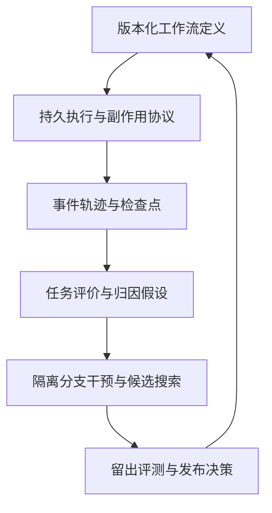

# Agent 工作流的可靠执行、因果诊断与实验优化

调研日期：2026-11-07。本文修订“工作流类比数据库事务、工作流类比神经网络”两条思路，并将其组织为可实现的系统框架。

本文区分三类内容：**工程机制**指已有明确实现与保证边界的能力；**研究方法**指论文在特定实验条件下提出的方法；**架构建议**是基于这些资料的综合设计，不代表业界统一标准。前沿不等于已成熟，早期提出的基础机制也不等于过时。

## 1. 核心命题与观点修正

更准确的总命题是：

> Agent 工作流是与外部环境交互的、部分可观测的随机执行系统。可靠性依赖持久执行、状态一致性和副作用协议；改进依赖可验证评价、依赖追踪、干预实验及受约束搜索。

| 修正后的表述                                            |
| ------------------------------------------------- |
| 可以在局部状态提交上使用事务；整个长时工作流通常跨越多个事务与外部系统，不能默认具有全局 ACID |
| 检查点显著降低恢复与实验成本，但不是错误定位的逻辑必要条件；完整重跑、静态契约检查也能定位部分错误 |
| 状态序列化、事务可串行化、分布式一致快照是不同概念；需要的保证由共享状态与执行协议决定       |
| 可串行化只约束并发事务的等价执行；模型采样、工具响应和环境变化仍会影响结果             |
| 可以表示成计算图，但包含离散路由、循环、外部副作用和动态结构，通常不可端到端微分          |
| 错误分类有助于诊断，但评价还需要成功标准、严重性、成本和硬约束；允许多标签、未知类和标注分歧    |
| 应沿数据、控制、消息和资源依赖提出归因假设，再通过干预检验；调用栈不是充分的因果图         |
| 这可以构成修复动作空间和候选生成策略；一般不满足数学上次梯度的定义，也不保证下降          |

## 2. 系统对象：定义、运行与轨迹

首先区分工作流的三种对象：

1. **工作流定义**：Agent 角色、提示词、工具、路由、预算、状态契约与可生成的结构。
2. **一次实际运行**：针对某个任务真正创建的节点、分支、子任务和重试。
3. **执行轨迹**：这次运行产生的事件、输入输出、资源版本和工具调用记录。

同一份定义可以产生不同结构的运行；相同结构也可能产生不同输出。2026 年的工作流优化综述已明确区分可复用模板、单次实现图与执行轨迹，并区分静态与动态结构优化。[1]

建议采用如下概念模型：

$$
s_{t+1}=F(s_t,a_t,o_{t+1};v),\qquad a_t\sim\pi_\theta(\cdot\mid h_t)
$$

其中，$s_t$ 是系统状态，$a_t$ 是动作，$o_{t+1}$ 是环境响应，$v$ 是代码和资源版本，$h_t$ 是 Agent 实际可见历史。内部观察经常不包含完整环境状态，因此建模时应考虑部分可观测性，不能把一段聊天记录自动视为满足马尔可夫性的状态。

循环工作流不必在定义上是 DAG；将一次有限运行按时间展开后，可用无环事件依赖图表达其因果先后关系。

## 3. 可靠执行：从事务类比到持久工作流

### 3.1 六种保证应分别定义

| 保证       | 解决什么问题            | 不自动保证什么         |
| -------- | ----------------- | --------------- |
| 状态序列化    | 状态可编码、存储、解码       | 跨进程全局一致、可重放     |
| 检查点持久化   | 故障后有已提交的恢复位置      | 外部操作已经且仅执行一次    |
| 一致快照     | 多个执行主体与消息状态构成合法切面 | 重执行生成相同模型输出     |
| 事务可串行化   | 并发事务效果等价于某种串行顺序   | 固定唯一顺序、符合真实时间顺序 |
| 历史重放     | 利用已记录事件重建规定范围内的状态 | 重新调用模型仍产生相同输出   |
| 分布意义上的复现 | 多次执行的性能与失败模式可比较   | 每条轨迹逐字相同        |

不要给整个系统笼统贴“可复现”标签，而应声明复现对象、边界、前提和允许差异。

### 3.2 检查点是逻辑边界，不一定是机器指令断点

常见工作流框架恢复的是节点、任务或事件边界，不会自动恢复 Python 任意栈帧、打开的网络连接或 GPU 内核。

Temporal 通过事件历史驱动工作流代码重放，并复用已经记录的 Activity 结果；其工作流代码必须与历史保持确定性兼容。[2] LangGraph 的 checkpointer 保存线程内图状态，store 则保存跨线程数据；两者的持久性与一致性边界不能混为一谈。[3]

建议定义检查点：

$$
C_k=(S_k,Q_k,M_k,I_k,V_k,E_k)
$$

- $S_k$：各逻辑执行主体的已提交状态。
- $Q_k$：待调度任务、依赖与取消状态。
- $M_k$：消息队列或可以重建消息状态的持久日志位置。
- $I_k$：未决工具调用、逻辑操作标识及已知回执。
- $V_k$：代码、提示词、工具、资源与状态模式版本。
- $E_k$：事件日志边界或因果前沿。

这是逻辑信息集合，不要求每次完整复制全部数据。快照可以引用不可变对象、增量状态或日志位置。

### 3.3 并发的关键是明确共享与提交协议

子 Agent 不一定对应操作系统线程；框架中的 thread 也可能只是持久会话标识。应明确区分逻辑任务、异步协程、进程、远程工作者与会话。

建议先按共享方式选择策略：

| 场景 | 优先考虑 |
| --- | --- |
| 分支读取同一不可变输入，各自产出结果 | 并行执行，按稳定标识合并 |
| 多分支追加不同记录 | 唯一标识、去重、定义显示顺序 |
| 多 Agent 修改同一对象 | 单写者、锁或版本比较提交 |
| 同时维护跨对象业务不变量 | 明确事务范围和隔离级别 |
| 跨服务长时操作 | 逻辑操作账本、幂等协议和必要补偿 |

合并函数若依赖输入顺序，就应记录或规定顺序；具备交换性也不代表业务语义一定正确。不要为没有冲突的任务引入全局串行瓶颈。

## 4. 重放与重执行必须拆成不同模式

### 4.1 历史重建

读取记录的模型响应、工具返回值、消息顺序和提交事件，重建历史状态。此模式适合事故还原、解析器回归和调度逻辑检查。

历史重建的确定性属于记录边界内的执行系统，不证明原模型本身确定。保存 seed、temperature 或模型名称，通常也不足以跨服务版本保证逐字相同。

### 4.2 从检查点继续执行

保留已提交状态，对尚未完成的后缀进行真实计算。外部环境可能已经变化，这主要服务于恢复业务。

### 4.3 分支实验

从相同逻辑前缀创建独立分支，改变某个提示词、输入、节点或调度策略，再评价结果。原始历史应保留，实验分支使用隔离的写入空间。

**注意框架术语差异：**LangGraph time travel 文档中的 replay 会重执行检查点之后的节点，包括模型和 API 调用，因此可能产生不同输出；fork 创建分支而不是撤销原历史。[4] Temporal 的历史重放则复用已完成且已记录的 Activity 结果。[2] 比较框架时必须核对实际语义。

### 4.4 固定哪些变量，取决于实验问题

修改摘要提示词时，可以固定检索结果；比较检索策略时，就不能固定检索输出。缓存复用应满足输入与依赖兼容，而不是仅因为节点名称相同。

上游发生修改后，受影响的下游产物必须失效。已经改变的请求不能复用旧模型响应，否则实验没有真正执行所声称的干预。

## 5. 外部副作用：恢复内部状态不等于回滚世界

典型故障窗口是：外部服务已经完成写入，但工作者在记录成功前崩溃。恢复系统看到的是“状态未知”，直接重试可能产生重复效果。

因此，检查点不能单独提供端到端 exactly-once。Temporal 官方资料也说明，已经记录完成的 Activity 不会因历史重放再次执行，但未能报告完成的 Activity 可能被重试，所以 Activity 仍应设计为幂等。[5]

建议为每个有副作用的逻辑操作定义：

1. 稳定的逻辑操作 ID；网络重试保持该 ID，独立新操作使用新 ID。
2. 接收端可执行的幂等或去重协议；仅在本地生成 ID 不够。
3. 意图记录、发送状态、外部回执和未知结果的查询方式。
4. 本地状态与发送意图需要原子提交时，采用事务 outbox 等模式。
5. 不可撤销操作的提交边界，以及确有需要时的补偿动作。

可用状态包括 `planned → dispatched → confirmed`，同时显式支持 `unknown` 与 `compensated`。未知结果需要核对，不应被当作未执行。补偿是新的业务动作，不保证世界回到原状。

调试与优化分支默认使用沙箱、模拟器或只读工具；需要观察真实写入效果时，必须使用明确隔离的测试资源。

## 6. 可观测性：从日志栈到带版本的数据血缘

建议使用统一事件与 span 关联运行，但不能假定一个 span 树就覆盖全部因果关系。异步消息、多父节点合并与共享文件读写需要额外关联。

| 信息组 | 建议字段 |
| --- | --- |
| 身份 | run_id、branch_id、logical_task_id、attempt_id、agent_id |
| 因果 | parent、depends_on、消息发送与接收关联、读写资源版本 |
| 输入输出 | 可取得的请求与响应、结构化产物、对象引用和完整性哈希 |
| 执行 | 工具版本、超时、重试、取消、错误类别、提交状态 |
| 环境 | 代码提交、提示词版本、模型标识、依赖锁定、数据快照 |
| 评价 | 评价规则版本、分项结果、人工标注与分歧 |

哈希只能核对内容，不能代替内容本身；仅保存网页 URL 也不能复原已变化页面。需要保存允许保留的证据快照或稳定版本。

记录可见消息、动作、工具结果和验证证据即可，不应将“取得模型不可见的内部推理过程”作为系统前提。日志与检查点还要遵守访问控制、脱敏和保留策略，凭据不应直接写入轨迹。

## 7. 评价体系：分类只是诊断的一层

### 7.1 将四个问题分开

| 问题 | 典型表示 |
| --- | --- |
| 是否完成任务 | 业务验收、可执行测试、结果验证器 |
| 出现什么错误 | 多标签错误类型及证据 |
| 为什么出错 | 归因假设、干预结果与不确定性 |
| 是否值得采用修复 | 留出集收益、成本、延迟与风险 |

错误标签可覆盖需求理解、证据不足、事实或推理、工具协议、状态一致性、协作通信、终止策略和评价器错误。相同最终错误可能有不同原因；同一根因也可能产生多个错误标签。

### 7.2 使用受约束、多指标目标

一个可用的设计形式是：

$$
\min_\theta\;\mathbb E_{x\sim D,\tau\sim P_\theta(\cdot\mid x)}
[L_{task}(x,\tau)+\lambda_c C(\tau)+\lambda_t T(\tau)]
$$

$$
\text{subject to }\Pr(\text{指定严重违规})\le\epsilon,\quad
\operatorname{p95}(T)\le B_T,\quad \mathbb E[C]\le B_C.
$$

这是设计表达，不是统一标准。实际选择也可以使用词典序或 Pareto 前沿。有限评测只能估计约束满足情况，不能直接证明部署分布上的概率保证。

拒答、超时、放弃、升级人工和重试必须计入任务结果与成本，否则优化器可能通过少做事获得漂亮分数。尽量优先使用可执行验证；模型裁判适合补充主观维度，并需要人工校准与独立复核。

## 8. 归因：反向追踪提出假设，干预实验提供证据

仅依赖日志阅读的自动归因仍是困难研究问题。Who&When 工作将“哪个 Agent、哪个步骤导致失败”明确为评测对象，不能据此假设目前已有通用、准确的自动根因定位器。[6]

建议建立以下诊断过程：

1. 明确失败结果和违反的契约。
2. 沿数据、控制、消息和资源依赖筛选候选节点。
3. 区分错误产生位置、错误传播路径与未能拦截错误的验证环节。
4. 对候选节点进行替换、修复或删除干预。
5. 重新执行受影响后缀，对比结果，并记录实验不确定性。

例如，用正确且符合接口契约的摘要替换原摘要后，答案恢复正确，这支持摘要是一个有效干预位置；但不证明摘要节点是唯一根因，也不证明实际提示词修复可以稳定生成这种摘要。

单节点干预无效也不意味着节点无关：可能存在两个错误共同作用，修复一个不足以恢复。需要时增加成对干预、最小失败子图搜索或联合消融。

## 9. 优化：保留反向反馈思想，放弃伪数学等价

### 9.1 梯度、文本反馈和修复动作的边界

在通常的凸分析定义中，$g$ 是 $f$ 在 $x$ 的次梯度，需要满足：

$$
f(y)\ge f(x)+g^\top(y-x),\quad\forall y.
$$

给错误类别绑定“增加验证器”“修改提示词”等动作，并没有定义满足该条件的向量空间、目标或局部近似。因此，应称为候选修复动作、文本反馈或搜索方向。

TextGrad 已将沿复合计算图传播自然语言反馈做成研究框架，但其中的文本“微分”不能自动继承数值反向传播的链式法则和下降保证。[7]

### 9.2 优化对象是混合空间

$$
\theta=(\text{提示词},\text{示例},\text{工具},\text{结构},\text{路由},
\text{通信},\text{模型选择},\text{预算},\text{可训练权重})
$$

| 层面 | 示例动作 | 可选方法 |
| --- | --- | --- |
| 输入与知识 | 修改检索、更新证据、补充任务约束 | 数据修订、检索评测 |
| 提示与示例 | 改角色指令、结构约束、示例集合 | 文本反馈、候选搜索、演化 |
| 工作流结构 | 拆分、合并、插入、删除、重排节点 | 树搜索、程序搜索、消融 |
| 路由与预算 | 选择模型、跳过节点、升级验证 | 上下文策略、bandit、强化学习 |
| 协作与状态 | 修改消息契约、隔离写入、调整提交 | 协议设计、并发验证 |
| 模型权重 | 学习工具调用、决策与协作行为 | 监督微调、强化学习 |

普通软件缺陷与并发协议错误应先直接修复；不必把每个缺陷都交给模型优化器。

### 9.3 已有研究路线与前沿方向

| 工作 | 对应能力 | 使用边界 |
| --- | --- | --- |
| TextGrad，2024 [7] | 沿图传播文本反馈并改进组件 | 反馈可能错误，不是严格数值梯度 |
| AFlow，2024／ICLR 2025 [8] | 在代码表示的工作流空间进行树搜索 | 搜索质量取决于操作空间和评价预算 |
| GEPA，2025 [9] | 根据执行反馈反思、演化提示词与保留互补候选 | 论文中胜过特定 RL 基线不代表普遍优于 RL |
| Agent Lightning，2025 [10] | 将 Agent 执行与训练解耦，支持轨迹信用分配和 RL | 不意味着任意黑盒 API 都能直接更新模型权重 |
| Agent-UCT，2026 [11] | 将已计算前缀的复用成本纳入组合搜索 | 复用依赖正确的缓存与版本边界 |
| FlowBank，2026 [12] | 建立互补工作流组合并按任务选择 | 路由器也需要留出评测和漂移监控 |
| Learning What to Skip，2026 [13] | 用跳过干预估计组件的条件价值 | 平均收益不能证明每次跳过都可靠 |

上述 2026 年工作应作为研究进展阅读，不视为已被广泛部署验证的标准方案。本文根据本次可取得的官方资料和论文摘要概括方法，不对所有实现细节或论文间优劣作全面复现结论。

从这些路线可以提炼三个方向：**干预比单纯读日志更接近可验证归因；最优工作流可能随输入改变；已经验证稳定的步骤可以编译为确定性程序，而不必始终由 Agent 重新决策。** 后一点也有将重复工具序列转成 meta-tools 的研究支持。[14]

## 10. 将“错误绑定操作”升级为可学习修复策略

建议保留原始想法，但把固定映射升级为带条件和证据的候选策略：

$$
q(a\mid\text{错误标签},\text{依赖子图},\text{历史实验},\text{约束})
$$

一次候选动作写成 $\theta'=T_a(\theta)$。用下式评价改善：

$$
\Delta_a=\mathbb E[L(\operatorname{Run}(\theta'))-L(\operatorname{Run}(\theta))].
$$

损失越低越好时，负值表示平均改善。这是实验效应估计，不是导数。单个样例一次改善仅构成线索。

修复动作应携带适用条件、前置契约、修改范围、资源代价、潜在回归和验证方式。例如：

| 观察 | 候选动作 | 验证重点 |
| --- | --- | --- |
| 摘要丢失时间限定 | 增加结构字段与证据引用 | 是否保留限定，是否扩大上下文成本 |
| 多 Agent 覆盖同一文件 | 隔离产物并统一提交 | 冲突与崩溃恢复，而非回答得分 |
| 验证器频繁放行错误 | 修订验证契约、增加独立检查 | 漏检率与误拒率 |
| 简单任务链条过长 | 跳过或合并冗余节点 | 成本下降与关键子集退化 |

## 11. 实验协议：避免修好案例、损坏系统

建议每次实验记录：任务集版本、原工作流、检查点、干预对象、复用范围、环境控制、候选版本、评价器与预算。

最低要求包括：

1. 区分开发集、验证集与最终测试集；不要不断根据测试集反馈改写候选。
2. 候选与基线使用相同任务和可比预算；存在采样波动时进行重复运行。
3. 报告配对差异与不确定性；重复采样不能代替覆盖不同业务任务。
4. 除均值外，检查关键任务子集、尾延迟、恢复成功率和严重失败。
5. 固定评价器版本，并检查候选是否利用评价器漏洞。
6. 单次控制变量实验用于解释局部效果；必要时采用多因素实验研究交互。
7. 离线通过后逐步发布，保留可回退的工作流版本与停止条件。

若目标是优化平均成功率，应评估随机执行分布；若目标是定位一次特定事故，应尽量冻结当时环境。两者的实验设计不能互相替代。

## 12. 统一架构与实施顺序

建议分阶段落地：

| 阶段 | 交付能力 | 验收方式 |
| --- | --- | --- |
| 1. 可评价 | 任务契约、明确失败定义、基线数据集 | 同一产物的评价差异可解释 |
| 2. 可观察 | 统一 ID、事件轨迹、证据与资源版本 | 最终产物可追溯到输入及工具结果 |
| 3. 可恢复 | 持久检查点、任务账本、幂等与核对 | 在外部写入前后注入故障，确认恢复语义 |
| 4. 可实验 | 历史重建、独立分支、依赖失效 | 一项修改仅影响声明的依赖范围 |
| 5. 可优化 | 人工归因辅助、候选生成、预算化搜索 | 留出任务收益与代价可复核 |
| 6. 可适应 | 条件路由、节点跳过、必要时模型训练 | 分布变化与关键子集退化可监控 |

检查点粒度应权衡重算成本、状态存储、写入延迟与副作用边界。不要等到自动优化阶段才建设评价，也不要在无法可靠记录和恢复时开放任意自修改。

## 13. 修订后的研究纲领

> 我们将 Agent 工作流建模为具有动态结构、随机决策与外部副作用的执行系统。通过版本化定义、持久事件、逻辑检查点和副作用协议建立恢复边界；通过分离历史重建、业务续跑与分支实验建立可比较的执行条件；通过多维评价、依赖追踪和干预验证进行诊断；最终在提示词、程序结构、路由、预算与模型参数等混合空间中进行受约束优化。
>
> 文本反向反馈可用于生成修复方向，但不自动构成数学梯度。错误分类可用于组织诊断，但不自动给出根因。一次成功修复可形成经验，但只有经过独立评测，才能成为可复用改进。

## 参考资料

以下为本次调研使用的官方文档与原始研究；访问日期均为 2026-11-07。动态文档应在实现时重新核对目标 SDK、语言与版本。

1. [From Static Templates to Dynamic Runtime Graphs: A Survey of Workflow Optimization for LLM Agents，2026](https://aclanthology.org/2026.findings-emnlp.1393/)。结构确定时机、优化对象与评价信号的分类。
2. [Temporal：Workflows](https://docs.temporal.io/workflows)；[Workflow Definition](https://docs.temporal.io/workflow-definition)。历史重放、确定性与版本兼容。
3. [LangGraph：Persistence](https://docs.langchain.com/oss/python/langgraph/persistence)。checkpointer 与 store 的范围。
4. [LangGraph：Use time-travel](https://docs.langchain.com/oss/python/langgraph/use-time-travel)。replay 与 fork 的实际语义。
5. [Temporal：Activity Definition / Idempotency，官方文档源](https://github.com/temporalio/documentation/blob/main/docs/encyclopedia/activities/activity-definition.mdx)。重放、重试与幂等的边界。
6. [Which Agent Causes Task Failures and When?，2025](https://arxiv.org/abs/2505.00212)。Who&When 与多 Agent 失败归因。
7. [TextGrad: Automatic “Differentiation” via Text，2024](https://arxiv.org/abs/2406.07496)。文本反馈传播。
8. [AFlow: Automating Agentic Workflow Generation，ICLR 2025](https://proceedings.iclr.cc/paper_files/paper/2025/hash/5492ecbce4439401798dcd2c90be94cd-Abstract-Conference.html)。工作流结构搜索。
9. [GEPA: Reflective Prompt Evolution Can Outperform Reinforcement Learning，2025](https://arxiv.org/abs/2507.19457)。反思驱动的提示演化。
10. [Agent Lightning: Train ANY AI Agents with Reinforcement Learning，2025](https://arxiv.org/abs/2508.03680)；[官方仓库](https://github.com/microsoft/agent-lightning)。执行与训练解耦。
11. [Agent-UCT: Upper Confidence Bounds Applied to Trees for Agentic Workflow Optimization with Cost-Awareness，2026](https://arxiv.org/abs/2607.24162)。成本感知搜索与前缀复用。
12. [FlowBank: Query-Adaptive Agentic Workflows Optimization through Precompute-and-Reuse，2026](https://arxiv.org/abs/2606.11290)。互补工作流组合与输入条件路由。
13. [Learning What to Skip: Counterfactual Credit Assignment for Efficient Multi-Agent LLM Workflows，2026](https://arxiv.org/abs/2609.30734)。跳过干预与条件组件价值。
14. [Optimizing Agentic Workflows using Meta-tools，2026](https://arxiv.org/abs/2601.22037)。将重复工具序列封装为确定性组合工具。
