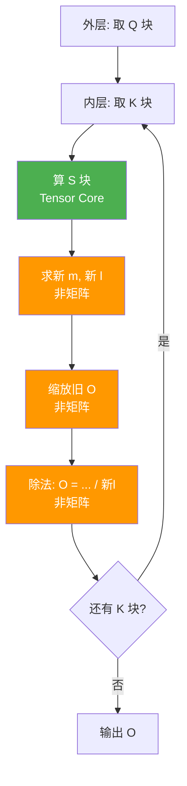
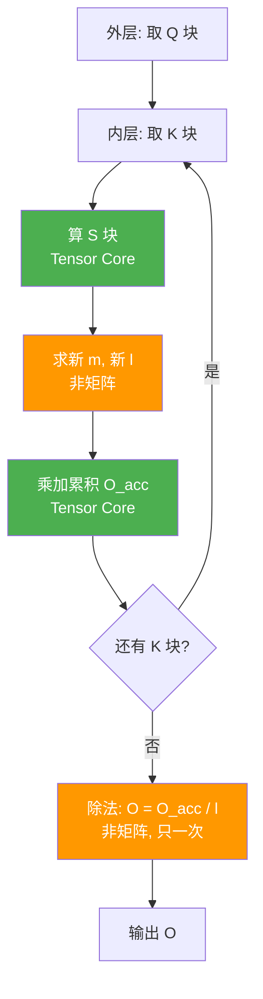

# 并行解码

串行解码：每次只生成一个词。
并行解码：一次提出多个未来词块，然后一次性验证。

怎么一次性提出多个词组合？

n-gram 检索。具体做法分为两步：
1. 查历史字典（构建候选池）：比如拿到当前输入“天气”，查找以“天气”作为开头的词组。

- 历史数据中：天气不错（2-gram）、天气真好啊（3-gram）

1. 然后将候选进行填充为多个候选列。

怎么一次性验证？

transformer 支持一次性输入多个序列。但是由于候选长度不同，可能做填充。

还有其他：
- 并行 beam search
- 连续批处理
- 多 GPU 张量并行
# 连续批处理

每一次前向传播（生成下一个 Token）之后，都会：

1. 释放已完成的任务。
2. 准入新的请求
3. 必要时进行抢占。
4. 重排当前批次

好的，用格子图来可视化。每个格子代表一个 token 生成的时间步，空格表示该 slot 被浪费/空转。

假设 4 个请求 A、B、C、D，输出长度分别为：**A=2，B=6，C=3，D=5**。

## 静态批处理（Static Batching）

一批 4 个请求同时开始，必须等最长的 B（6 步）全部结束，才能释放整批。

```
时间步 →   1    2    3    4    5    6
        ┌────┬────┬────┬────┬────┬────┐
A(2)    │ A  │ A  │ ░  │ ░  │ ░  │ ░  │   ← 2步就完了，空等4步
        ├────┼────┼────┼────┼────┼────┤
B(6)    │ B  │ B  │ B  │ B  │ B  │ B  │   ← 最长，决定整批耗时
        ├────┼────┼────┼────┼────┼────┤
C(3)    │ C  │ C  │ C  │ ░  │ ░  │ ░  │   ← 3步完，空等3步
        ├────┼────┼────┼────┼────┼────┤
D(5)    │ D  │ D  │ D  │ D  │ D  │ ░  │   ← 5步完，空等1步
        └────┴────┴────┴────┴────┴────┘
           ↑                         
        新请求必须等这整批(6步)结束才能进来
```

**问题一眼可见：**
- `░` 是空转的 slot，总共浪费了 **4+3+1 = 8 个 slot·步**；
- GPU 在这 6 步里从第 3 步开始就"吃不饱"，越往后越空；
- 新请求 E、F… 必须等到第 6 步之后才能开始。

## 二、连续批处理（Continuous Batching）

每一步（每生成一个 token）都重新组织 batch：谁完成就立刻移出，空出的位置马上让排队的新请求补进来。

假设排队等待的新请求：**E=3，F=4，G=2**。

```
时间步 →   1    2    3    4    5    6    7    8
        ┌────┬────┬────┬────┬────┬────┬────┬────┐
slot 1  │ A  │ A  │ E  │ E  │ E  │ F  │ F  │ F  │
        ├────┼────┼────┼────┼────┼────┼────┼────┤
slot 2  │ B  │ B  │ B  │ B  │ B  │ B  │ G  │ G  │
        ├────┼────┼────┼────┼────┼────┼────┼────┤
slot 3  │ C  │ C  │ C  │ D  │ D  │ D  │ D  │ D  │
        ├────┼────┼────┼────┼────┼────┼────┼────┤
slot 4  │ D  │ D  │ D  │ F  │ F  │ F  │ F  │ ░  │
        └────┴────┴────┴────┴────┴────┴────┴────┘
```

逐列解读：

| 时间步 | 发生了什么                        |
| --- | ---------------------------- |
| 1   | A、B、C、D 同时开始                 |
| 2   | A 生成完第 2 个 token，**下一步移出**   |
| 3   | A 的位置换成 **E**（新请求立即补入）       |
| 4   | C 完成（3 步），位置换成 **F**；同时 D 继续 |
| 6   | E 完成（3 步），位置换成 **G**         |
| 7   | B、G 继续                       |
| 8   | F、G 完成，整批清空                  |

**对比效果：**
- 只有最后一步有 1 个 `░`，浪费的 slot·步从 **8 降到 1**；
- 新请求 E、F、G 分别在**第 3、4、6 步**就进来了，而静态批处理要等到第 6 步之后；
- 8 步内处理完了 **7 个请求**，而静态批处理 6 步只处理了 4 个。

## 三、并排对比（同一时间轴）

```
静态批处理:
step   1    2    3    4    5    6    7    8
     ┌────┬────┬────┬────┬────┬────┬────┬────┐
     │ A  │ A  │ ░  │ ░  │ ░  │ ░  │    │    │
     │ B  │ B  │ B  │ B  │ B  │ B  │    │    │
     │ C  │ C  │ C  │ ░  │ ░  │ ░  │    │    │
     │ D  │ D  │ D  │ D  │ D  │ ░  │    │    │
     └────┴────┴────┴────┴────┴────┴────┴────┘
     第6步整批结束后，E/F/G 才开始 → 总耗时更长

连续批处理:
step   1    2    3    4    5    6    7    8
     ┌────┬────┬────┬────┬────┬────┬────┬────┐
     │ A  │ A  │ E  │ E  │ E  │ F  │ F  │ F  │
     │ B  │ B  │ B  │ B  │ B  │ B  │ G  │ G  │
     │ C  │ C  │ C  │ D  │ D  │ D  │ D  │ D  │
     │ D  │ D  │ D  │ F  │ F  │ F  │ F  │ ░  │
     └────┴────┴────┴────┴────┴────┴────┴────┘
     完成即换、空位即补 → 同样8步处理了7个请求
```

---

## 四、一句话看懂

```
静态批处理 = 整批同进同出   →  短请求陪跑，GPU 空转
连续批处理 = 逐个完成逐个补 →  slot 几乎不空，吞吐翻倍
```

那个 `░`（空转的 slot）就是连续批处理要消灭的东西——**它消灭得越干净，吞吐量就越高。**

# PageAttention

## 静态批处理：必须 padding

在传统静态批处理里，同一个 batch 的序列要**对齐成同一个长度**才能送进 GPU 做矩阵运算，所以短序列必须 padding。

```
Batch (prompt 长度不一):  A=2,  B=5,  C=3
对齐到 max=5，补 PAD：

┌────┬────┬────┬────┬────┐
│ A  │ A  │PAD │PAD │PAD │
├────┼────┼────┼────┼────┤
│ B  │ B  │ B  │ B  │ B  │
├────┼────┼────┼────┼────┤
│ C  │ C  │ C  │PAD │PAD │
└────┴────┴────┴────┴────┘
              ↑ PAD 是纯浪费的算力和显存
```

**代价：**
- 浪费算力：PAD 位置也要参与 attention 计算（虽然可 mask，但矩阵乘的规模还是按 max 长度算）；
- 浪费显存：KV Cache 要按 max 长度预留；
- 序列长度差异越大，浪费越严重（长尾问题）。

---

## 连续批处理 + PagedAttention：不需要 padding

这是 vLLM 的核心优势之一。原因是：

### 1. 变长序列用「拼接 + 位置索引」处理，而不是 padding

prefill 阶段：vLLM 把 batch 里所有序列的 token **首尾拼接成一条扁平的长序列**，靠额外的元信息区分各属于谁：

```
不需要 padding，直接拼:

序列 A(2) │         序列 B(5)       │ 序列 C(3)
┌────┬────┐┌────┬────┬────┬────┬────┐┌────┬────┬────┐
│ A  │ A  ││ B  │ B  │ B  │ B  │ B  ││ C  │ C  │ C  │
└────┴────┘└────┴────┴────┴────┴────┘└────┴────┴────┘
     ↑ 每个 token 记录自己属于哪个序列、在序列内的位置
```

Attention 时通过 **attention mask / block table** 保证每个 token 只 attend 自己序列内的 token，不会串到别的序列去。

prefill 阶段的 mask 矩阵：

```
   key →   t1 t2  │ t3 t4 t5  t6 t7 │ t8 t9 t10
       ┌──────────┼─────────────────┼────────────┐
 t1  A │   █  ·   │  ·  ·  ·  ·  ·  │  ·  ·  ·   │
 t2  A │   █  █   │  ·  ·  ·  ·  ·  │  ·  ·  ·   │
       ├──────────┼─────────────────┼────────────┤
 t3  B │   ·  ·   │  █  ·  ·  ·  ·  │  ·  ·  ·   │
 t4  B │   ·  ·   │  █  █  ·  ·  ·  │  ·  ·  ·   │
 t5  B │   ·  ·   │  █  █  █  ·  ·  │  ·  ·  ·   │
 t6  B │   ·  ·   │  █  █  █  █  ·  │  ·  ·  ·   │
 t7  B │   ·  ·   │  █  █  █  █  █  │  ·  ·  ·   │
       ├──────────┼─────────────────┼────────────┤
 t8  C │   ·  ·   │  ·  ·  ·  ·  ·  │  █  ·  ·   │
 t9  C │   ·  ·   │  ·  ·  ·  ·  ·  │  █  █  ·   │
t10  C │   ·  ·   │  ·  ·  ·  ·  ·  │  █  █  █   │
       └──────────┴─────────────────┴────────────┘
          └A:2列┘    └────B:5列────┘   └C:3列┘
```

decode 阶段的 序列拼接：

```
                新 token
              ┌──────────┐
     序列 A → │  new_A   │
              ├──────────┤
     序列 B → │  new_B   │
              ├──────────┤
     序列 C → │  new_C   │
              └──────────┘
                     ↑ 每个新 token 记录：我属于哪个序列 + 我在序列内的位置

拼成一条长度为 3 的扁平序列（不是 10）
```

decode 阶段的 mask 矩阵：

```
  key →   t1 t2  │ t3 t4 t5 t6 t7 │ t8 t9 t10
      ┌──────────┼────────────────┼────────────┐
new_A │   █  █   │                │            │   ← A 新 token 看自己 2 个历史
      ├──────────┼────────────────┼────────────┤
new_B │          │  █  █  █  █  █ │            │   ← B 新 token 看自己 5 个历史
      ├──────────┼────────────────┼────────────┤
new_C │          │                │  █  █  █   │   ← C 新 token 看自己 3 个历史
      └──────────┴────────────────┴────────────┘
```

关键区别：**decode 阶段每行是"当前新 token 对所有历史 KV"，行数 = batch 里序列数，每行长度 = 各序列当前历史长度。**

### 整个 decode 一步的流程

假设 batch 里有 A、B、C 三个序列，各自长度 2、5、3，当前要各生成 1 个新 token：

```
Step 1: 三个新 token 的 embedding 拼在一起
        input = [emb(new_A), emb(new_B), emb(new_C)]   ← 形状 [3, hidden]

Step 2: 进入 Transformer 的每一层（比如 32 层）
        每一层都要做：
          - QKV 投影
          - Attention（就是上面那个 mask 矩阵）
          - FFN
        ↓
        attention 部分：三个新 token 各自 attend 自己序列的历史 KV
        这就是上面那个 3 行 × 10 列的 mask 矩阵在起作用的地方
        ↓
        注意：这个 mask 矩阵在【每一层】都用一次，不是只用一次

Step 3: 经过所有层后，输出 3 个 hidden state
        output = [h_A, h_B, h_C]   ← 形状 [3, hidden]

Step 4: 最后才接 LM head，分别算 logits
        logits_A = h_A @ W_lm   → 词表分布 → 采样出 A 的下一个 token
        logits_B = h_B @ W_lm   → 采样出 B 的下一个 token
        logits_C = h_C @ W_lm   → 采样出 C 的下一个 token
```

所以：

> **拆分（每个序列独立 attend 自己的历史）发生在每一层的 attention 里，不是只在最后一层。**
> **最后一层之后只是"各自算 logits、各自采样"，那是另一件事，不是拆分。**


### 2. PagedAttention 按 block 管理 KV Cache，按需分配

KV Cache 不再按 max 长度整块预留，而是切成固定大小的 **block（页）**，谁需要谁分配：

```
Block Table（逻辑页 → 物理页 映射）:

序列 A:  [逻辑页0] ──→ 物理页 7
序列 B:  [逻辑页0] ──→ 物理页 2
         [逻辑页1] ──→ 物理页 9
序列 C:  [逻辑页0] ──→ 物理页 4

物理显存里页是散落的，不需要连续，也不按 max 长度预留
```

这样：
- 短序列只占自己实际需要的 block，**不预留多余显存**；
- 序列变长时按需再追加 block；
- 序列结束时 block 立即回收，给新请求用。

## 对比总结

| 维度          | 静态批处理                   | 连续批处理 + PagedAttention |
| ----------- | ----------------------- | ---------------------- |
| 同 batch 短序列 | **必须 padding** 到 max 长度 | **不需要 padding**，拼接处理   |
| 算力浪费        | PAD 也参与计算               | 无 PAD，只算真实 token       |
| 显存浪费        | 按 max 长度预留 KV Cache     | 按 block 按需分配           |
| 长尾/长度不均     | 浪费严重                    | 几乎无浪费                  |

## prefill 和 decode 的 mask 矩阵，本质是同一个东西

其实两者是**同一个分块对角结构**，只是：

| 阶段 | Q 的行数 | 每行含义 | 矩阵形状 |
|------|---------|---------|---------|
| prefill | 该序列的 prompt 长度（A=2, B=5, C=3） | 每个 prompt token | 10 × 10 |
| decode | batch 里序列数（3） | 每个序列的新 token | 3 × 10 |

prefill 是"一次算完整个 prompt"，decode 是"每步只加 1 行"。但**块间隔离、块内因果**这个结构完全一样，attention kernel 用同一套 varlen 逻辑处理。


```
┌─────────────────────────────────────────────────────────┐
│  Prefill 阶段（一次性）                                 │
│  ┌───────────────────────────────────────────────┐      │
│  │ Q: 所有 prompt token (10 行)                  │      │
│  │ K/V: 所有 prompt token (10 列)                │      │
│  │ mask: 10×10 分块对角下三角                    │      │
│  └───────────────────────────────────────────────┘      │
│  输出: 每个 prompt token 的 hidden → 最后一层算 logits  │
│        (但 prefill 通常只关心最后一个 token 的 logits)  │
└─────────────────────────────────────────────────────────┘
                          ↓ 进入 decode 循环
┌─────────────────────────────────────────────────────────┐
│  Decode 阶段（每步一次，重复直到所有序列结束）          │
│  ┌───────────────────────────────────────────────┐      │
│  │ Q: 每个序列的新 token (3 行)                  │      │
│  │ K/V: 每个序列的全部历史 (10 列，随生成增长)   │      │
│  │ mask: 3×10 分块对角                           │      │
│  │                                               │      │
│  │ ★ 这个 attention 在【每一层】都做一次        │      │
│  └───────────────────────────────────────────────┘      │
│  最后一层输出 3 个 hidden → 各自接 LM head → 3 组 logits│
│  → 各自采样 → 得到 3 个新 token → 拼回 KV Cache         │
└─────────────────────────────────────────────────────────┘
```

## 没有 PageAttention 之前

先看 KV Cache 的本质。LLM 自回归生成时，每个 token 都要产生 K、V 向量，后续 token 要 attend 它们，所以必须缓存下来：

```
序列 A 生成到第 n 个 token，它的 KV Cache:
┌────────────────────────────────────────────┐
│ K1 V1 │ K2 V2 │ K3 V3 │ ... │ Kn Vn        │
└────────────────────────────────────────────┘
  每个 token 占 2 个向量 (K 和 V)，长度 = n
```

**关键：这个 Cache 是随着生成不断变长的，而且事先不知道最终会有多长。**

在 PagedAttention 之前，主流做法是**为每个序列预分配一块连续显存**，按 `max_seq_len` 来预留。

### 传统方案的具体问题

假设 `max_seq_len = 2048`，但实际输出可能只有 100：

```
为序列 A 预分配的连续显存（按 max 预留）:
┌──────────────────────────────────────────────────────────┐
│ 实际用了 100 个 token 的 KV  │      预留但没用（浪费）   │
└──────────────────────────────────────────────────────────┘
←────────── max_seq_len = 2048 ──────────────────────────→
```

问题一：**内部碎片（预留浪费）**
- 每个序列都按 max 预留，实际用多少不知道；
- 短序列浪费巨大，实测利用率常常只有 **20%~40%**。

问题二：**外部碎片**
- 不同序列长度不同，一块块连续显存分配出去、回收回来；
- 时间一长，显存里布满大小不一的空洞，明明总量够，却拼不出一块足够大的连续空间。

问题三：**无法共享**
- 多个请求如果有相同前缀（比如 system prompt、few-shot 示例），各自的 KV Cache 完全独立存一份；
- 明明内容一样，却重复占用显存。

问题四：**内存分配不能灵活增长**
- 序列生成超过预留长度时，要么没法扩，要么得整块搬到更大的连续空间（拷贝开销大）。

这几条合起来导致：**显存利用率低 → 能同时跑的 batch 小 → 吞吐量上不去。**

## 核心思想分页

借鉴操作系统的**虚拟内存分页**：

- 把 KV Cache 切成固定大小的 **block（页）**，比如每块存 16 个 token 的 KV；
- 序列的 KV 不再要求连续存放，可以散落在物理显存的任意 block；
- 用一个 **block table（页表）** 记录"逻辑第几页 → 物理第几页"的映射。

### 图示

```
序列 A 的逻辑 KV（连续视角）:
  逻辑页0    逻辑页1    逻辑页2
┌──────────┬──────────┬──────────┐
│ token0-15│token16-31│token32-47│
└──────────┴──────────┴──────────┘

物理显存（散落存放，不需要连续）:
┌────┬────┬────┬────┬────┬────┬────┐
│页2 │页7 │页9 │页4 │页1 │页5 │页3 │
└────┴────┴────┴────┴────┴────┴────┘
  ↑         ↑         ↑
 A逻辑0 → 物理页7    A逻辑1 → 物理页2    A逻辑2 → 物理页9

Block Table（序列 A 的页表）:
  逻辑页0 → 物理页7
  逻辑页1 → 物理页2
  逻辑页2 → 物理页9
```

attention 计算时，kernel 通过 block table 找到实际物理位置，效果上等价于连续。

## 解决了什么

### 1. 消灭内部碎片（不用按 max 预留）
- 按需分配：序列长到需要新页时才分配新 block；
- 一个序列实际用多少就占多少，只可能浪费**最后一个 block 内部没填满的部分**（最多 block_size - 1 个 token）；
- 显存利用率从 20%~40% 提升到 **90%+**。

```
按页分配（block_size=16）:
序列实际 100 token → 占 7 个页（112 容量）
浪费 = 12 个 token 容量，而不是 2048-100=1948
```

### 2. 消灭外部碎片（页可以散落）
- 物理 block 大小固定，分配回收都按整页；
- 不再需要连续大块显存，物理页散落无所谓；
- 显存里不会出现"总量够但拼不出连续块"的情况。

### 3. 支持前缀共享（Copy-on-Write）
这是 PagedAttention 的一大亮点：

- 多个序列如果有**相同前缀**（如共享 system prompt），可以让它们的逻辑页**指向同一批物理页**，只存一份；
- 当某个序列要写新内容时才复制（写时复制，CoW）；
- 大幅节省显存，尤其在**并行采样、beam search、共享 prompt** 场景收益巨大。

```
序列 A、B 共享前缀:
A逻辑页0 ─┐
          ├─→ 物理页5（共享，只存一份）
B逻辑页0 ─┘
A逻辑页1 ──→ 物理页8（A 独有）
B逻辑页1 ──→ 物理页3（B 独有）
```

### 4. 灵活增长
- 序列变长时，只需分配新页、在页表加一条映射；
- 不需要搬移已有数据，没有大块拷贝开销。

## 与连续批处理的配合

两者是**互补**的，前面聊过，这里点明关系：

|            | 连续批处理                      | PagedAttention                 |
| ---------- | ------------------------------- | ------------------------------ |
| 管什么     | **计算调度**：每步重组 batch    | **显存管理**：KV Cache 怎么存  |
| 解决的问题 | slot 空转、排队延迟             | 碎片、预留浪费、共享           |
| 关系       | batch 每步都变，KV 频繁分配回收 | 分页让这种频繁分配回收变得廉价 |

**如果只有连续批处理、没有 PagedAttention**：batch 每步变，KV Cache 要频繁扩、缩、搬移，连续显存方案根本扛不住。
**如果只有 PagedAttention、没有连续批处理**：显存省了，但调度还是静态的，吞吐仍上不去。

**两者结合，才让 vLLM 做到高吞吐 + 高显存利用率。**
# Chunked Prefill

## 问题场景

连续批处理中，新来的请求要经过 prefill，而已经在 decode 的请求也要继续生成，两者确实存在“时间差”和资源竞争。vLLM 的核心做法是**在同一个 GPU 上混合调度（unified scheduling）**，但为了避免 prefill 拖慢 decode，会引入 **chunked prefill（分块预填充）** 来精细控制这种混合。

时间上：将长输入提示词的预填充计算，切分成多个小的计算块，与解码任务在同一个 GPU 上混合调度。防止一个长文本请求长期独占 GPU。

在默认配置下，vLLM 不会把 prefill 和 decode 放到不同的机器或 GPU 上。它通过 **iteration-level scheduling**，在每个 step 决定这一轮 batch 里放哪些请求。

一个直接的做法是：有新请求就立刻把它的完整 prefill 塞进当前 batch。但这样会有一个问题：**长 prompt 的 prefill 计算量很大，会显著拉长这一步的耗时，导致正在 decode 的请求“卡顿”一下**，表现为 inter-token latency（ITL）的尖峰。

## 步骤

vLLM 的解法是 **Chunked Prefill**。它把长 prompt 的 prefill 切成多个小 chunk，每个 chunk 只包含一部分 prompt token。调度器在每一步：

1. **优先把所有正在 decode 的请求放进当前 batch**（保证 decode 的连续性，控制 ITL）。
2. **再看当前 step 的 token budget 还剩多少**（由 `max_num_batched_tokens` 控制）。
3. **用剩余额度调度 prefill 任务**。如果剩余额度不够完整跑完一个 prompt 的 prefill，就把这个 prefill 切下一块来跑。

这样，一个新请求的 prefill 不再是一口气做完，而是被“切碎”成小块，**和已有的 decode 请求拼在同一个 batch 里一起前向传播**。从 GPU 的视角看，每一步的 batch 都是混合的：一部分是 decode 的 token（计算量小，读 KV cache 为主），一部分是 prefill 的 chunk（计算量大，算力密集）。这恰好让 GPU 的算力和显存带宽都得到利用。

所以，你感受到的“时间差”确实存在——新请求的完整 prefill 可能被拆到好几步里完成。但它不会阻塞 decode，而是以更平滑的方式“插空”完成。

调度器每步先保 decode，再用剩余预算切 prefill。

```
时间步 →      1         2         3         4         5         6
          ┌─────────┬─────────┬─────────┬─────────┬─────────┬─────────┐
          │         │         │         │         │         │         │
decode A  │  A_tok  │  A_tok  │  A_tok  │  A_tok  │  A_tok  │  A_tok  │
          │         │         │         │         │         │         │
          ├─────────┼─────────┼─────────┼─────────┼─────────┼─────────┤
          │         │         │         │         │         │         │
decode B  │  B_tok  │  B_tok  │  B_tok  │  B_tok  │  B_tok  │  B_tok  │
          │         │         │         │         │         │         │
          ├─────────┼─────────┼─────────┼─────────┼─────────┼─────────┤
          │         │         │         │         │         │         │
prefill C │C_chunk 1│C_chunk 2│C_chunk 3│C_chunk 4│  C_dec  │  C_dec  │
          │ (1~4)   │ (5~8)   │ (9~12)  │ (收尾)  │         │         │
          │         │         │         │         │         │         │
          └─────────┴─────────┴─────────┴─────────┴─────────┴─────────┘
            ↑
            每一步 batch 里都同时有：
              - A、B 的 decode token（计算量小）
              - C 的一个 prefill chunk（计算量大，但被切小）
```


逐列解读：

| 步   | batch 内容                     | 说明                                               |
| ---- | ------------------------------ | -------------------------------------------------- |
| 1    | A_decode + B_decode + C_chunk 1 | C 的 prompt 第 1~4 个 token 做 prefill             |
| 2    | A_decode + B_decode + C_chunk 2 | C 的 prompt 第 5~8 个 token 做 prefill             |
| 3    | A_decode + B_decode + C_chunk 3 | C 的 prompt 第 9~12 个 token 做 prefill            |
| 4    | A_decode + B_decode + C_chunk 4 | C 的 prefill 收尾，KV cache 建完                   |
| 5    | A_decode + B_decode + C_decode | C 正式进入 decode，和 A、B 一起每步生成 1 个 token |
| 6    | A_decode + B_decode + C_decode | 继续                                               |

关键点：

- **C 的 prefill 被切成 4 块**，分散在第 1~4 步完成，而不是一口气占满一步。
- **A、B 的 decode 每一步都没断**，ITL 不会因为 C 的长 prompt 出现巨大尖峰。
- 每一步 GPU 都在同时处理“算力密集的 prefill chunk”和“带宽密集的 decode”，利用率更高。
- 代价：C 的 TTFT 变长了一点（要等 4 步才 prefill 完），但换来了整体吞吐和 decode 稳定性。

## KV Cache 是“边算边加”的

序列 C 的 prompt 有 12 个 token，记作 `c 1 c 2 c 3 ... c 12`。

Prefill 的本质是：**把这 12 个 token 一次性过一遍模型，算出每个位置的 K、V，存进 KV Cache，并让每个位置 attend 它前面所有位置。**

切成 4 个 chunk（每块 3 个 token）后：

```
chunk 1: c 1 c 2 c 3      → 算完，K/V 追加进 cache
chunk 2: c 4 c 5 c 6      → 算完，K/V 追加进 cache
chunk 3: c 7 c 8 c 9      → 算完，K/V 追加进 cache
chunk 4: c 10 c 11 c 12   → 算完，K/V 追加进 cache
```

关键点：**chunk 2 的 Q 要和 chunk 1 已经存好的 K/V 做 attention**，而不是只和自己这块算。这就是“跨 chunk”的核心。

## 时间步 2 的 batch 构成

回到你上一个问题里那张图。假设：

- A、B 正在 decode，各生成 1 个新 token：`a_new`、`b_new`
- C 的 prefill 进行到第 2 块：`c 4 c 5 c 6`
- C 的历史 KV：`c 1 c 2 c 3` 已经在 cache 里

那么 step 2 这一步，batch 里的 **Q** 是：

```
Q 行（本步要算的 query token）:

  ┌──────────┐
  │  a_new   │   ← A 的 decode token
  ├──────────┤
  │  b_new   │   ← B 的 decode token
  ├──────────┤
  │   c 4    │   ← C 的 chunk 2 第 1 个 token
  ├──────────┤
  │   c 5    │   ← C 的 chunk 2 第 2 个 token
  ├──────────┤
  │   c 6    │   ← C 的 chunk 2 第 3 个 token
  └──────────┘
```

而这一步可用的 **K/V 列**（所有历史 + 本步新算的）是：

```
KV 列（每列是一个 token 的 K/V）:

  A 的历史      B 的历史        C 已存的历史    本步新算的
 ┌────┬────┐  ┌────┬────┬────┐ ┌────┬────┬────┐ ┌────┬────┬────┐
 │a1  │a2  │  │b1  │b2  │b3  │ │c1  │c2  │c3  │ │c4  │c5  │c6  │
 └────┴────┘  └────┴────┴────┘ └────┴────┴────┘ └────┴────┴────┘
   ↑ A 之前生成的              ↑ C 的 chunk 1          ↑ chunk 2 自己
```

注意：`c 4 c 5 c 6` 的 K/V 是在这一步**同时**算出来的（因为它们是本步的 Q，QKV 投影一起做）。attention 时，`c 4` 能看 `c 4` 自己，`c 5` 能看 `c 4 c 5`，`c 6` 能看 `c 4 c 5 c 6` ——这是块内的因果性。

## 时间步 2 的掩码矩阵（ASCII）


行 = 本步的 Q（5 行），列 = 所有可见的 KV（2 + 3 + 3 + 3 = 11 列）。

```
        key →   a1  a2  │ b1   b2   b3 │ c1   c2   c3 │ c4   c5   c6
              ┌────┬────┼────┬────┬────┼────┬────┬────┼────┬────┬────┐
 a_new  (A)   │ █  │ █  │ ·  │ ·  │ ·  │ ·  │ ·  │ ·  │ ·  │ ·  │ ·  │
              ├────┼────┼────┼────┼────┼────┼────┼────┼────┼────┼────┤
 b_new  (B)   │ ·  │ ·  │ █  │ █  │ █  │ ·  │ ·  │ ·  │ ·  │ ·  │ ·  │
              ├────┼────┼────┼────┼────┼────┼────┼────┼────┼────┼────┤
 c4     (C)   │ ·  │ ·  │ ·  │ ·  │ ·  │ █  │ █  │ █  │ █  │ ·  │ ·  │
              ├────┼────┼────┼────┼────┼────┼────┼────┼────┼────┼────┤
 c5     (C)   │ ·  │ ·  │ ·  │ ·  │ ·  │ █  │ █  │ █  │ █  │ █  │ ·  │
              ├────┼────┼────┼────┼────┼────┼────┼────┼────┼────┼────┤
 c6     (C)   │ ·  │ ·  │ ·  │ ·  │ ·  │ █  │ █  │ █  │ █  │ █  │ █  │
              └────┴────┴────┴────┴────┴────┴────┴────┴────┴────┴────┘
                └─A:2─┘  └──B:3──┘  └──C 历史:3──┘  └─chunk 2:3─┘
```

读法：

| 行 | 含义 | 能看谁 |
|---|---|---|
| `a_new` | A 的新 token | 只能看 A 自己的历史 `a 1 a 2`（+ 自己，但自己不在列里，因为 decode 的 Q 只 attend 历史 KV） |
| `b_new` | B 的新 token | 只能看 `b 1 b 2 b 3` |
| `c 4` | C 的 chunk 2 第 1 个 token | 看 `c 1 c 2 c 3`（跨 chunk 历史）+ `c 4` 自己 |
| `c 5` | C 的 chunk 2 第 2 个 token | 看 `c 1 c 2 c 3` + `c 4 c 5` |
| `c 6` | C 的 chunk 2 第 3 个 token | 看 `c 1 c 2 c 3` + `c 4 c 5 c 6` |

**这就是跨 chunk attention 的全部秘密**：`c 4 c 5 c 6` 的 Q，和 `c 1 c 2 c 3` 已经存好的 K/V 做点积。`c 1 c 2 c 3` 不需要重新算，直接从 KV Cache 里读。

注意这个矩阵是**分块对角 + 块内下三角**结构：

- 块间（A/B/C 之间）全 `·`，互不 attend；
- 块内（C 的 `c 1..c 6`）是下三角，保证因果性；
- 但 C 的块跨越了“已存历史”和“本步新算”两部分，所以列方向上是 `c 1 c 2 c 3 | c 4 c 5 c 6` 连续排列的。

如果你把 chunk 1 那一步的 mask 也画出来，会发现 **chunk 2 的 mask 就是 chunk 1 mask 的“续写”**——C 的因果下三角在列方向上不断变长。

## 为什么最后会“收尾”？chunk 4 特殊在哪

看 chunk 的划分：

```
chunk 1: c 1  c 2  c 3     → 3 个 token
chunk 2: c 4  c 5  c 6     → 3 个 token
chunk 3: c 7  c 8  c 9     → 3 个 token
chunk 4: c 10 c 11 c 12    → 3 个 token
```

如果 prompt 长度刚好是 12，每块 3 个，那 **chunk 4 并不特殊**，它和 chunk 1~3 一样，只是最后一块。

但实际调度中，“收尾”指的是另一种情况：**prompt 长度不是 chunk 大小的整数倍**。

比如 prompt 长度 11，chunk 大小 4：

```
chunk 1: c 1  c 2  c 3  c 4      → 满块
chunk 2: c 5  c 6  c 7  c 8      → 满块
chunk 3: c 9  c 10 c 11         → 只剩 3 个，不满块 ← 这就是“收尾”
```

“收尾”这个 chunk 的特点是：

1. **token 数少于 chunk 上限**，因为 prompt 快结束了；
2. 算完这一块，C 的 **全部 prompt token 都进了 KV Cache**；
3. 下一步 C 就可以从 prefill 状态**切换到 decode 状态**，每步只生成 1 个新 token；
4. 调度器会把 C 从“prefill 队列”挪到“decode 队列”。

用图表示 C 的生命周期：

```
        prefill 阶段（chunked）                     decode 阶段
  ┌─────────┬─────────┬─────────┬─────────┐   ┌─────┬─────┬─────┐
  │ chunk1  │ chunk2  │ chunk3  │ chunk4  │   │ dec │ dec │ dec │
  │ c1 c2 c3│ c4 c5 c6│ c7 c8 c9│c10 c11  │   │ c13 │ c14 │ c15 │
  └─────────┴─────────┴─────────┴─────────┘   └─────┴─────┴─────┘
                                         ↑
                                  这一步算完，
                                  prompt 全部进 KV，
                                  下一步转 decode
```

所以“收尾”不是 attention 计算上的特殊操作，而是**调度状态机的一次切换**：prefill 的最后一个 chunk 完成后，该请求从 prefill 队列毕业，进入 decode 队列。

# Disaggregated Prefill

空间上的分离，将 prefill 和 decode 阶段分开在独立的 GPU 上进行。
解耦 TTFT（prefill）和 ITL(decode)，可以独立优化。

# kernel 融合的收益

GPU 的算力（FLOPS）增长速度远快于显存带宽的增长速度，所以绝大多数 CUDA 程序是 Memory-Bound（受显存带宽限制）的。
融合的最大收益在于：消除了中间结果的“全局内存读写”

次要收益：减少屏障损耗，如果两个 kernel 具有依赖关系，会导致流处理器（SM）空闲。

融合后：数据通过寄存器共享内存传递，同步粒度从全局同步降低为线程束，速度极快，几乎没有空闲等待。

资源复用。

# Medusa

*   **多头并行预测**：在原有模型的基础上，添加几个额外的预测头。原本的模型头预测下一个 token（t+1），而新的 Medusa 头则分别预测接下来的几个 token（如 t+2, t+3...）。这些新头与主干模型共享大部分参数，因此增加的算力开销很小。
*   **树形注意力验证**：Medusa 头会为每个位置生成多个候选词，组合成许多条候选路径（像一棵树一样）。然后，模型会利用一种特殊的“树形注意力”机制，在一次前向传播中**并行验证**所有这些候选路径的合理性。
*   **接受最长正确前缀**：验证后，模型会从中挑选出**最长的一条完全正确的连续 token 序列**作为本次的输出，然后继续下一轮预测。
# EAGLE 系列

EAGLE 并非静态技术，而是一个不断进化的系列，其核心思路是在特征层面进行预测。

1.  **基础原理**：EAGLE 系列在目标 LLM 的内部层上附加一个极轻量级的“草稿头”，让它利用主模型生成的**特征向量**（而非仅仅依赖输出的词）来预测接下来的多个 token。这种方式让它能够比 Medusa 那样的"表层预测"更深入理解上下文。

2.  **EAGLE-2：动态调整，加速更上一层楼**：EAGLE-2 在此基础上前进了一大步。它会利用草稿模型自身的置信度分数来动态调整“草稿树”的结构，从而在每个验证周期生成更长的、更可能被接受的 token 序列。这使其在代码生成等任务中，**平均每个验证周期可生成约 4-5.5 个 token**，几乎是 Medusa 的两倍。

3.  **EAGLE-3 与 3.1：持续进化**：最新的 EAGLE-3 进一步改进了训练方式，让其能更好地从大规模数据中获益。而 EAGLE-3.1 则针对长文本等复杂场景的稳定性做了优化，目前已集成到 vLLM 等主流框架中。

# SplitFuse

**SplitFuse** 是微软 DeepSpeed 团队提出的一种**动态调度策略**，旨在解决大模型推理时，处理用户输入（Prefill 阶段）和生成回复（Decode 阶段）的算力不均衡问题。

它通过将长用户的**提示词处理（Prefill）动态切分成更小的块**，与**文本生成（Decode）请求**混合在同一个批次中处理，从而提升系统的整体吞吐量和响应速度。


# flashattention-V1 版

下面用 ASCII 图解释 FlashAttention V1 为什么通过分块（Tiling）降低 I/O 峰值。

## 标准 Attention 的 I/O 模式

标准 Attention 计算

```
S = Q @ K^T     →  N×N 矩阵，必须写入 HBM
P = softmax(S)  →  N×N 矩阵，再从 HBM 读回
O = P @ V       →  输出
```

以 N=5 为例（实际 N 是几千），中间矩阵 S 和 P 的大小是 N×N：

```
         K (5×d)
         ┌───┬───┬───┬───┬───┐
         │ 5 │ 3 │ 8 │ 2 │ 4 │
         └───┴───┴───┴───┴───┘
Q (5×d)
┌───┐
│ 5 │
├───┤
│ 3 │
├───┤
│ 8 │
├───┤
│ 2 │
├───┤
│ 4 │
└───┘
         ↓  Q @ K^T

              S (5×5) —— 必须写回 HBM
         ┌────┬────┬────┬────┬────┐
         │ 89 │ 73 │120 │ 68 │ 96 │
         ├────┼────┼────┼────┼────┤
         │ 73 │ 59 │ 98 │ 55 │ 78 │
         ├────┼────┼────┼────┼────┤
         │120 │ 98 │164 │ 92 │130 │
         ├────┼────┼────┼────┼────┤
         │ 68 │ 55 │ 92 │ 52 │ 73 │
         ├────┼────┼────┼────┼────┤
         │ 96 │ 78 │130 │ 73 │103 │
         └────┴────┴────┴────┴────┘
                    ↓ softmax

              P (5×5) —— 再写回 HBM
         ┌──────┬──────┬──────┬──────┬──────┐
         │0.19  │0.16  │0.25  │0.15  │0.20  │
         ├──────┼──────┼──────┼──────┼──────┤
         │0.20  │0.16  │0.27  │0.15  │0.21  │
         ├──────┼──────┼──────┼──────┼──────┤
         │0.19  │0.16  │0.26  │0.15  │0.21  │
         ├──────┼──────┼──────┼──────┼──────┤
         │0.20  │0.16  │0.27  │0.15  │0.21  │
         ├──────┼──────┼──────┼──────┼──────┤
         │0.19  │0.16  │0.26  │0.15  │0.21  │
         └──────┴──────┴──────┴──────┴──────┘
                    ↓  P @ V

              O (5×d)
```

各阶段 I/O 峰值

```
┌──────────┬────────────────────┬──────────┐
│   阶段   │       I/O 内容     │ 元素数量 │
├──────────┼────────────────────┼──────────┤
│ ① 加载Q,K│ 2 × N × d          │    10    │
│ ② 算S    │ N × N              │    25    │
│ ③ softmax│ 2 × N × N          │    50    │
│ ④ 加载V  │ N × d              │     5    │
│ ⑤ 算O    │ N×N + 2×N×d        │    35    │
│ ⑥ 写O    │ N × d              │     5    │
└──────────┴────────────────────┴──────────┘
```

```
I/O 元素数
   ↑
 50│              ●
   │             ╱ ╲
 45│            ╱   ╲
   │           ╱     ╲
 40│          ╱       ╲
   │         ╱         ╲
 35│        ╱           ╲              ●
   │       ╱             ╲            ╱ ╲
 30│      ╱               ╲          ╱   ╲
   │     ╱                 ╲        ╱     ╲
 25│    ●                   ╲      ╱       ╲
   │   ╱ ╲                   ╲    ╱         ╲
 20│  ╱   ╲                   ╲  ╱           ╲
   │ ╱     ╲                   ╲╱             ╲
 15│╱       ╲                  ⑤              ╲
   │         ╲                                 ╲
 10│●         ╲                                 ╲
   │①         ╲                                 ╲
  5│           ╲        ●───●                     ●
   │            ╲      ╱     ╲                   ╱
  0└─────┬─────┬─┴───┬─────┬───┴──┬─────┬───────┬→ 阶段
         ①     ②     ③     ④     ⑤       ⑥
         10    25    50     5    35       5
```

内存峰值的表
```
┌──────────┬────────────────────────────┬──────────┐
│   阶段   │        内存内容            │ 峰值元素 │
├──────────┼────────────────────────────┼──────────┤
│ ① 加载Q,K│ Q (N×d) + K (N×d)          │    10    │
│ ② 算S    │ Q,K + S (N×N)              │    35    │
│ ③ softmax│ Q,K + S + P (N×N)          │    60    │
│ ④ 加载V  │ Q,K + S + P + V (N×d)      │    65    │
│ ⑤ 算O    │ Q,K + S + P + V + O (N×d)  │    70    │
│ ⑥ 写O    │ Q,K + S + P + V + O        │    70    │
└──────────┴────────────────────────────┴──────────┘
```

内存峰值的折线图

```
内存元素数
   ↑
 70│                          ●───●
   │                         ╱     ╲
 65│                        ╱       ╲
   │                       ●         ╲
 60│                      ╱           ╲
   │                     ●             ╲
 55│                    ╱               ╲
   │                   ╱                 ╲
 50│                  ╱                   ╲
   │                 ╱                     ╲
 45│                ╱                       ╲
   │               ╱                         ╲
 40│              ╱                           ╲
   │             ╱                             ╲
 35│            ●                               ╲
   │           ╱                                 ╲
 30│          ╱                                   ╲
   │         ╱                                     ╲
 25│        ╱                                       ╲
   │       ╱                                         ╲
 20│      ╱                                           ╲
   │     ╱                                             ╲
 15│    ╱                                               ╲
   │   ╱                                                 ╲
 10│  ●                                                   ╲
   │ ①                                                    ╲
  5│                                                       ╲
   │                                                        ╲
  0└─────┬─────┬─────┬─────┬─────┬─────┬───────────────────→ 阶段
         ①     ②     ③     ④     ⑤     ⑥
         10    35    60    65    70    70
```

## 分块+Online Softmax

### 分块方式

```
Q 按行切，tile = 2：

┌───┐
│ 5 │
├───┤
│ 3 │   ← Q 块 1
└───┘

┌───┐
│ 8 │
├───┤
│ 2 │   ← Q 块 2
└───┘

┌───┐
│ 4 │   ← Q 块 3
└───┘
```

```
K 按行切，tile = 2：

┌───┬───┐
│ 5 │ 3 │   ← K 块 1
└───┴───┘

┌───┬───┐
│ 8 │ 2 │   ← K 块 2
└───┴───┘

┌───┐
│ 4 │       ← K 块 3
└───┘
```

```
V 同样切：

┌───┬───┐
│ 5 │ 3 │   ← V 块 1
└───┴───┘

┌───┬───┐
│ 8 │ 2 │   ← V 块 2
└───┴───┘

┌───┐
│ 4 │       ← V 块 3
└───┘
```

### 循环结构

```
外层循环：遍历 Q 块
  └─ 内层循环：遍历 K 块 / V 块
```

```

外层循环Q分块
  ↓
┌───┐     				┌───┬───┐    ┌───┬───┐    ┌───┐
│ 5 │  内层循环K分块 ->	│ 5 │ 3 │ -> │ 8 │ 2 │ -> │ 4 │
├───┤        		   	└───┴───┘    └───┴───┘    └───┘
│ 3 │    
└───┘
  ↓
┌───┐
│ 8 │
├───┤
│ 2 │ 
└───┘
  ↓
┌───┐
│ 4 │ 
└───┘
```

## 一次内循环示例

```
┌────────────────────── SRAM ──────────────────────┐
│                                                  │
│  Q 块 1：                                        │
│  ┌───┐                                           │
│  │ 5 │                                           │
│  ├───┤                                           │
│  │ 3 │                                           │
│  └───┘                                           │
│                                                  │
│  K 块 1：                                        │
│  ┌───┬───┐                                       │
│  │ 5 │ 3 │                                       │
│  └───┴───┘                                       │
│                                                  │
│  算 S 块：                                       │
│    s₁ = 5×5 + 3×3 = 34                           │
│    s₂ = 5×3 + 3×5 = 30                           │
│                                                  │
│  → S 块 = [34, 30]  （留在 SRAM，不写 HBM）      │
│                                                  │
│  online softmax 更新：                           │
│    m_new = max(34, 30) = 34                      │
│    l_new = exp(34-34) + exp(30-34)               │
│          = 1 + 0.018 = 1.018                     │
│    O 块 = (exp(34-34)×V₁ + exp(30-34)×V₂) / l    │
│         = (1×5 + 0.018×3) / 1.018                │
│         = 5.054 / 1.018 = 4.96                   │
│                                                  │
│  → 只把 O 块 = [4.96] 暂存                       │
└──────────────────────────────────────────────────┘
```

## I/O 阶段峰值表（tile=2）

```
┌──────────────┬────────────────────────┬──────────┐
│     阶段     │        I/O 内容        │ 元素数量 │
├──────────────┼────────────────────────┼──────────┤
│ ① 加载 Q 块  │ N × d                  │     5    │
│ ② 加载 K 块  │ N × d                  │     5    │
│ ③ 算 S 块    │ 0（留在 SRAM）         │     0    │
│ ④ online 更新│ 0（留在 SRAM）         │     0    │
│ ⑤ 加载 V 块  │ N × d                  │     5    │
│ ⑥ 累加 O 块  │ 0（留在 SRAM）         │     0    │
│ ⑦ 写 O 块    │ N × d                  │     5    │
└──────────────┴────────────────────────┴──────────┘
```

## I/O 阶段折线图

```
I/O 元素数
   ↑
 50│
   │
 40│
   │
 30│
   │
 20│
   │
 10│
   │
  5│●─────●─────●─────●─────●─────●
   │①    ②     ③     ④     ⑤     ⑥
  0└─────┬─────┬─────┬─────┬─────┬────→ 阶段
         ①     ②     ③     ④     ⑤     ⑥
         5     0     0     5     0     5
```

## 内存峰值表

```
┌──────────────┬────────────────────────────┬──────────┐
│     阶段     │        内存内容            │ 峰值元素 │
├──────────────┼────────────────────────────┼──────────┤
│ ① 加载Q块    │ Q (N×d)                    │     5    │
│ ② 加载K块    │ Q + K块 (tile×d)           │     7    │
│ ③ 算S块      │ Q + K块 + S块 (tile×tile)  │    11    │
│ ④ online更新 │ Q + K块 + S块 + O块        │    13    │
│ ⑤ 加载V块    │ Q + K块 + S块 + O块 + V块  │    15    │
│ ⑥ 累加O块    │ Q + O块 (S/P已释放)        │    10    │
│ ⑦ 写O块      │ Q + O (N×d)                │    10    │
└──────────────┴────────────────────────────┴──────────┘
```

## 内存峰值折线图

单次 title 内存峰值折线图

```
内存元素数
   ↑
 12│              ●
   │             ╱ ╲
 10│            ●   ╲
   │           ╱     ╲
  8│          ●       ╲
   │         ╱         ╲
  6│        ╱           ╲
   │       ╱             ╲
  4│      ●               ●───●
   │     ╱                 ╲   ╲
  2│    ●                   ╲   ●
   │   ╱                     ╲
  0└───┬─────┬─────┬─────┬─────┬─────┬──→ 阶段
       ①     ②     ③     ④     ⑤     ⑥
       2     4     8    10    12     4
```

全 tile 内存峰值折线图
```
内存元素数
   ↑
 36│                                              ●
   │                                             ╱ ╲
 33│                                        ●~~~●   ╲
   │                                       ╱         ╲
 30│                                  ●~~~●           ╲
   │                                 ╱                 ╲
 27│                            ●~~~●                   ╲
   │                           ╱                         ╲
 24│                      ●~~~●                           ╲
   │                     ╱                                 ╲
 21│                ●~~~●                                   ╲
   │               ╱                                         ╲
 18│          ●~~~●                                           ╲
   │         ╱                                                 ╲
 15│    ●~~~●                                                   ╲
   │   ╱                                                        ╲
 12│  ●                                                           ╲
   │ ╱                                                             ╲
  9│●                                                               ╲
   │                                                                 ╲
  6│                                                                  ╲
   │                                                                   ╲
  3│                                                                    ╲
   │                                                                     ╲
  0└───┬─────┬─────┬─────┬─────┬─────┬─────┬─────┬─────┬─────┬──────────→
       t1    t1    t2    t2    t3    t3    t4    t4    t5    t5
       升    降    升    降    升    降    升    降    升    降
```

## 内存峰值：标准 VS flashattention

```
内存元素数
   ↑
 70│                          ●───●   ← 标准 Attention（单调上升）
   │                         ╱
 60│                        ╱
   │                       ╱
 50│                      ╱
   │                     ╱
 40│                    ╱
   │                   ╱
 36│                  ╱         ●     ← FA1 最后峰值
   │                 ╱         ╱ ╲
 30│                ╱     ●~~~●   ╲
   │               ╱     ╱         ╲
 24│              ╱ ●~~~●           ╲
   │             ╱ ╱                 ╲
 18│            ╱ ●                   ╲
   │           ╱ ╱                     ╲
 12│          ╱ ●                       ╲
   │         ╱ ╱                         ╲
  6│        ╱ ●                           ╲
   │       ╱ ╱                             ╲
  0└───────┬─────┬─────┬─────┬─────┬───────┬──→
          ①     ②     ③     ④     ⑤
```

# flashattention-v2

## 算法层面

GPU 里最值钱的硬件是 Tensor Core，它做矩阵乘法（GEMM）极快，但做 softmax、缩放、边界检查这些**非矩阵运算（non-matmul FLOPs）** 却很慢。FA 1 的在线 softmax 流程中夹杂了大量这类“副业”，拖累了整体速度。

FA 2 重新设计了在线 softmax 的计算顺序：**在循环过程中不再反复缩放输出，而是先累积一个未缩放的版本，等循环完全结束后再一次性做最终缩放**。这个看似微小的改动，大幅削减了循环内的非矩阵运算，让 GPU 的时间更多地花在 Tensor Core 擅长的矩阵乘法上。

FA 1：每个 K 块做除法+缩放



橙色 = 非矩阵运算，Tensor Core 要等。

FA2：循环内只累积，循环结束才除一次



## 增加序列并行度

把长序列切成更小的块，让这些块能分配到 GPU 的不同**线程块（thread block）** 上并行计算。这样即使 batch=1，GPU 也有足够的工作可做，显著提升了长序列场景下的**占用率（occupancy）**。

### 原始循环结构

```
外层循环：遍历 Q 块
  ↓
┌───┐
│ 5 │  Q块1
├───┤
│ 3 │
└───┘
  ↓
┌───┐
│ 8 │  Q块2
├───┤
│ 2 │
└───┘
  ↓
┌───┐
│ 4 │  Q块3
└───┘

内层循环：每个 Q 块都要遍历所有 K/V 块
  ┌───┬───┐    ┌───┬───┐    ┌───┐
  │ 5 │ 3 │ -> │ 8 │ 2 │ -> │ 4 │
  └───┴───┘    └───┴───┘    └───┘
   K块1          K块2          K块3
```

串行：Q块1 算完 → Q块2 算完 → Q块3 算完。

### FA2 分配：Q块-> thread block

FA 2 把每个 Q 块分给一个独立的 **thread block（线程块）**，让它们在 GPU 的不同 SM 上**同时跑**。

```
┌─────────────────────────────────────────────────────────────┐
│  GPU                                                        │
│                                                             │
│  ┌───────────────┐  ┌───────────────┐  ┌───────────────┐    │
│  │ Thread Block 1│  │ Thread Block 2│  │ Thread Block 3│    │
│  │ (SM 1)        │  │ (SM 2)        │  │ (SM 3)        │    │
│  │               │  │               │  │               │    │
│  │  Q块1         │  │  Q块2         │  │  Q块3         │    │
│  │  ┌───┐        │  │  ┌───┐        │  │  ┌───┐        │    │
│  │  │ 5 │        │  │  │ 8 │        │  │  │ 4 │        │    │
│  │  ├───┤        │  │  ├───┤        │  │  └───┘        │    │
│  │  │ 3 │        │  │  │ 2 │        │  │               │    │
│  │  └───┘        │  │  └───┘        │  │               │    │
│  │               │  │               │  │               │    │
│  │  内层遍历     │  │  内层遍历     │  │  内层遍历     │    │
│  │  K块1→K块2    │  │  K块1→K块2    │  │  K块1→K块2    │    │
│  │  →K块3        │  │  →K块3        │  │  →K块3        │    │
│  └───────────────┘  └───────────────┘  └───────────────┘    │
│                                                             │
│  三个 Q 块同时计算，互不干扰                                │
└─────────────────────────────────────────────────────────────┘
```

### 每个 Thread Block 内部做什么

以 **Thread Block 1（Q 块 1）** 为例：

```
┌──────────────────────────────────────────────────────┐
│  Thread Block 1  (负责 Q块1 = [5,3])                 │
│                                                      │
│  内层循环：遍历所有 K/V 块                           │
│                                                      │
│  第1轮: K块1=[5,3], V块1=[5,3]                       │
│    算 S 块 → online 更新 → 累加 O_acc                │
│                                                      │
│  第2轮: K块2=[8,2], V块2=[8,2]                       │
│    算 S 块 → online 更新 → 累加 O_acc                │
│                                                      │
│  第3轮: K块3=[4], V块3=[4]                           │
│    算 S 块 → online 更新 → 累加 O_acc                │
│                                                      │
│  循环结束 → O = O_acc / l → 写回 HBM                 │
└──────────────────────────────────────────────────────┘
```

Thread Block 2 和 3 **同时**做同样的事，只是 Q 块不同。

### 并行分配表

```
┌──────────────┬──────────┬────────────────────┬──────────────┐
│ Thread Block │  Q 块    │  内层遍历的 K/V     │  输出        │
├──────────────┼──────────┼────────────────────┼──────────────┤
│ TB 1 (SM 1)  │ [5, 3]   │ K1→K2→K3, V1→V2→V3 │ O块1         │
│ TB 2 (SM 2)  │ [8, 2]   │ K1→K2→K3, V1→V2→V3 │ O块2         │
│ TB 3 (SM 3)  │ [4]      │ K1→K2→K3, V1→V2→V3 │ O块3         │
└──────────────┴──────────┴────────────────────┴──────────────┘
```

**三个 TB 同时跑，K/V 块从 HBM 读一次，可被多个 TB 共享（L 2 缓存）。**

---

### 对比 FA1 的分配

```
FA1:
  只有 1 个 Q 块时，只有 1 个 TB，GPU 其他 SM 空闲。

  ┌───────────────┐  ┌───────────────┐  ┌───────────────┐
  │ Thread Block 1│  │ SM 2          │  │ SM 3          │
  │ Q块1+Q块2+Q块3│  │ 空闲          │  │ 空闲          │
  │ 串行遍历      │  │               │  │               │
  └───────────────┘  └───────────────┘  └───────────────┘

FA2:
  每个 Q 块一个 TB，全部并行。

  ┌───────────────┐  ┌───────────────┐  ┌───────────────┐
  │ Thread Block 1│  │ Thread Block 2│  │ Thread Block 3│
  │ Q块1          │  │ Q块2          │  │ Q块3          │
  │ 遍历K/V       │  │ 遍历K/V       │  │ 遍历K/V       │
  └───────────────┘  └───────────────┘  └───────────────┘
```

## Split-Q 取代 Split-K

### FA1：Split-K（按 K/V 切分给不同 Warp）

一个 Thread Block 内，4 个 Warp 协作算同一个 Q 块，但各自负责一部分 K/V：

```
┌─────────────────────────────────────────────────────────────┐
│  Thread Block（负责 Q块1 = [5,3]）                          │
│                                                             │
│  Q块1 对所有 Warp 共享：                                    │
│  ┌───┐                                                      │
│  │ 5 │                                                      │
│  ├───┤                                                      │
│  │ 3 │                                                      │
│  └───┘                                                      │
│                                                             │
│  K/V 被切分给不同 Warp：                                    │
│                                                             │
│  ┌──────────┐  ┌──────────┐  ┌──────────┐  ┌──────────┐     │
│  │ Warp 1   │  │ Warp 2   │  │ Warp 3   │  │ Warp 4   │     │
│  │ K块1     │  │ K块2     │  │ K块3     │  │ K块4     │     │
│  │ ┌───┬───┐│  │ ┌───┬───┐│  │ ┌───┬───┐│  │ ┌───┐    │     │
│  │ │ 5 │ 3 ││  │ │ 8 │ 2 ││  │ │ 4 │ 1 ││  │ │ 7 │    │     │
│  │ └───┴───┘│  │ └───┴───┘│  │ └───┴───┘│  │ └───┘    │     │
│  │ V块1     │  │ V块2     │  │ V块3     │  │ V块4     │     │
│  └──────────┘  └──────────┘  └──────────┘  └──────────┘     │
│                                                             │
│  每个 Warp 算自己那部分的 S 块：                            │
│  Warp1: S=[34,30]  Warp2: S=[46,34]  ...                    │
│                                                             │
│  问题：每个 Warp 只算了部分 K，要得到完整 O，               │
│        必须把各自的中间结果写回共享内存，再同步合并。       │
│                                                             │
│  ┌─────────────────────────────────────────────────────┐    │
│  │              共享内存（Shared Memory）              │    │
│  │  Warp1写 → Warp2写 → Warp3写 → Warp4写 → 同步 → 合并│    │
│  └─────────────────────────────────────────────────────┘    │
│                                                             │
│  ★ 大量共享内存读写 + __syncthreads() 同步开销             │
└─────────────────────────────────────────────────────────────┘
```

**问题**：Warp 之间必须通信、同步，才能把各自的局部结果拼成完整输出。

### FA2：Split-Q（按 Q 切分给不同 Warp）

每个 Warp 独立负责 Q 的不同行块，K/V 对所有 Warp 共享：

```
┌─────────────────────────────────────────────────────────────┐
│  Thread Block（Q块 = [5,3,8,2]）                            │
│                                                             │
│  K/V 对所有 Warp 共享（放在共享内存，只读）：               │
│  ┌─────────────────────────────────────────────────────┐    │
│  │              共享内存（Shared Memory）              │    │
│  │  K: [5, 3, 8, 2]   V: [5, 3, 8, 2]                  │    │
│  │  （所有 Warp 都能读，不需要写回）                   │    │
│  └─────────────────────────────────────────────────────┘    │
│                                                             │
│  Q 被切分给不同 Warp：                                      │
│                                                             │
│  ┌──────────┐  ┌──────────┐  ┌──────────┐  ┌──────────┐     │
│  │ Warp 1   │  │ Warp 2   │  │ Warp 3   │  │ Warp 4   │     │
│  │ Q行1     │  │ Q行2     │  │ Q行3     │  │ Q行4     │     │
│  │ ┌───┐    │  │ ┌───┐    │  │ ┌───┐    │  │ ┌───┐    │     │
│  │ │ 5 │    │  │ │ 3 │    │  │ │ 8 │    │  │ │ 2 │    │     │
│  │ └───┘    │  │ └───┘    │  │ └───┘    │  │ └───┘    │     │
│  │          │  │          │  │          │  │          │     │
│  │ 遍历K/V  │  │ 遍历K/V  │  │ 遍历K/V  │  │ 遍历K/V  │     │
│  │ 算S→O    │  │ 算S→O    │  │ 算S→O    │  │ 算S→O    │     │
│  │          │  │          │  │          │  │          │     │
│  │ O1=4.96  │  │ O2=...   │  │ O3=...   │  │ O4=...   │     │
│  └──────────┘  └──────────┘  └──────────┘  └──────────┘     │
│                                                             │
│  每个 Warp 独立完成整个 attention 计算，                    │
│  算完直接写回 HBM，不需要和其他 Warp 通信。                 │
│                                                             │
│  ★ 无共享内存写入，无 __syncthreads()                      │
└─────────────────────────────────────────────────────────────┘
```

**关键**：每个 Warp 自己就能算出完整的 O 行，不需要合并。

### 并排对比

```
┌─────────────────────────────────────────────────────────────┐
│  FA1: Split-K                                               │
│                                                             │
│  ┌────────┐                                                 │
│  │ Q块1   │ ← 所有 Warp 共享                                │
│  └────────┘                                                 │
│      │                                                      │
│      ├──→ Warp1: K块1 → S1 ─┐                               │
│      ├──→ Warp2: K块2 → S2 ─┤                               │
│      ├──→ Warp3: K块3 → S3 ─┼→ 共享内存 → 同步 → 合并 O     │
│      └──→ Warp4: K块4 → S4 ─┘                               │
│                                                             │
│  ★ 需要写共享内存 + 同步                                   │
└─────────────────────────────────────────────────────────────┘

┌─────────────────────────────────────────────────────────────┐
│  FA2: Split-Q                                               │
│                                                             │
│  ┌─────────────────────────┐                                │
│  │ K/V 共享（只读）         │                               │
│  └─────────────────────────┘                                │
│      │                                                      │
│      ├──→ Warp1: Q行1 → 遍历K/V → O1 ──→ 直接写 HBM         │
│      ├──→ Warp2: Q行2 → 遍历K/V → O2 ──→ 直接写 HBM         │
│      ├──→ Warp3: Q行3 → 遍历K/V → O3 ──→ 直接写 HBM         │
│      └──→ Warp4: Q行4 → 遍历K/V → O4 ──→ 直接写 HBM         │
│                                                             │
│  ★ 无共享内存写入，无同步                                  │
└─────────────────────────────────────────────────────────────┘
```

### 数据流对比

```
FA1 的数据流：

  Q块 ──→ Warp1 ──→ S1 ──┐
          Warp2 ──→ S2 ──┤
          Warp3 ──→ S3 ──┼──→ 共享内存 ──→ 同步 ──→ 合并 ──→ O
          Warp4 ──→ S4 ──┘
                                    ↑
                              通信瓶颈在这里


FA2 的数据流：

  Q行1 ──→ Warp1 ──→ O1 ──→ HBM
  Q行2 ──→ Warp2 ──→ O2 ──→ HBM
  Q行3 ──→ Warp3 ──→ O3 ──→ HBM
  Q行4 ──→ Warp4 ──→ O4 ──→ HBM

  K/V 共享只读，各 Warp 独立完成，无通信。
```

# flashattention-v3

## 把 warp 分成“搬运工”和“计算工”

FA 2 仍然是一个同步思路：加载数据、等待、计算、再加载。FA 3 引入了 **Warp Specialization（Warp 专门化）**。

一个 Thread Block 内的 Warp 被分成两类：

*   **Producer（生产者）**：专职用 **TMA** 从 HBM 异步搬运 Q/K/V 块到共享内存。它们几乎不占寄存器，搬完就发起下一次。
*   **Consumer（消费者）**：专职从共享内存读数据，用 **WGMMA** 做矩阵乘法并执行 softmax。它们不需要等待数据搬运，只需要从共享内存的流水线 buffer 里取。

场景设定

```
Q/K/V 在 HBM（慢）
共享内存（SMEM）作为中转 buffer
Producer Warp：专职搬运
Consumer Warp：专职计算
```

共享内存设置 3 个 buffer 槽位（双缓冲+预取）：

```
SMEM:  [ Buffer 0 ]  [ Buffer 1 ]  [ Buffer 2 ]
```

第 1 帧：Producer 启动搬运

```
HBM                SMEM                    Consumer
┌─────┐         ┌─────────┐              ┌─────────┐
│ K/V │ ──TMA──→│ Buffer 0│              │ 空闲    │
│ 块1 │         │ (加载中)│              │ 等待    │
└─────┘         └─────────┘              └─────────┘
┌─────┐         ┌─────────┐
│ K/V │         │ Buffer 1│
│ 块2 │         │ (空)    │
└─────┘         └─────────┘
┌─────┐         ┌─────────┐
│ K/V │         │ Buffer 2│
│ 块3 │         │ (空)    │
└─────┘         └─────────┘

Producer: 发起 TMA，搬块1 → Buffer 0
Consumer: 还没数据，等待
```

第 2 帧：Buffer O 就绪，Consumer 开始算；Producer 继续搬

```
HBM                SMEM                    Consumer
┌─────┐         ┌─────────┐              ┌─────────┐
│ K/V │         │ Buffer 0│──读─────────→│ 算 S 块 │
│ 块1 │         │ (就绪)  │              │ WGMMA   │
└─────┘         └─────────┘              └─────────┘
┌─────┐         ┌─────────┐
│ K/V │ ──TMA──→│ Buffer 1│
│ 块2 │         │ (加载中)│
└─────┘         └─────────┘
┌─────┐         ┌─────────┐
│ K/V │         │ Buffer 2│
│ 块3 │         │ (空)    │
└─────┘         └─────────┘

Producer: 搬块2 → Buffer 1（不等待）
Consumer: 从 Buffer 0 读，开始算
★ 搬运与计算重叠
```

第 3 帧：Buffer 1 就绪，Consumer 算下一块；Producer 搬块 3

```
HBM                SMEM                    Consumer
┌─────┐         ┌─────────┐              ┌─────────┐
│ K/V │         │ Buffer 0│              │ 算 S 块 │
│ 块1 │         │ (释放)  │              │ 块2     │
└─────┘         └─────────┘              └─────────┘
┌─────┐         ┌─────────┐                   ↑
│ K/V │         │ Buffer 1│──读───────────────┘
│ 块2 │         │ (就绪)  │
└─────┘         └─────────┘
┌─────┐         ┌─────────┐
│ K/V │ ──TMA──→│ Buffer 2│
│ 块3 │         │ (加载中)│
└─────┘         └─────────┘

Producer: 搬块3 → Buffer 2
Consumer: 从 Buffer 1 读
★ 三个 buffer 轮转，流水线满
```

第 4 帧：流水线满载运行

```
HBM                SMEM                    Consumer
┌─────┐         ┌─────────┐              ┌─────────┐
│ K/V │         │ Buffer 0│──读─────────→│ 算 S 块 │
│ 块4 │ ──TMA──→│ (加载中)│              │ 块3     │
└─────┘         └─────────┘              └─────────┘
┌─────┐         ┌─────────┐                   ↑
│ K/V │         │ Buffer 1│              WGMMA 异步
│ 块2 │         │ (释放)  │              在后台跑
└─────┘         └─────────┘
┌─────┐         ┌─────────┐
│ K/V │         │ Buffer 2│──读─────────→ softmax
│ 块3 │         │ (就绪)  │              在算
└─────┘         └─────────┘

Producer: 持续搬块4
Consumer: 算块3，同时 softmax 块2
★ 搬运、GEMM、softmax 三条流水线同时跑
```

## 将 Softmax 与 GEMM 异步流水线运行

Hopper 的 **WGMMA 是异步指令**——发起后，Tensor Core 自己在后台算，发起线程可以立刻去做别的事。

FA 3 利用这一点，打破了 attention 计算中“GEMM → softmax → GEMM”的严格串行依赖。它设计了一套 **2 阶段 GEMM-softmax 流水线**：

*   当 softmax 在计算第 j 个 S 块时，WGMMA 已经在异步计算第 j+1 个 S 块了。
*   当第二个 GEMM（P·V）在算第 j 个块时，softmax 在处理第 j+1 个块。

```
时间 ──────────────────────────────────────────────────────────────→

              t1      t2      t3      t4      t5      t6
           ┌───────┬───────┬───────┬───────┬───────┬───────┐
GEMM ①     │ S块1  │ S块2  │ S块3  │ S块4  │ S块5  │ S块6  │
(S=QK^T)   │ WGMMA │ WGMMA │ WGMMA │ WGMMA │ WGMMA │ WGMMA │
           ├───────┼───────┼───────┼───────┼───────┼───────┤
softmax    │       │ soft  │ soft  │ soft  │ soft  │ soft  │
           │ 等待  │ 块1   │ 块2   │ 块3   │ 块4   │ 块5   │
           ├───────┼───────┼───────┼───────┼───────┼───────┤
GEMM ②     │       │       │ O块1  │ O块2  │ O块3  │ O块4  │
(O=PV)     │ 等待  │ 等待  │ WGMMA │ WGMMA │ WGMMA │ WGMMA │
           └───────┴───────┴───────┴───────┴───────┴───────┘
```


这样，**Softmax 的非矩阵运算时间，就被完全藏在了 GEMM 的异步执行时间之下**。Softmax 本身很慢（比如 128×192 的块做 exp 要 1536 个 cycle，接近 WGMMA 的一半），如果不藏起来，Tensor Core 会等得很浪费。

## 乒乓调度

FA 3 在更粗的粒度上做重叠：一个 Thread Block 里放**两个 Consumer Warpgroup**。

通过 named barrier 精细控制，让 **Warpgroup 1 在执行 GEMM 时，Warpgroup 2 在做 softmax**；然后角色互换。这就像乒乓球一样来回切换。实验数据显示，仅这一项调度的改进，就能把 FP 16 forward 从 570 TFLOPS 拉到 **620-640 TFLOPS**。

### 回顾 Warp 和 Warpgroup

```
GPU 线程层级：

Thread Block（线程块）
  └─ Warp（32 个线程）
  └─ Warp（32 个线程）
  └─ Warp（32 个线程）
  └─ Warp（32 个线程）
  ...

Warpgroup = 4 个连续 Warp 组成一组（128 个线程）
  └─ Warpgroup 是 Hopper 上发射 WGMMA 的最小单位
```

一个 Thread Block 里通常有多个 Warpgroup。FA 3 在 Thread Block 里放了**两个 Consumer Warpgroup**。

### 为什么放两个

WGMMA 是异步的，但它有个特点：**同一时刻，一个 Warpgroup 只能有一批 WGMMA 在飞**。如果这个 Warpgroup 的 WGMMA 在算 S 块，它自己就暂时没活干，只能等。
FA 3 的想法是：**既然一个 Warpgroup 会闲着，那就放两个，互相填补对方的空档。**

```
┌─────────────────────────────────────────────────────┐
│  Thread Block                                       │
│                                                     │
│  ┌─────────────────┐    ┌─────────────────┐         │
│  │ Warpgroup 1     │    │ Warpgroup 2     │         │
│  │                 │    │                 │         │
│  │ 状态: GEMM 中   │    │ 状态: softmax 中│         │
│  │ (Tensor Core 忙)│    │ (CUDA Core 忙)  │         │
│  └─────────────────┘    └─────────────────┘         │
│                                                     │
│  ★ WG1 用 Tensor Core，WG2 用 CUDA Core，互不抢资源│
└─────────────────────────────────────────────────────┘
```

### 乒乓调度：角色互换

不是固定分工，而是**来回切换**：

```
时间 ──────────────────────────────────────────────→

WG1:  [ GEMM ] [ softmax ] [ GEMM ] [ softmax ] [ GEMM ]
WG2:  [ softmax ] [ GEMM ] [ softmax ] [ GEMM ] [ softmax ]
         ↑           ↑          ↑          ↑
       第1轮       第2轮      第3轮      第4轮

★ 同一时刻，一个在 GEMM，另一个一定在 softmax
★ 像乒乓球一样来回打
```

### 为什么这样能提速

关键在于 **GEMM 和 softmax 用的是不同硬件单元**：

```
┌─────────────────────────────────────────────────────┐
│  GPU SM（流多处理器）内部                           │
│                                                     │
│  ┌─────────────────┐    ┌─────────────────┐         │
│  │ Tensor Core     │    │ CUDA Core       │         │
│  │ 做矩阵乘法 GEMM │    │ 做 exp/除法 等  │         │
│  └─────────────────┘    └─────────────────┘         │
│                                                     │
│  如果只有一个 Warpgroup：                           │
│    GEMM 时：Tensor Core 忙，CUDA Core 闲            │
│    softmax 时：CUDA Core 忙，Tensor Core 闲         │
│    → 两种硬件交替闲置                               │
│                                                     │
│  有两个 Warpgroup 乒乓：                            │
│    WG1 GEMM + WG2 softmax：                         │
│      Tensor Core 忙 + CUDA Core 忙                  │
│    WG1 softmax + WG2 GEMM：                         │
│      CUDA Core 忙 + Tensor Core 忙                  │
│    → 两种硬件始终都在干活                           │
└─────────────────────────────────────────────────────┘
```

### named barrier 的作用

两个 Warpgroup 要乒乓，必须精确同步：**WG 1 做完 GEMM，WG 2 才能开始用它的结果做 softmax**。

普通 barrier 会让整个 Thread Block 都等，粒度太粗。FA 3 用 **named barrier（命名屏障）**，只让指定的 Warpgroup 等待：

```
┌─────────────────────────────────────────────────────┐
│  named barrier 控制：                               │
│                                                     │
│  WG1 做完 GEMM → 到达 barrier A                     │
│  WG2 在 barrier A 等 → 拿到数据 → 开始 softmax      │
│                                                     │
│  WG2 做完 softmax → 到达 barrier B                  │
│  WG1 在 barrier B 等 → 拿到数据 → 开始下一轮 GEMM   │
│                                                     │
│  ★ 只同步相关的两个 Warpgroup，不阻塞其他人        │
└─────────────────────────────────────────────────────┘
```

### 和 WGMMA 异步的关系

前面讲的“2 阶段 GEMM-softmax 流水线”是**同一个 Warpgroup 内部**，利用 WGMMA 异步性，让 softmax 藏在 GEMM 影子里。

这里讲的“乒乓调度”是**两个 Warpgroup 之间**，在更粗的粒度上再叠一层重叠：

```
┌─────────────────────────────────────────────────────┐
│  两层重叠：                                         │
│                                                     │
│  第 1 层（细粒度，Warpgroup 内部）：                │
│    WGMMA 异步 → softmax 藏在 GEMM 影子里            │
│                                                     │
│  第 2 层（粗粒度，Warpgroup 之间）：                │
│    WG1 GEMM 时 WG2 softmax → 硬件单元不闲置         │
│                                                     │
│  两层叠加 → Tensor Core 和 CUDA Core 几乎一直忙     │
└─────────────────────────────────────────────────────┘
```

## 总结

```
┌────────────────────────────────────────────────────────────┐
│  一个 Thread Block 里放两个 Consumer Warpgroup。           │
│                                                            │
│  通过 named barrier 让它们乒乓：                           │
│    WG1 做 GEMM 时，WG2 做 softmax；                        │
│    WG1 做 softmax 时，WG2 做 GEMM。                        │
│                                                            │
│  因为 GEMM 用 Tensor Core，softmax 用 CUDA Core，          │
│  两者硬件不冲突，乒乓之后两种硬件始终都在干活。            │
│                                                            │
│  效果：FP16 从 570 → 620-640 TFLOPS。                      │
└────────────────────────────────────────────────────────────┘
```

**一句话**：乒乓调度就是在 Thread Block 里放两个 Warpgroup，一个做 GEMM 时另一个做 softmax，让 Tensor Core 和 CUDA Core 同时忙，硬件不闲置。

## 对比 FA 1/2/3

> **FA 1 解决“内存墙”（分块），FA 2 解决“并行墙”（切 Q），FA 3 解决“异步墙”——把 kernel 改造成生产者-消费者流水线，让搬运、GEMM、softmax 三条流水线在 Hopper 上交错奔跑，互相掩护。**
# flash decoding

在大模型生成文本（解码）时，每生成一个新 token，都需要和之前所有 token 的键值缓存（KV Cache）计算注意力。当处理长文本且批处理大小（Batch Size）较小时，这个计算任务量不足以占满 GPU 的所有核心，导致 GPU 利用率极低（例如，在 A 100 上可能低于 1%）。

FlashDecoding 引入了一个新的并行化维度：**将 KV 序列分割成多个块**，让 GPU 的众多核心同时处理不同的块，从而实现并行计算，大幅提升 GPU 利用率。

工作原理

FlashDecoding 通过以下三个步骤实现高效计算：

1. **切分 KV Cache**：将完整的 KV 缓存按序列长度切割成更小的块。
    
2. **并行计算局部注意力**：将每个 KV 块分配到不同的 GPU 线程块上，并利用 **FlashAttention** 高效地并行计算查询（Query）与每个块的局部注意力结果，同时记录每个块独立的 log-sum-exp 值（用于后续的归一化）。
    
3. **归并结果**：将所有 KV 块计算出的局部注意力结果，通过一个快速的归约（Reduction）步骤合并，得到最终正确的注意力输出。

# MLP 的线性层切分

第一层按列切分，第二层按行切分。

示例：输入 $X$

$$
X=
\begin{bmatrix}
1&2\\
3&4\\
\end{bmatrix}
$$
$$
A=
\begin{bmatrix}
1&2&3&4\\
5&6&7&8\\
\end{bmatrix}
$$

$$
B=
\begin{bmatrix}
1&2\\
3&4\\
5&6\\
7&8\\
\end{bmatrix}
$$

$$
X A=X
\begin{bmatrix}
A_1&A_2\\
\end{bmatrix}
=
\begin{bmatrix}
XA_1&XA_2
\end{bmatrix}
=
\begin{bmatrix}
Y_1&Y_2\\
\end{bmatrix}
$$

A 按行切分结果，此时：

GPU0 持有 $Y_1$ ，GPU1 持有 $Y_2$，不需要合并

B 按列切分结果，此时：

$$
B=
\begin{bmatrix}
B_1\\
B_2
\end{bmatrix}
$$

$$
YB=Y_1B_1+Y_2B_2\\
$$

只需要最后一步：All-Reduce（规约求和）

期间 GPU 间不用通信。

# GPTQ 量化

假设我们有一个训练好的神经网络层，其权重矩阵为 $W$，输入为 $X$，输出为 $Y$，推理过程是 $Y=WX$

量化的目标是找到一个新的量化权重矩阵 $\hat{W}$，使得量化前后输出的平方误差尽可能小。

$$
\|WX-\hat{W}X\|^2_2
$$

引入二阶泰勒展开来简化

$$
\delta L(w)=\nabla L(w)^T\delta w+{1\over 2}\delta w^TH\delta w\\
$$

数学假设，当模型已经训练收敛时，梯度趋于 0，因此一阶项可忽略。
量化误差近似为

$$
\delta L \approx {1\over 2}\delta w^T H\delta w
$$

为了计算方便，海森矩阵可以用输入激活值的协方差来近似，

# Adagrad 算法

Adam算法，去掉期望估计

$$
G_t=G_{t-1}+(g_t)^2\\
$$

更新公式
$$
w_{t+1}=w_t-{\eta\over \sqrt{G_t+\epsilon}}\cdot g_t
$$

# Lion优化器


步骤一：计算更新方向

$$
u_t=\text{sign}(\beta_1m_{t-1}+(1-\beta_1)g_t)+\lambda \theta_{t-1}\\
$$

其中 sign(x)是逐元素符号函数

$$
\text{sign}(x_i)
=
\begin{cases}
+1,&x_i>0\\
0,&x_i=0\\
-1,&x_i<0\\
\end{cases}
$$

步骤二：更新参数

$$
\theta_{t}=\theta_{t-1}-\eta_t\cdot u_t
$$

# Tranformer block

## 输入

$$
X\in \mathbb{R}^{b\times n \times d}
$$

- b：批次大小
- n：序列长度
- d：模型隐藏维度

# 第一个 LayerNorm

对最后一个维度做归一化（隐藏层维度）

先求均值

$$
\mu_{b, n}={1\over D}\sum_{d=1}^D X_{b,n,d}
$$

再求方差：

$$
\sigma_{b,n}^2 ={1\over D}\sum_{i=1}^D (X_{b,n,d}-\mu_{b,n})^2
$$

归一化

$$
\hat{X}_{b,n,d}={X_{b,n,d}-\mu_{b,n}\over \sqrt{\sigma^2_{b,n}+\epsilon}}
$$

仿射变换

$$
Y_{b,n,d}=\gamma_d \hat{X}_{b,n,d}+\beta_d
$$

$$
X'=LayerNorm(X)\in \mathbb{R}^{b\times n \times d}
$$
## 多头注意力

Q/K/V 投影

$$
W_i^Q \in \mathbb{R}^{d\times d_k}, Q_i =X'W_i^Q \in \mathbb{R}^{b\times n \times d_k}
$$

$$
W_i^K \in \mathbb{R}^{d\times d_k}, K_i =X'W_i^K \in \mathbb{R}^{b\times n \times d_k}
$$

$$
W_i^V \in \mathbb{R}^{d\times d_v}, V_i =X'W_i^V \in \mathbb{R}^{b\times n \times d_v}
$$

缩放点积注意力

$$
A_i =softmax\left({Q_iK_i^T\over \sqrt{d_k}} +M  \right)
$$

- $Q_iK_iT\in \mathbb{R}^{b\times n \times n}$，softmax 是在最后一个维度做归一化，当 b=1 时，就是按行做归一化。
- M：mask 矩阵，保证 A 的上三角为 0。

加权求和

$$
head_i =A_iV_i \in \mathbb{R}^{b\times n \times d_v}
$$

拼接所有头：

$$
Concat(head_1,\dots,head_h)\in \mathbb{R}^{b\times n \times (h d_v)}
$$

因为 $hd_v=d$，所以

$$
Concat \in \mathbb{R}^{b \times n \times d}
$$

最后输出投影

$$
MHA(X') = Concat(head_1,\dots, head_h)W^O \in \mathbb{R}^{b\times n\times d}
$$

## 第一个残差链接

$$
X_1=X+MHA(X') \in \mathbb{R}^{b\times n \times d}
$$

## 第二个 LayerNorm

$$
X'_1 = LayerNorm(X_1) \in \mathbb{R}^{b\times n \times d}
$$

## 前馈网络 FFN

FFN 是逐 token 独立作用的两层 MLP：

$$
FFN(X_1')=Act(X_1'W_1+b_1)W_2+b_2
$$

- $W_1\in d\times d_{ff}$
- $b_1\in d_{ff}$
- $W_2\in d_{ff}\times d$
- $b_2\in d$
- Act 通常是 GELU、ReLU 或者 SwiGLU。

## 第二个残差连接

$$
X_2=X_1+FFN(X_1')
$$

维度

$$
X_2\in \mathbb{R}^{b\times n \times d}
$$

# KV-Cache

上述公式，除了 Self-Attention 层，其他层，只涉及隐藏维度层和逐元素的混合，每个 Token 中包含它自己与自己 Token 之前的混合信息。

即使是深层的 Token，不涉及未来的 Token 信息，可以复用之前的结果

由于 Mask 下三角掩码矩阵的存在，

$$
M =
\begin{bmatrix}
0 & -\infty & -\infty & \cdots & -\infty \\
0 & 0 & -\infty & \cdots & -\infty \\
0 & 0 & 0 & \cdots & -\infty \\
\vdots & \vdots & \vdots & \ddots & \vdots \\
0 & 0 & 0 & \cdots & 0
\end{bmatrix}
$$

导致只有最后一行需要计算，确切的说，假设拼接了新的 Token 后，输入 $Y\in \mathbb{R}^{b\times(n+1)\times d}$

我们只需要计算

$$
Q_{i,n+1}K_{i,p}^T, p\le n+1
$$
完整的自回归推理流程：

假设已经生成了 n+1 个 token，现在要预测第 n+2 个：

输入

- 新的 token id：$t_{n+1}$
- 每层 cache：$K_1,V_1,\dots,K_L,V_L$，各含前 n 个 token 的 K、V。

第 1 层：

1. embedding 查表：$x_{n+1}=E[t_{n+1}]\in \mathbb{R}^d$
2. 只需要利用 $x_{n+1}$ ，按顺序计算得到 P
3. 对 P 进行 采样，得到第 n+2 个 token。
# LLM 输出层

假设有 L 层 Transformer bloc，最后一层


LLM Head

$$
logits = Y^{(L)}W_{lm}+b_{lm} \in \mathbb{R}^{b\times (n+1)\times V}
$$
- $W_{lm}\in \mathbb{R}^{d\times V}$
- $b_{lm}\in \mathbb{R}^V$


softmax 

$$
P= softmax(logits)\in \mathbb{R}^{(b\times (n+1)\times V)}
$$

$$
P_{b,t,v}={\exp(logits_{b,t,v})\over \sum_{v'=1}^V \exp(logits_{b,t,v'}) }
$$

- $P_{b,t,v}$：表示第 b 个样本、第 t 个位置、预测下一个词是词表中第 v 个词的概率

自回归推理时，我们只关心第 n+1 个位置的输出

$$
logits_{n+1}=Y_{n+1}^{(L)}W_{lm}+b_{lm}\in \mathbb{R}^{b\times 1\times V}
$$

$$
P_{n+1}=softmax(logitis_{n+1})\in \mathbb{R}^{b\times 1 \times V}
$$
# H2O 算法

## 问题设定

带淘汰策略的生成过程

标准注意力计算过程

给定 query 矩阵 $Q \in \mathbb{R}^{n \times d}$ 和 key 矩阵 $K \in \mathbb{R}^{n \times d}$，标准注意力为：

$$
\text{Att}(Q,K,V) := D^{-1} A V
$$

其中：

$$
A = \exp(QK^\top) \in \mathbb{R}^{n \times n}, \qquad D = \text{diag}(A \mathbf{1}_n)
$$

这里 $\exp(\cdot)$ 是逐元素指数，$\mathbf{1}_n$ 是全 1 向量，$\text{diag}(\cdot)$ 把向量变成对角矩阵。

精确生成过程

对第 $i$ 个 token，定义：

$$
o_i := D_i^{-1} \cdot \exp(Q_{i,*}(K_{\leq i,*})^\top) \in \mathbb{R}^i
$$

$$
D_i := \exp(Q_{i,*}(K_{\leq i,*})^\top) \cdot \mathbf{1}_i \in \mathbb{R}
$$

其中 $Q_{i,*}$ 是 $Q$ 的第 $i$ 行，$K_{\leq i,*}$ 是 $K$ 的前 $i$ 行。$o_i$ 就是第 $i$ 个 token 对所有前驱 token 的注意力分布。

近似生成过程

设 KV Cache 预算为 $k < n$。令 $S_i \subset [n]$ 表示预测第 $i$ 个 token 时保留在 cache 中的 token 集合，满足：

$$
|S_i| = k, \qquad |S_i \setminus S_{i-1}| \leq 1
$$

第二个条件表示每步最多淘汰 1 个 KV。则近似注意力为：

$$
o_i := D_i^{-1} \cdot \exp(Q_{i,*}(K_{S_i,*})^\top)
$$

$$
D_i := \left(\exp(Q_{i,*}(K_{S_i,*})^\top) - \mathbf{1}_{[i]\setminus S_i}\right) \cdot \mathbf{1}_i
$$

被淘汰的 KV 被置零，归一化因子 $D_i$ 中需要减去它们。

**目标**：找到淘汰策略，使得近似生成过程的输出与精确生成过程尽可能接近。

## 算法步骤

1. 遍历当前集合种的每一个候选 token v
2. 假设把 v 淘汰后，计算剩余集合的评分
3. 选择那个淘汰后剩余集合评分最高的 v 作为被淘汰者

## 评分函数如何计算

假设我们在第 $i$ 步，某一层某个注意力头。

### Step 1: 计算当前步注意力分布

$$
o_i = D_i^{-1} \cdot \exp\left(Q_{i,*}(K_{S_{i-1},*})^\top\right)
$$

其中：

- $Q_{i,*} \in \mathbb{R}^{1 \times d}$：当前 token 的 query
- $K_{S_{i-1},*} \in \mathbb{R}^{k \times d}$：cache 中 $k$ 个 token 的 key
- $o_i \in \mathbb{R}^{i}$：长度为 $i$ 的向量，但只有 $S_{i-1}$ 中位置非零

### Step 2: 更新累积注意力分数

$$
\tilde{o}_i = \tilde{o}_{i-1} + o_i
$$

$\tilde{o}_i$ 是一个长度为 $i$ 的向量，记录每个 token 到当前步为止被关注的总量。

### Step 3: 计算评分函数

$$
F_{\text{score}}(T) = h\left(\sum_{s \in T} \tilde{o}_{i,s}\right)
$$

其中 $h$ 是非递减凹函数。在算法 1 的简化版中 $h(z) = z$，所以：

$$
F_{\text{score}}(T) = \sum_{s \in T} \tilde{o}_{i,s}
$$

### Step 4: 淘汰决策

候选集合 $G_i = S_{i-1} \cup \{i\}$。

对每个 $v \in G_i$，计算淘汰 $v$ 后剩余集合的评分：

$$
F_{\text{score}}(G_i \setminus \{v\}) = \sum_{s \in G_i \setminus \{v\}} \tilde{o}_{i,s}
$$

选择使这个值最大的 $v$：

$$
u = \arg\max_{v \in G_i} \sum_{s \in G_i \setminus \{v\}} \tilde{o}_{i,s}
$$

由于 $\sum_{s \in G_i \setminus \{v\}} \tilde{o}_{i,s} = \sum_{s \in G_i} \tilde{o}_{i,s} - \tilde{o}_{i,v}$，所以等价于：

$$
u = \arg\min_{v \in G_i} \tilde{o}_{i,v}
$$

即：**淘汰累积注意力分数最小的 token**。

### Step 5: 更新 cache

$$
S_i = G_i \setminus \{u\}
$$

# 前缀复用：vllm vs sglang

一句话概括：**vLLM 的 PagedAttention 共享前缀是基于哈希表的块级复用，而 SGLang 的 RadixAttention 是基于基数树的任意前缀边界复用。** 两者目标一致，但数据结构和复用粒度不同。

## 核心区别

### vLLM PagedAttention 的前缀共享

vLLM 的自动前缀缓存（APC）建在 PagedAttention 的分页机制之上：

- **匹配粒度**：**块级**。KV Cache 被切成固定大小的块（如 16 个 token/块），共享只发生在**完整块**的边界上。如果共享前缀在一个块中间结束，那部分无法被复用。
- **数据结构**：**全局哈希表**。每个块用 `hash(前缀 tokens + 块内 tokens)` 唯一标识，所有相同哈希值的块映射到同一份物理内存。
- **关键设计**：**不需要维护树结构**。每个块独立存在，可以单独分配和释放，像操作系统的普通缓存一样管理。这种设计也便于扩展——比如把 LoRA ID 纳入哈希键，就能实现多 LoRA 适配器的联合缓存。

### SGLang RadixAttention 的前缀共享

RadixAttention 用一棵**基数树（压缩前缀树）** 管理 KV Cache：

- **匹配粒度**：**任意前缀边界**。共享的前缀可以在 token 序列的**任何位置**结束，不要求对齐到块边界。
- **数据结构**：**基数树**。以 token 序列为索引，每个节点对应一段 token 的 KV Cache。新请求到来时，沿树走找到最长已缓存前缀，直接复用。
- **树的操作**：当新请求的前缀与已有节点部分匹配时，会触发**节点分裂**，让不同请求能共享公共祖先而各自分叉。淘汰按叶子节点的 LRU 进行。

## 对比表格

| 维度             | vLLM PagedAttention + APC         | SGLang RadixAttention       |
| ---------------- | --------------------------------- | --------------------------- |
| **匹配粒度**     | 块级（block-aligned）             | 任意前缀边界（token-level） |
| **核心数据结构** | 全局哈希表 + 块表                 | 基数树（压缩前缀树）        |
| **共享约束**     | 仅完整块可共享                    | 前缀可在任意位置结束        |
| **块/节点关系**  | 块之间独立，无树结构              | 节点之间有父子关系，构成树  |
| **淘汰策略**     | 引用计数 + LRU + 最长前缀末尾优先 | LRU 递归淘汰叶子节点        |
| **多 LoRA 支持** | 哈希键包含 LoRA ID，天然支持      | 需要额外扩展                |

## 实际差异有多大？

在**全注意力模型 + 常规共享前缀场景**下，两者效果**几乎等价**。vLLM 官方文档甚至指出，其 APC 的淘汰策略（引用计数为 0、LRU、最长前缀末尾优先）**有效实现了与 RadixAttention 完全相同的策略**。

差异主要体现在：

1. **前缀在块中间结束的场景**：RadixAttention 能复用，vLLM 的块级缓存不能（除非前缀恰好对齐到块边界）。
2. **实现复杂度与工程性能**：vLLM 的哈希方案更简单，且 C++ 实现绕开了 Python GIL，在高并发下吞吐更高。RadixAttention 的树操作在 Python 层，并发规模大时可能成为瓶颈。
3. **工作负载偏重**：对于多轮对话、few-shot、tree-of-thought 等**前缀复用密集**的场景，RadixAttention 的细粒度匹配理论上更有优势。实测中 SGLang 在多轮对话场景吞吐提升可达 5 倍。

# Ring 流水线

## TMA

TMA 是 NVIDIA Hopper 架构引入的 Tensor Memory Accelerator（张量内存加速器），是一组专门用于在全局内存和共享内存之间高效搬运多维数组的硬件指令。

### 解决什么搬运问题

传统方式下，搬运一个数据块需要很多线程各自计算地址、各自发拷贝指令，开销大且占用计算资源。TMA 的做法：一条指令就能搬完一整块数据，硬件不再需要为块里每个元素单独算地址、单独发指令。

### 它怎么工作

TMA 指令不直接接收全局内存指针，而是接收一个 TMA 描述符（descriptor）。这个描述符在主机端提前创建好，里面打包了张量的基地址、数据类型、各维大小、步长等信息。核函数里执行 TMA 时，只需给出描述符指针、共享内存指针以及坐标，硬件就会按描述符自动整块搬运。

## Ring 流水线要解决的问题

1. 直接硬件空转

不流水线时，K 维每小段都是“搬进来 -> 算 -> 写回”串行：

```
[搬A0][算A0][搬A1][算A1]...
 TMA忙 MMA闲 TMA忙 MMA闲
```
搬数据时 tensor core 闲着，算数据时 TMA 闲着，两个硬件永远错开，利用率腰斩。

2. 缓冲问题：重叠需要多个槽

要重叠就得“一边算 buffer\[0\]，一边往 buffer\[1\]搬”，所以需要 N 个缓冲区循环使用——这就是 Ring（环形）缓冲和 `kNumStages` 的来源

3. 同步问题：多槽循环带来两个歧义
- 槽能不能用：靠 full/empty barrier 协调——生产者等 empty、填完发 full；消费者等 full、算完发 empty。
- 第几圈的数据：环绕回后槽 0 这一圈和上一圈是同一个物理位置，光靠槽号分不清，靠 `phase` 位每绕一圈翻转一次来消除歧义。

## Ring 流水线

把 搬数据（TMA）和算数据（MMA），以 `kNumStages = 3` 为例（槽 0/1/2 循环），K 维切成 6 段：

```dataviewjs
const times = ["t1","t2","t3","t4","t5","t6","t7"];

// 错开一格：TMA 在 t_i 搬 A_i，消费者在 t_{i+1} 算 A_i
// 槽循环：槽 = 段号 % 3（iter_idx % kNumStages），生产者和消费者共用一个 stage_idx
const rows = [
  {
    name: "TMA（1 个生产者）",
    cells: [
      { main: "搬A0→槽0", slot: "槽0", sig: "发full0" },
      { main: "搬A1→槽1", slot: "槽1", sig: "发full1" },
      { main: "搬A2→槽2", slot: "槽2", sig: "发full2" },
      { main: "搬A3→槽0", slot: "槽0", sig: "发full0" },
      { main: "搬A4→槽1", slot: "槽1", sig: "发full1" },
      { main: "搬A5→槽2", slot: "槽2", sig: "发full2" },
      { main: "(空闲)", slot: "", sig: "" },
    ],
  },
  {
    name: "MMA（1 个消费者，槽随 iter_idx 循环）",
    cells: [
      { main: "等full0", slot: "槽0", sig: "" },
      { main: "算A0", slot: "槽0", sig: "发empty0" },
      { main: "算A1", slot: "槽1", sig: "发empty1" },
      { main: "算A2", slot: "槽2", sig: "发empty2" },
      { main: "算A3", slot: "槽0", sig: "发empty0" },
      { main: "算A4", slot: "槽1", sig: "发empty1" },
      { main: "算A5", slot: "槽2", sig: "发empty2" },
    ],
  },
];

let html = `<div style="overflow-x:auto"><table style="border-collapse:collapse;font-family:monospace;font-size:12px;white-space:nowrap">`;

html += `<tr><th style="border:1px solid #999;padding:4px 8px;background:#eee">器件 \\ 时间</th>`;
for (const t of times) {
  html += `<th style="border:1px solid #999;padding:4px 8px;background:#eee">${t}</th>`;
}
html += `</tr>`;

for (const row of rows) {
  html += `<tr>`;
  html += `<td style="border:1px solid #999;padding:4px 8px;background:#f6f6f6;font-weight:bold">${row.name}</td>`;
  for (const c of row.cells) {
    const isWait = c.main.includes("等");
    const isIdle = c.main.includes("空闲");
    let bg = "#fff";
    if (isWait) bg = "#fff8e1";
    if (isIdle) bg = "#f0f0f0";
    html += `<td style="border:1px solid #999;padding:4px 8px;background:${bg};vertical-align:top">`;
    html += `<div>${c.main}</div>`;
    if (c.slot) html += `<div style="color:#666">${c.slot}</div>`;
    if (c.sig) html += `<div style="color:#1565c0">${c.sig}</div>`;
    html += `</td>`;
  }
  html += `</tr>`;
}

html += `</table></div>`;
dv.paragraph(html);
```
关键点对照：

```
槽状态流转（以槽 0 为例）：

  empty ──TMA搬入──→ full ──MMA算完──→ empty ──TMA搬A3──→ full ──MMA算A3──→ ...
   ↑                                      ↑
 生产者等 empty                          消费者发 empty

phase 位（槽 0 被复用两次）：
  第1圈：槽0 的 full/empty 用 phase=0 判
  第2圈：槽0 的 full/empty 用 phase=1 判   ← 绕回时翻转，消除“同槽不同圈”歧义
```

与参考表格的对应关系：
```
参考表（FlashAttention 风格）        Ring 流水线表（GEMM 风格）
─────────────────────────────      ─────────────────────────────
GEMM ①  = 算数据（WGMMA）     ↔     MMA 算 A_i
softmax = 中间处理             ↔     （GEMM 无此步，槽直接复用）
GEMM ②  = 算数据（WGMMA）     ↔     MMA 算 A_{i+1}
“等待”  = 等上一阶段          ↔     MMA 等 full barrier
                                  TMA 等 empty barrier
错开一格 = 软件流水线          ↔     TMA 填 i+1 与 MMA 算 i 同时进行
```

# prefill 阶段的 Sequence Parallelism

## Ulysses

```dataviewjs
// Ulysses 三步图：直接映射因果注意力矩阵
// 12 个 token 恰能被 P=3 整除，无需补齐；3 节点 A/B/C 各持 4 个
// 为清晰只画 1 个头

const tokens = ["t1","t2","t3","t4","t5","t6","t7","t8","t9","t10","t11","t12"];
const nodeOfToken = ["A","A","A","A","B","B","B","B","C","C","C","C"];
const nodeColor = { A: "#e57373", B: "#64b5f6", C: "#81c784" };

const cell = 11, gap = 1;
const plateW = tokens.length * (cell + gap);
const depth = 7;
const layerGap = 14;
const layerNode = ["A", "B", "C"];
const leftPad = 48, topPad = 44;

function svgEl(tag, attrs = {}, text = "") {
  const el = document.createElementNS("http://www.w3.org/2000/svg", tag);
  for (const [k, v] of Object.entries(attrs)) el.setAttribute(k, v);
  if (text) el.textContent = text;
  return el;
}

function drawMatrix(svg, x0, y0, mode, layer) {
  for (let i = 0; i < tokens.length; i++) {
    for (let j = 0; j < tokens.length; j++) {
      const x = x0 + j * (cell + gap);
      const y = y0 + i * (cell + gap);
      const causal = j <= i;

      let fill = "#fafafa";
      let stroke = "#eee";

      if (causal) {
        if (mode === "before") {
          fill = "#f4f4f4";
          stroke = "#e6e6e6";
        } else if (mode === "mid") {
          fill = nodeColor[layerNode[layer]];
          stroke = "#ffffff";
        } else {
          fill = nodeColor[nodeOfToken[i]];
          stroke = "#ffffff";
        }
      }

      svg.appendChild(svgEl("rect", {
        x, y, width: cell, height: cell, rx: 3, ry: 3,
        fill, stroke, "stroke-width": 1
      }));
    }
  }
}

const colX = leftPad + 24;
const stackW = 3 * plateW + 2 * layerGap;
const stackCx = colX + stackW / 2;
const panelStep = 56 + depth + plateW + 20 + 60;

const legendLines = [
  ["颜色 = 节点：A 红、B 蓝、C 绿；12 个 token 等分，每节点 4 个。", "#555"],
  ["3 层平板 = 头维切成 3 组（每组 H/3 个头）；每层只画其中 1 个头的 12×12。", "#555"],
  ["① 交换前：每节点持全部头，3 层相同；格内不画任何东西（这里不算），归属只看左条/上条。", "#555"],
  ["② 交换后：3 层各归一个节点 → 每层整块下三角都能算，头维切分这才看得见。", "#555"],
  ["③ 换回后：3 层又变回相同（每节点重新拥有全部头），但只持自己那 4 行。", "#555"],
  ["注：实现在交换后统一算整块；层只是头的分组，不是多份拷贝。", "#888"]
];

const yTop1 = topPad + 40;
const yTop2 = yTop1 + panelStep;
const yTop3 = yTop2 + panelStep;
const legendTop = yTop3 + plateW + 48;
const totalW = colX + stackW + 26;
const totalH = legendTop + legendLines.length * 20 + 12;

const svg = svgEl("svg", {
  width: totalW, height: totalH,
  viewBox: `0 0 ${totalW} ${totalH}`,
  style: "background:#fff;border:1px solid #ddd;border-radius:8px;font-family:sans-serif;"
});

const defs = svgEl("defs");
const marker = svgEl("marker", {id: "ar", markerWidth: 10, markerHeight: 10, refX: 8, refY: 3, orient: "auto"});
marker.appendChild(svgEl("path", {d: "M0,0 L0,6 L9,3 z", fill: "#444"}));
defs.appendChild(marker);
svg.appendChild(defs);

function drawArrow(yFrom, yTo, label1, label2) {
  const cx = stackCx;
  svg.appendChild(svgEl("line", {
    x1: cx, y1: yFrom, x2: cx, y2: yTo,
    stroke: "#444", "stroke-width": 2, "marker-end": "url(#ar)"
  }));
  const midY = (yFrom + yTo) / 2;
  svg.appendChild(svgEl("text", {
    x: cx + 14, y: midY - 2,
    "font-size": 12, "font-weight": "bold", fill: "#c62828"
  }, label1));
  svg.appendChild(svgEl("text", {
    x: cx + 14, y: midY + 14,
    "font-size": 11, fill: "#555"
  }, label2));
}

// 平板立体感：顶面 + 右面
function drawSlab(x, y) {
  svg.appendChild(svgEl("polygon", {
    points: `${x},${y} ${x + depth},${y - depth} ${x + plateW + depth},${y - depth} ${x + plateW},${y}`,
    fill: "#eceff1", stroke: "#cfd8dc", "stroke-width": 0.8
  }));
  svg.appendChild(svgEl("polygon", {
    points: `${x + plateW},${y} ${x + plateW + depth},${y - depth} ${x + plateW + depth},${y + plateW - depth} ${x + plateW},${y + plateW}`,
    fill: "#e0e4e6", stroke: "#cfd8dc", "stroke-width": 0.8
  }));
}

// 一层 = 一组头；3 层并排画（层叠会被遮住，故摊开）
function drawStack(x0, y0, title, subtitle, mode) {
  svg.appendChild(svgEl("text", {x: x0, y: y0 - 56, "font-size": 13, "font-weight": "bold", fill: "#222"}, title));
  svg.appendChild(svgEl("text", {x: x0, y: y0 - 40, "font-size": 11, fill: "#666"}, subtitle));

  for (let k = 0; k < 3; k++) {
    const px = x0 + k * (plateW + layerGap);
    drawSlab(px, y0);
    svg.appendChild(svgEl("text", {
      x: px + plateW / 2, y: y0 - depth - 22,
      "font-size": 10, "text-anchor": "middle",
      fill: mode === "mid" ? nodeColor[layerNode[k]] : "#666"
    }, mode === "mid" ? layerNode[k] + " 的 16 头" : "头组 " + (k + 1)));
    drawMatrix(svg, px, y0, mode, k);
  }

  if (mode !== "mid") {
    for (let i = 0; i < tokens.length; i++) {
      svg.appendChild(svgEl("rect", {
        x: x0 - 9, y: y0 + i * (cell + gap), width: 6, height: cell,
        fill: nodeColor[nodeOfToken[i]]
      }));
    }
    for (let j = 0; j < tokens.length; j++) {
      svg.appendChild(svgEl("rect", {
        x: x0 + j * (cell + gap), y: y0 - depth - 9, width: cell, height: 6,
        fill: nodeColor[nodeOfToken[j]]
      }));
    }
  }

  ["t1–t4", "t5–t8", "t9–t12"].forEach((t, k) => {
    svg.appendChild(svgEl("text", {
      x: x0 + (k * 4 + 2) * (cell + gap), y: y0 + plateW + 13,
      "font-size": 10, "text-anchor": "middle", fill: "#666"
    }, t));
  });
}

drawStack(colX, yTop1,
  "① 交换前：每节点持全部头 → 3 层内容相同，但一格没算",
  "格子只是占位；左条 = 该行 Q 归属，上条 = 该列 K 归属，行/列同色才有本地数据",
  "before"
);

drawArrow(yTop1 + plateW + 22, yTop2 - 68, "All-to-All", "换头：全序列 + 自己 1/3 头");

drawStack(colX, yTop2,
  "② 交换后：头维被切成 3 层，每层归一个节点",
  "每层都是完整 12×12 下三角，三节点各算一层（各 16 头，数值不同）",
  "mid"
);

drawArrow(yTop2 + plateW + 22, yTop3 - 68, "All-to-All", "换回：按 token 分回各行");

drawStack(colX, yTop3,
  "③ 换回后：3 层再次相同，改按 token 行归属",
  "每节点持自己 4 行的全部头；沿层拼起来才是完整输出",
  "after"
);

legendLines.forEach(([text, color], i) => {
  svg.appendChild(svgEl("text", {
    x: leftPad, y: legendTop + i * 20,
    "font-size": 11, fill: color
  }, text));
});

dv.el("div", "").appendChild(svg);
```

### 起始状态：每个节点到底持有什么

以 $P=3$、12 个 token 为例（$12 \bmod 3 = 0$，无需补齐）：A 持 t1–t4，B 持 t5–t8，C 持 t9–t12。进入 attention 之前，每个节点只持有自己那一段 token 的 Q/K/V。

| 对象                          | 交换前（每节点）                               | 第一次 all-to-all 后                                | 备注                      |
| --------------------------- | -------------------------------------- | ----------------------------------------------- | ----------------------- |
| $Q$                         | 本段 4 个 token、全部头：$[b,\,H,\,S/P,\,d_h]$ | 全序列、只本段 $\tfrac{H}{P}$ 个头：$[b,\,H/P,\,S,\,d_h]$ | 每 rank 发送 $S/P\cdot h$  |
| $K$                         | 同 $Q$                                  | 同 $Q$                                           | $QKV$ 合计发送量 3×          |
| $V$                         | 同 $Q$                                  | 同 $Q$                                           |                         |
| 完整的 $K/V$                   | **不持有**，只有 4/12（图①左条与上条同色才齐）           | 持有，但仅自己那 $H/P$ 个头                               | 没有任何节点持"全序列 × 全部头"      |
| 分数 $A=QK^{\top}/\sqrt{d_h}$ | 只能算 4×4 的对角块                           | 全 12×12：$[b,\,H/P,\,S,\,S]$                     | 上三角由因果 mask 挡掉    |
| 权重 $\mathrm{softmax}(A)$    | 块内归一，行和缺别段的项 → 不是真正的 softmax           | 行内 12 项归一，正确                                    | 这正是本地数据不全的直接后果 |
| 输出 $O=PV$                   | 本段 4 行 × 全部头，数值不对                      | 全 12 行 × $H/P$ 头                                | 第二次 all-to-all 后回到本段、全头 |

注意"本地数据够" ≠ "会在这里算"：A 的行只用到 $t_1$–$t_4$，理论上本地就能算对；B 的 $t_5$ 行还要 A 的 K/V，C 的 $t_9$ 行还要 A、B 的 K/V，本地只能凑出残缺行。实现里并不提前算这些块——交换后统一重算整块 $12\times12$，$S$ 里没有哪一格是被省掉的。

三个硬约束（来自实现，不是理论）：

- $S \bmod P = 0$：`pre_all2all_inp_shape` 直接用 `global_seq_len // seq_world_size` 做 reshape，不整除直接报错——本图取 $S=12$ 正好整除；不整除时先 pad 再切，补出的位必须在分数矩阵里 mask（真实 token 的列不能看它），它自己的输出行算完丢弃。
- $H \bmod P = 0$：`assert num_total_head % seq_world_size == 0`。
- GQA 更严：KV 头数须 $\ge P$（`assert num_kv_heads >= seq_world_size`），否则有 rank 分不到 KV 头；除不尽时 DeepSpeed 支持不均匀分配，如 7 个头分 4 卡给成 $[2,2,2,1]$。

两个易混点：

- RoPE 放在 all-to-all 之前或之后数学等价（逐 token、位置已知）。Megatron-DeepSpeed 在**之前**：`DistributedAttention` 只包住 `CoreAttention`，送进 all-to-all 的 Q/K 已经旋转过，所以那时必须带全局 position 偏移。
- 与 Megatron 的 Sequence Parallel 不是一回事：Megatron SP 借 TP 组做 all-gather / reduce-scatter，通信量 $O(S)$；Ulysses 用 all-to-all 以序列换头，每链路 $O(S/P)$。

### 第一次 all-to-all：以节点 A 为例

通信范围只在 SP 组内，即 A 只和 B、C 换，不碰 TP / DP 组。

A 手上的东西：$t_1$–$t_4$ 的 $Q_A,K_A,V_A$，各为 $[4,\,h]$，含**全部** $H$ 个头。
A 要换成的目标：$Q,K,V$ 各为 $[12,\,h/P]$ —— 全序列，只留自己负责的那 $H/P$ 个头。

做法就一句：把本地张量按头维切成 $P=3$ 份 $[4,\,h/3]$，第 $p$ 份发给第 $p$ 个节点。

| 方向 | 对端 | 内容 | 形状（每个张量） |
| --- | --- | --- | --- |
| 发 | B | $Q_A,K_A,V_A$ 里归 B 的头（$H/3 \sim 2H/3$） | $[4,\,h/3]$ |
| 发 | C | 归 C 的头（$2H/3 \sim H$） | $[4,\,h/3]$ |
| 留 | — | 归 A 的头（$0 \sim H/3$） | $[4,\,h/3]$ |
| 收 | B | $Q_B,K_B,V_B$ 里归 A 的头 | $[4,\,h/3]$ |
| 收 | C | $Q_C,K_C,V_C$ 里归 A 的头 | $[4,\,h/3]$ |

拼起来就是 ② 的样子：$Q_A^{\text{new}} = [\,Q_A^{\text{own}};\ Q_B^{\text{own}};\ Q_C^{\text{own}}\,]$，行数 $4+4+4=12$、列宽 $h/3$；$K$、$V$ 同理。

几个要点：

- 这是**一次**组内 all-to-all（`all_to_all_single`），A→B、A→C、B→A、C→A…六个方向同时进行，不是 A 逐个去找 B、C。
- 因为等分，收发长度都是定值，缓冲区可以 `empty_like`，不需要 split-size 数组。
- 对端拿到的是 A 的 4 行 × 1/3 列，正好补上它对 $t_1$–$t_4$ 的缺口；换完之后谁都没有"全序列 × 全部头"，只有"全序列 × 自己那 1/3 头"。
- 通信量（$S=12$、$P=3$、$H=48$、$d_h=128$ 即 $h=6144$、fp16）：$QKV$ 给 B 的是 $3\times4\times 2048$ 个元素 $=48$ KiB，给 C 同样 $48$ KiB；输出那次每对端 $4\times2048=16$ KiB。单节点每层发出 $128$ KiB、收回同样多，复杂度 $\Theta(N/P)$。
- 三个节点的收发量完全相等（各 $128$ KiB/层）：$B$ 不会因为"前缀更长"就多收。交换的是"全序列 × 自己的 1/3 头"，不是"自己的前缀 KV"——后者才是 ring attention 的形态，那种做法在因果注意力下天然前轻后重，要靠 zigzag / 条带切分去摊平。
- 也不用担心算力失衡：换完后每个节点都在同样的 $12\times 12$ 因果矩阵上算，只是头不同，work 一样多。
- ② 之所以能画成"一体"的一张：三个节点持有的张量**形状完全相同**，差别只在头维。同一个格子 $(i,j)$ 在三个节点上算的是不同的头，数值不同、互不重复——所以不存在谁"多算"。真实情况是 $H/P$ 张同形状矩阵叠在一起。
- 第二次 all-to-all 方向正好反过来：A 把 $[12,\,h/3]$ 的输出里属于 B 的 4 行（$t_5$–$t_8$）发给 B、属于 C 的发给 C，收回归 A 的 4 行全头，得到 $[4,\,h]$。

### 第二次 all-to-all：只"换"，不"加"

③ 图上写的"规约"容易误读成求和。它其实是纯重排 $(S,\,H/P)\to(S/P,\,H)$，没有任何加法。

此刻 A 手里是 12 行 × 它那 16 个头，$[12,\,2048]$：

| 方向 | 对端 | 内容 | 形状 |
| --- | --- | --- | --- |
| 发 | B | 行 $t_5$–$t_8$ 的全部 16 个头 | $[4,\,2048]$ |
| 发 | C | 行 $t_9$–$t_{12}$ 的全部 16 个头 | $[4,\,2048]$ |
| 留 | — | 行 $t_1$–$t_4$ | $[4,\,2048]$ |
| 收 | B | B 那 16 个头 × 行 $t_1$–$t_4$ | $[4,\,2048]$ |
| 收 | C | C 那 16 个头 × 行 $t_1$–$t_4$ | $[4,\,2048]$ |

三块沿**头维拼接**（不是相加）得到 $[4,\,6144]=[S/P,\,h]$，正好对上残差的形状。

为什么没有加法：每个 $(\text{token},\ \text{head})$ 的注意力结果在全组里只存在一份，节点之间不重叠，所以只是"把各自那份搬回原位"。

真正需要相加的是另一种切法：如果在交换**之前**就乘 $W_o$ 的对应行，每个节点算出的只是部分和，必须 reduce-scatter 求和才能得到 $[S/P,\,h]$——那是 TP 式 attention 输出的做法。Ulysses 选择先换回、再在本地对完整 $h$ 乘 $W_o$，支付的只是一次搬运。

据此，$W_o$ 落在第二次 all-to-all 之后、序列切分布局里做，结果直接进残差；DeepSpeed 的实现就是把 `DistributedAttention` 塞在 `core_attention` 的位置，`self.dense` 仍在它外面。通信量每对端 $4\times 2048$ 元素 $=16$ KiB，与第一次同阶。

换完之后每个节点持有的就是它开局时的形状：

| 节点 | 持有的行 | 头 | 形状 |
| --- | --- | --- | --- |
| A | $t_1$–$t_4$ | 全部 $H=48$ | $[4,\,6144]=[S/P,\,h]$ |
| B | $t_5$–$t_8$ | 全部 48 | $[4,\,h]$ |
| C | $t_9$–$t_{12}$ | 全部 48 | $[4,\,h]$ |

三条可以直接拿去用的性质：

- **形状闭合**：$[S/P,\,h]\to[S,\,h/P]\to[S/P,\,h]$，与 ① 完全一致，所以后面的 $W_o$、残差、LayerNorm、MLP 一行代码都不用改。
- **所有权按 token**：每个节点只持自己那段 4 个 token 的完整 $h$，与 position_ids、label、残差的切法对齐；单节点只是 $1/3$，三者拼起来才等于不切分时的完整输出。
- **没有重叠也没有求和**：任何一个 $(t_i,\ h_j)$ 全组只存在一份，所以"拼起来"就够，不需要再做一次 reduce。

### 顺带澄清：注意力矩阵不是"每人分几行"

"每节点持下三角的某几行"这个说法只在 **Q 的行归属**上成立，对 score 矩阵本身不成立：

| 时刻 | 每节点手里的 Q | 能算的 score | 手里的输出 $O$ |
| --- | --- | --- | --- |
| ① 交换前 | 4 行 × 全部 48 头 | 只有 4×4 对角块（缺列，算不全行） | 无 |
| ② 交换后、attention 内 | 12 行 × 自己 16 头 | 完整 12×12 因果下三角，每个节点各一份，头不同 | 边算边累加 |
| ② 算完 | 释放 | 不落盘 | 12 行 × 16 头 |
| ③ 换回后 | 释放 | — | 4 行 × 48 头 |

两个要点：

- **行不拆、头拆**。② 期间每个节点都能算满 12 行（它持有全序列），拆的是头。只有交换前和换回后，行才按 token 段切开。
- **$S$ 矩阵根本不落盘**。FlashAttention 分块算、边算边累加，内存里只留 $O$ 和 softmax 的 running max/sum；所以"持有注意力矩阵"在实现里只在 kernel 内部瞬时成立，长度一长也不可能把 $S\times S$ 摆进显存。

### 那这不就是头并行（TP）吗

② 那一步确实是头并行——论文原话是 "attention computation is head parallelism with full attention per head"。差别不在"分了头"，而在头**切在什么范围、怎么产生**：

| | Megatron TP | Ulysses SP |
| --- | --- | --- |
| 切分范围 | 整个 layer：QKV、$W_o$、MLP 全切 | 只在 attention 内临时切，前后不动 |
| $W_{qkv}$ | 按头切成列块，每卡只算自己那 16 头 | 完整一份，每卡对本地 token 算出**全部 48 头**，再切头发走 |
| 参数显存 | 降低 | 不降低（要靠 ZeRO-3 / FSDP） |
| 通信 | attention 内 all-gather + 输出 reduce-scatter | 两次 all-to-all |
| 对外呈现的并行维 | 头 / 隐维 | 序列（头只是手段） |

一句话：**序列并行是目的，头并行是手段**。要摊开的是 $S$ 带来的激活和 $S\times S$ 的注意力开销；手段是换头，让每卡只算 $H/P$ 个头，同时保住全序列和标准因果 kernel。正因为它切的是序列、TP 切的是宽度，两者是正交维度，可以叠着用（Ulysses 常与 TP、DP、ZeRO-3 组合，SP 度也不太受 TP 度牵制）。

## Ring Attention

和 Ulysses 的分岔只有一句：**Ulysses 把整个序列"搬"到每台（换头），Ring Attention 让 K/V 沿着环"转"过去（换时间）**。前者用一次集合通信换来全序列视图，后者用 $P-1$ 轮点到点搬运换来与序列长度无关的驻留量。

### 每一步做什么

序列切成 $P$ 块、每块 $c = S/P$。设备 $i$ 固定持有 $Q_i$（$c\times h$），以及初始的 $K_i,V_i$。

```dataviewjs

// Ring Attention 分步：持有 → 转一格 → 再转 → 收尾
const N = 12, P = 3, blk = 4;
const cell = 10, gap = 1;
const gw = N * (cell + gap);
const gh = blk * (cell + gap);
const cards = [40, 198, 356];
const nodeColor = { A: "#e57373", B: "#64b5f6", C: "#81c784" };
const names = ["A", "B", "C"];
const W = 520, H = 846;

function el(tag, attrs = {}, text = "") {
  const e = document.createElementNS("http://www.w3.org/2000/svg", tag);
  for (const [k, v] of Object.entries(attrs)) e.setAttribute(k, v);
  if (text) e.textContent = text;
  return e;
}

const svg = el("svg", {
  width: W, height: H, viewBox: `0 0 ${W} ${H}`,
  style: "background:#fff;border:1px solid #ddd;border-radius:8px;font-family:sans-serif;"
});

const defs = el("defs");
const marker = el("marker", {id: "ar", markerWidth: 10, markerHeight: 10, refX: 8, refY: 3, orient: "auto"});
marker.appendChild(el("path", {d: "M0,0 L0,6 L9,3 z", fill: "#444"}));
defs.appendChild(marker);
svg.appendChild(defs);

function txt(x, y, s, size, color, extra = {}) {
  svg.appendChild(el("text", Object.assign({x, y, "font-size": size, fill: color}, extra), s));
}

// 第 r 轮时设备 dev 手里有哪些 K/V 块
const availAt = (dev, r) => {
  const s = new Set();
  for (let k = 0; k <= r; k++) s.add(((dev - k) % P + P) % P);
  return s;
};

// 持有状态：三个 chip，实心 = 手里有这块 K/V
function chips(px, py, dev, avail) {
  for (let b = 0; b < P; b++) {
    const has = avail.has(b);
    const a = {
      x: px + b * 26, y: py, width: 22, height: 11, rx: 2,
      fill: has ? nodeColor[names[dev]] : "#ffffff",
      stroke: has ? "#ffffff" : "#cfcfcf", "stroke-width": 1
    };
    if (!has) a["stroke-dasharray"] = "2,2";
    svg.appendChild(el("rect", a));
    txt(px + b * 26 + 11, py + 9, "b" + b, 8, has ? "#fff" : "#999", {"text-anchor": "middle"});
  }
}

function grid(px, py, dev, avail) {
  for (let i = 0; i < blk; i++) {
    for (let j = 0; j < N; j++) {
      const b = Math.floor(j / blk);
      const causal = j <= dev * blk + i;
      let fill = "#eeeeee", stroke = "#dcdcdc", dash = null;
      if (causal) {
        if (avail.has(b)) {
          fill = nodeColor[names[dev]];
          stroke = "#ffffff";
        } else {
          fill = "#fff4f4";
          stroke = "#e8a8a8";
          dash = "2,2";
        }
      }
      const a = {
        x: px + j * (cell + gap), y: py + i * (cell + gap),
        width: cell, height: cell, rx: 2, ry: 2, fill, stroke, "stroke-width": 1
      };
      if (dash) a["stroke-dasharray"] = dash;
      svg.appendChild(el("rect", a));
    }
  }
  for (let b = 1; b < P; b++) {
    const x = px + b * blk * (cell + gap) - gap / 2;
    svg.appendChild(el("line", {
      x1: x, y1: py - 2, x2: x, y2: py + gh + 2,
      stroke: "#90a4ae", "stroke-width": 1.2
    }));
  }
}

function panel(yTop, title, sub, r) {
  txt(24, yTop, title, 13, "#222", {"font-weight": "bold"});
  txt(24, yTop + 15, sub, 11, "#666");
  names.forEach((nm, dev) => {
    const px = cards[dev];
    txt(px, yTop + 36, `${nm}：Q${dev} 不动`, 10, nodeColor[nm]);
    txt(px, yTop + 50, "持有：", 9, "#888");
    chips(px + 34, yTop + 42, dev, availAt(dev, r));
    grid(px, yTop + 60, dev, availAt(dev, r));
  });
}

function arrow(yFrom, yTo, label) {
  const cx = (cards[0] + gw + cards[2] + gw) / 2;
  svg.appendChild(el("line", {
    x1: cx, y1: yFrom, x2: cx, y2: yTo,
    stroke: "#444", "stroke-width": 2, "marker-end": "url(#ar)"
  }));
  txt(cx + 12, (yFrom + yTo) / 2 + 4, label, 11, "#c62828");
}

panel(28, "① 轮 0：每台只持自己那块 K/V",
  "Q 不动；行块也归自己，能算的只有对角线那格", 0);
arrow(156, 196, "各把当前 K/V 发给下一台");

panel(216, "② 轮 1：各收到上一台的块",
  "多持一块；但行号小于那一列的格仍被因果 mask 挡掉", 1);
arrow(344, 384, "再转一格");

panel(404, "③ 轮 2：三块都见过，行就完整",
  "P-1 轮后每台覆盖全部 K/V，online-softmax 已累加完毕", 2);

txt(24, 522, "④ 收尾：输出本来就在本机", 13, "#222", {"font-weight": "bold"});
txt(24, 538, "行归属全程没变 → 无第二次 all-to-all，也没有跨节点求和", 11, "#666");
names.forEach((nm, dev) => {
  const px = cards[dev];
  svg.appendChild(el("rect", {x: px, y: 554, width: gw, height: 16, rx: 3, fill: nodeColor[nm]}));
  txt(px + gw / 2, 566, `O${dev}  4×h（本机）`, 11, "#fff", {"text-anchor": "middle"});
});

// ⑤ 一轮的环上通信：三向同时
txt(24, 640, "⑤ 单步通信：一轮里三个方向同时发生", 13, "#222", {"font-weight": "bold"});
txt(24, 656, "每台把当前手里的 K/V 块发给下一台，同时从上一台收", 11, "#666");

const boxes = [
  {x: 30, name: "A", hold: "b0"},
  {x: 215, name: "B", hold: "b1"},
  {x: 400, name: "C", hold: "b2"}
];
const bw = 90, bh = 26, by = 672;
boxes.forEach((b) => {
  svg.appendChild(el("rect", {x: b.x, y: by, width: bw, height: bh, rx: 4, fill: nodeColor[b.name]}));
  txt(b.x + bw / 2, by + 17, b.name + "：持 " + b.hold, 10, "#fff", {"text-anchor": "middle"});
});
function edge(x1, x2, label) {
  const y = by + bh / 2;
  svg.appendChild(el("line", {x1, y1: y, x2, y2: y, stroke: "#444", "stroke-width": 2, "marker-end": "url(#ar)"}));
  txt((x1 + x2) / 2, by - 6, label, 9, "#c62828", {"text-anchor": "middle"});
}
edge(122, 213, "b0 的 K/V");
edge(307, 398, "b1 的 K/V");

// C → A：从下方绕回，箭头从下往上进 A
const cxA = 75, cxC = 445, loopY = by + bh + 34;
svg.appendChild(el("path", {
  d: "M " + cxC + " " + (by + bh) + " L " + cxC + " " + loopY + " L " + cxA + " " + loopY + " L " + cxA + " " + (by + bh + 2),
  fill: "none", stroke: "#444", "stroke-width": 2, "marker-end": "url(#ar)"
}));
txt((cxA + cxC) / 2, loopY - 6, "b2 的 K/V →", 9, "#c62828", {"text-anchor": "middle"});
txt(24, loopY + 14, "三个方向并发；下一轮同样的三向再转一次，块的归属整体平移一格", 10, "#888");

txt(40, 800, "chip 实心 = 手里有这个 K/V 块；格内实色 = 能算；红虚线 = 缺块；灰 = 被因果 mask 挡掉。", 10, "#555");
txt(40, 818, "参数：P=3、每块 c=4 行、S=12。设备 0 的行只要 b0，后面收到的块用不上——这就是负载不均的来源。", 10, "#888");

dv.el("div", "").appendChild(svg);
```

- 共 $P-1$ 轮；第 $r$ 轮设备 $i$ 手里是块 $(i-r) \bmod P$ 的 K/V
- 每轮：用本地 $Q_i$ 对当前 K/V 块做一次 blockwise 注意力，**增量累加**进 $O_i$；同时把 K/V 发给 $i+1$、从 $i-1$ 收下一块
- $P-1$ 轮后每台都得到完整的 $O_i$（$c\times h$）；$Q$ 全程不动

图里三件可直接读出的事：每台全程只算自己的 4 行（行块从不搬家）；每个块在每一台上恰好出现一次，所以 $P-1$ 轮循环既完备又不重复；以及**设备 0 只算 1 块、设备 1 算 2 块、设备 2 算 3 块**——这就是下面要处理的因果负载不均。

### 为什么可以边算边滚

blockwise 注意力的内层循环对 K/V 块的**顺序不敏感**，只要 softmax 统计量按结合律合并：

$$
m' = \max\Big(m,\ \max_j s_j\Big),\qquad
l' = e^{m-m'}\,l + \sum_j e^{\,s_j-m'},\qquad
o' = e^{m-m'}\,o + \sum_j e^{\,s_j-m'}\,v_j
$$

其中 $s_j = q^\top k_j/\sqrt{d_h}$。所以既不用物化 $S\times S$，也不用把全序列 K/V 攒在本地——这是"滚得动"的数学前提，也是它天然能套 FlashAttention 的原因。

### 重叠的判据：块不能太小

一轮里单块的计算量 $4dc^2$ FLOPs，搬运量 $4cd$ 字节（K、V 各一份，bf16），要盖住就得

$$
\frac{4dc^2}{F} \ge \frac{4cd}{B}
\quad\Longrightarrow\quad
c \ge \frac{F}{B}
$$

按论文实测：A100 NVLink（312T / 300GB/s）→ $c \approx 1\mathrm{K}$ token；A100 InfiniBand（12.5GB/s）→ $c \approx 24.8\mathrm{K}$。块太小，交换就变成"等着收"，环白转。


### 显存：与序列长度无关

每台同时只需 6 个块（本地 Q、当前 K/V、接收中的 K/V、输出），合计 $6bch$ 字节、bf16。

| 方案 | 每层最大激活 |
| --- | --- |
| 原始 Transformer（物化 $S$） | $2bhs^2$ |
| 只做 blockwise attention | $8bsh$ |
| blockwise attention + FFN | $2bsh$ |
| Ring Attention | $6bch$（$c$ 与 $S$ 无关） |

这是它和 Ulysses 最本质的差别：Ulysses 交换后本地仍持全序列 $[S,\,h/P]$，$S$ 一长照样涨；Ring 的驻留量只跟块大小走，所以上下文长度能随卡数线性增长（论文里 TPUv4-512 上 3B 模型到 131M token）。

### 因果注意力下的负载不均

连续切分加因果 mask 时，设备 $i$ 的行只需块 $0..i$：设备 0 算 1 块、设备 $P-1$ 算 $P$ 块，$P$ 倍失衡。

- **ZigZag**：把第 $i$ 块和第 $P-1-i$ 块配给同一台，每台"一早一晚"两块，工作量拉平
- **Striped Attention**：把 token 均匀铺开（设备 $i$ 拿 $i,\ i+P,\ i+2P,\dots$），每台的 mask 密度一致；论文实测 256K 时 1.45×、TPUv4-16 上 786K 时 1.65×

### 和 Ulysses 的账（沿用上面的 $S=12,\ P=3$）

| | Ulysses | Ring Attention |
| --- | --- | --- |
| 每台初始张量 | $Q,K,V$ 各 $[S/P,\,h]$ | 相同 |
| 换完之后 | $[S,\,h/P]$：全序列、$1/P$ 头 | 仍是 $[S/P,\,h]$ 的块，K/V 在环上转 |
| 每台每层发出量 | $4\cdot\frac{S}{P}h\cdot\frac{P-1}{P} \approx 10.7h$ | $2\cdot\frac{S}{P}h\cdot(P-1) = 16h$ |
| 通信形态 | 1 次组内 all-to-all（QKV）+ 1 次（输出） | $P-1$ 轮点到点，可被计算完全覆盖 |
| 驻留量与 $S$ 的关系 | 随 $S$ 线性涨 | 只与块大小 $c$ 有关 |
| 硬约束 | $H \bmod P = 0$、$S \bmod P = 0$ | $S$ 能切块即可，头数不受限 |
| 因果 mask | 换完后每台持全序列，标准下三角 | 每轮只对一块做 mask，要额外处理负载 |

把 $S=12$、$P=3$ 代进去：Ulysses $4\cdot 4h\cdot\frac{2}{3}=10.7h$，Ring $2\cdot 4h\cdot 2=16h$ —— 同样的活，Ring 多付约 50% 的通信，换掉的是"每台驻留全序列"。

### 怎么选

- **Ulysses 更省通信**，但要求头数/序列长度能被 $P$ 整除，且组内 all-to-all 够快（NVLink / NVSwitch 域内最舒服）；代价是每台驻留量随 $S$ 增长
- **Ring 更省显存**，序列长度可以超出单卡甚至单机能力，代价是 $P-1$ 轮串行，必须靠足够大的块掩盖延迟；跨机 InfiniBand 需要 ~25K token/块才划算
- 实践里两者常**叠着用**：机内 NVLink 走 Ulysses、机间走 Ring，或把 SP 与 TP 组成 2D 并行，各取各的带宽优势

两个容易踩的点：

- Ring 的 K/V 分布在环上，decode 每步都得通一圈才凑齐历史 K/V；所以长上下文推理常见做法是 prefill 用 Ring/Ulysses、decode 另配 KV cache 策略
- 块大小有下限 $c \ge F/B$，低于它就退化成"等数据"，吞吐反不如 Ulysses

> 参考：Ring Attention with Blockwise Transformers（arXiv:2310.01889）；Striped Attention: Faster Ring Attention for Causal Transformers（arXiv:2311.09431）

# PD 分离