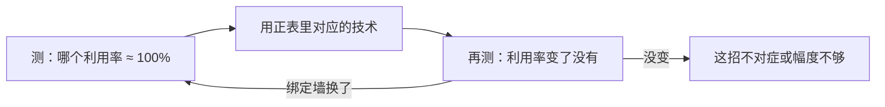

> 技术的名字是结果，约束才是原因。判断一个技术该不该用，只需要两步：测出那堵墙在绑定（利用率接近 100%的那一个），看它是否正对着那堵墙。技术失效的唯一原因是“墙没绑定在哪里”。

# 四层

| 层                | 内容                               |
| ----------------- | ---------------------------------- |
| **L 0 物理**       | 带宽、算力、延迟、并发度、功耗上限 |
| **L 1 资源**       | 这些物理量在本机剩下多少可用       |
| **L 2 约束（墙）** | 把 L 0 和 L 1 相除，得到"绑定"判据   |
| **L 3 技术族**     | 每堵墙只有固定几招                 |
| **L 4 代码**       | 本项目里那几行                     |

**绑定判据的统一形式**：$$\text{利用率} = \frac{\text{实测用量}}{\text{该资源上限}}$$

哪一项接近 1，哪一项就是当前瓶颈。其余全是余量。这一步不需要任何技术知识，只需要两个数。

# 约束 -> 技术

| 约束（墙）         | 绑定判据                                | 技术族                                                       |
| ------------------ | --------------------------------------- | ------------------------------------------------------------ |
| **带宽墙**         | 实测 GB/s ≈ 412                         | ① 少读字节（低位宽/量化/共享）② 一次读服务多次用（tile、batch） |
| **计算墙**         | 实测 TF ≈ 峰值                          | ① 换更宽的算力（张量核）② 提高每周期 MAC（分块复用）         |
| **内存墙**（延迟） | 纯读工作集 ≪ kernel 时间                | ① 提高并发覆盖延迟 ② 预取/异步                               |
| **局部性墙**       | 未命中率高 / 工作集 > L 2                | ① 分块提高重用 ② 融合减少往返 ③ L 2 驻留                      |
| **存储访问墙**     | 扇区浪费 / bank 冲突                    | ① 合并访存 ② 对齐/pad/swizzle ③ 避免转置                     |
| **异步墙**         | Σkernel ≪ 墙钟                          | ① 减少次数（融合/graph）② 重叠（流水）                       |
| **并行墙**         | 占用率低 / 波数 < 1 / eligible warp ≈ 0 | ① 加并发（拆分、更多 block）② 减小串行段 ③ 消除尾波          |
| **功耗墙**         | 功耗 ≈ 上限，频率 < 峰值                | ① 每焦耳算更多（低位宽数据通路）② 少搬数据                   |
| **IO 墙**          | PCIe 6.6 GB/s 打满                      | ① 少搬（留在设备）② 重叠 ③ 换通道                            |
| **通信墙**         | 通道吞吐打满                            | ① 换通道 ② 减少同步点 ③ 降低字节数                           |

**读法**：一堵墙只有 2–3 招，招法的名字是固定的。所以"学技术"其实是在学"这招解哪堵墙"。

# 反表：技术 -> 解那堵墙（以及何时失效）

| 技术                  | 真正针对                                     | 何时无效（本项目证据）                                       |
| --------------------- | -------------------------------------------- | ------------------------------------------------------------ |
| **CUDA graph**        | 异步墙（减少提交次数）                       | kernel 本身够长时没有收益：prefill 的间隔只占 5.7%           |
| **FlashAttention**    | 局部性墙 + 带宽墙（不物化 N²、分块留在片上） | 网格太小时无效：本项目 `flash_attn` 只发 2 个 block，8.36% 占用率 |
| **连续批处理**        | 带宽墙（权重读一次服务 B 个 token）          | 长上下文时被 KV 反超：8k 下每加一行要读 192 MiB，边际 149 GB/s |
| **算子融合**          | 异步墙 + 带宽墙（少一次写回读回）            | 融合后 kernel 变长、占用率下降时白赚；本例 7 个预处理 pass 只有 4 个不同输入 |
| **split-K**           | 并行墙（块数饿死）                           | 块已够多时只增加归约开销：FFMA 全库只赚 4%                   |
| **量化 / 低位宽**     | 带宽墙（decode）+ 功耗墙                     | int8 在本机亏损（已评估）；KV→bf16 未做，是长上下文的真杠杆  |
| **张量核**            | 计算墙 + 功耗墙（每焦耳算更多）              | decode（强度 2 FLOP/B）上是纯浪费；单趟 bf16 精度不够（4.0e-4 间隔） |
| **分块 tile**         | 局部性墙                                     | 形状窄到只有 2 波时，tile 越大越糟（896 列形状）             |
| **pad / swizzle**     | 存储访问墙                                   | 无 bank 冲突且已合并时是纯开销                               |
| **CUDA IPC / 零拷贝** | IO 墙 + 通信墙                               | 单卡单进程时不存在这个问题                                   |
| **paged / 流式 KV**   | 显存墙                                       | 16 GB 下 32k 只用 768 MiB，本项目还没碰到                    |
# 闭环：绑定墙会移动

本项目的实际迁移史（每一步都是"上一堵墙被推倒后，下一堵顶上来"）：

| 阶段   | 当时的绑定墙       | 用的招                 | 新绑定墙                                         |
| ------ | ------------------ | ---------------------- | ------------------------------------------------ |
| 起点   | 计算墙（无分块）   | 分块 GEMM              | shared 端口（存储访问墙的内部形式）              |
| 第二轮 | shared 16 lane/cyc | `[k][row]` + `LDS.128` | 线程块内 float/FMA 比                            |
| 第三轮 | 同一条             | 4×4 → 8×8              | 计算墙（FFMA 到 74%）                            |
| 第四轮 | 计算墙             | 张量核 + split         | 精度 + **异步墙占比上升到 5.7%** + attention 17% |
| 现在   | 并行墙 / attention | ？（未做）             | —                                                |
| 全程   | **功耗墙**         | 一直贴着 115 W         | 决定了"墙内加速=省电"                            |

# 一些公式

框架的价值在于**能算出天花板**，不必先写代码。

**(a) 批量化的最优值**——权重读一次服务 B 个 token，但每行还要读自己的 KV：

$$B^\* = \frac{W_{\text{bytes}}}{L\cdot \text{KV}_{\text{per-token}}}
\quad\Rightarrow\quad L{=}2048:\ 20,\quad L{=}8192:\ 5$$

超过 $B^\*$ 之后，每加一行都是 KV 在付账，权重摊薄已经结束。

**(b) 长上下文的吞吐上限**（与 batch 无关，每 token 必须读自己的 KV）：

$$\text{tok/s} \le \frac{412\ \text{GB/s}}{L\times 24\ \text{KiB}}
\quad\Rightarrow\quad L{=}2048:\ 8192,\quad L{=}8192:\ 2048$$

**(c) 该不该上张量核**（由算术强度决定）：

$$P_{\text{cross}} = \frac{24\ \text{FLOP/B}\times W_{\text{bytes}}}{2\cdot \text{params}}
= 33\ \text{行}\quad\Rightarrow\quad \text{rows} \ge 64\ \text{时才稳定划算}$$

**(d) 批量的显存上限**（资源层直接封顶）：

$$B_{\max} = \frac{15\ \text{GiB}}{L\times 24\ \text{KiB}}
\quad\Rightarrow\quad L{=}8192:\ 80,\quad L{=}2048:\ 321$$

（15 GiB = 16 GiB 减去 0.94 GiB 权重；实测 B=12 @8192 的 KV 是 2.25 GiB，与 12×192 MiB 吻合。）

四个公式放在一起，批量化的问题就闭环了：**短上下文批量到 $B^\*$ 为止（受带宽），长上下文批量到 $B_{\max}$（受显存），中间由 (b) 决定吞吐上限**。

# 元规律

1. **资源墙不报错，它变成性能悬崖**。同一份代码，在累积显存的进程里 B=96 是 **1098 ms/step**，隔离测量是 **21.3 ms/step**（52×）。WDDM 不 OOM，它分页。→ 测量环境本身是变量。
2. **沙盒的赢家不迁移**。同一变体在沙盒里赢，在管线里输（BK=32→16、8×8 的 2× 只剩 7%），因为沙盒的重复跑把操作数留在 L 2。→ 参数只在 in-situ 定。
3. **效率百分比必须按真实频率算**。名义 1.75 GHz、负载 1.5 GHz，把 64% 算成 74% 的差别会直接改变"还剩多少余量"的判断。