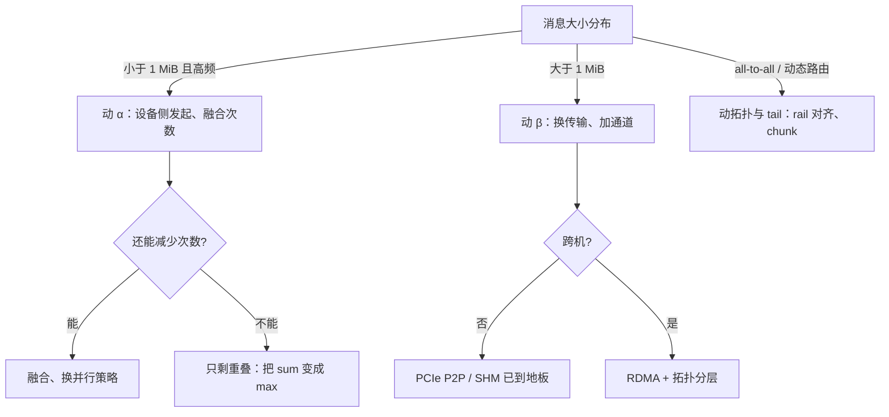

通信优化最容易变成列表：换 RDMA、上 NVLink、做拓扑感知、加压缩、搞重叠。这些都对，但都不能回答“**在我的场景里该先动哪一个**”。所以先把它写成方程——写成方程之后，每个手段必须指出它改了哪一项，否则就只是换了说法。

# 本机的锚点

先看一组实测（单机：RTX 3080 Laptop，Windows + WSL）。这张表是下面所有推理的输入：

| 量 | 实测值 | 含义 |
| --- | --- | --- |
| $\alpha$：gloo over TCP loopback | **348 µs/次** | 主机侧发起 + 一次 WDDM 往返 |
| $\alpha$：NCCL 单卡两 rank | **1.0–2.2 ms/次** | 没有第二条通道，只能走 proxy |
| $\alpha$：NCCL 多卡（参考量级，非本机） | ~10 µs | SM 内 kernel 直接交换 |
| $\beta$：AF_UNIX | 16.2 GB/s | 同机进程间上限 |
| $\beta$：命名管道 / 共享内存 | 10.1 / 7.2 GB/s | 同机，更慢的实现 |
| $\beta$：TCP loopback | 0.76 GB/s | 同机 TCP 的上限 |
| $\beta$：PCIe Gen3 x8（pinned） | 6.67 GB/s | 跨卡/跨机的地板 |
| $\beta$：DRAM | 412 GB/s | 参照系 |
| 切换点 | **1 MiB** | 小于它 $\alpha$ 主导，大于它 $\beta$ 主导 |

![[通信模型-曲线.svg|同一条消息，两种库：gloo 是「税 + 带宽」，NCCL 单卡是纯税；虚线是 0.76 GB/s 的纯传输下限]]

这张图是出发点：**在 1 KiB 处，两条线都在纯传输下限之上 260–780 倍**。也就是说，"网络慢"这件事，在小消息上几乎与网络无关。

# 方程

$$T_{\text{comm}}=\underbrace{n\,\alpha}_{\text{次数} \times \text{每次的税}}+\underbrace{\frac{Q}{\beta_{\text{eff}}}}_{\text{字节}/\text{有效带宽}}+\underbrace{T_{\text{tail}}}_{\text{最慢的那个}}$$

$$T_{\text{step}}=\begin{cases}T_{\text{comp}}+T_{\text{comm}} & \text{不重叠}\\[2pt] \max(T_{\text{comp}},T_{\text{comm}}) & \text{重叠}\end{cases}$$

四项，四个旋钮，没有第五项。任何"通信优化"如果不能指出它动了哪一项，就只是换了个说法。

# 六个可动的量

| 动的量 | 手段 | 什么时候值得 | 什么时候白费 |
| --- | --- | --- | --- |
| $\alpha$ 每次的税 | device-initiated（kernel 内发起）、persistent kernel、NCCL device API、绕开主机往返、避开 WDDM 同步（13–18 µs） | 小消息高频：TP、MoE dispatch | 大消息，税被带宽淹没 |
| $n$ 次数 | 融合（两次 all-reduce → 一次 reduce-scatter + all-gather）、更大 batch 摊薄、分层通信、换并行策略 | 每层固定次数的结构性通信 | $Q$ 很大且次数已被算法钉死 |
| $Q$ 字节 | 降精度（bf16→fp8）、稀疏、量化 + 误差反馈、KV 压缩、all-gather→reduce-scatter | $Q/\beta$ 主导：DP 梯度、EP、PD 的 KV | 消息已小于 $\alpha\beta$（3.5 KiB 时压缩毫无意义） |
| $\beta_{\text{eff}}$ | 换传输（NVLink > PCIe P2P > SHM > AF_UNIX > TCP）、RDMA/IB、GPUDirect、多网卡聚合、多 channel 并行 | 大消息、跨机 | 单条通道已跑满（本机 TCP 0.76 就是） |
| 拓扑 | ring / tree / 2D-3D、节点内 + 节点间两级、rank 放置、rail 对齐 | 规模跨节点、all-to-all | 单机单卡 |
| $T_{\text{tail}}$ | chunked 通信、剔除慢节点、超时、冗余计算 | 异构/多租户、EP | 同构且同步良好 |

# 决策顺序

顺序不是随便排的：**先判 $\alpha$ 侧还是 $\beta$ 侧，再看能不能减少次数，最后才谈重叠**。重叠只能把加号变成 max，改不动被 max 的两项中的任何一项。

# 压缩：判据，以及它的两个真实约束

"通信太慢就压缩"这个反射，需要用两个式子验一遍。

**算力判据**（每字节省下的时间 vs 压解花掉的时间）：

$$\frac{1-r}{\beta} > \frac{c}{P}\quad\Longleftrightarrow\quad c < \frac{P(1-r)}{\beta}$$

本机代入（$P=11.2$ TF、$\beta=6.67$ GB/s）：$P/\beta = 1{,}679$ FLOP/byte；即使压缩率 $r=0.5$，也允许 $c < 840$ FLOP/byte。

**结论与直觉相反：算力从来不是压缩的瓶颈。** 真实压缩器每秒字节只有几十条指令，远在这条线以下。

真正的约束是另外两条：

1. **无损压缩对随机浮点几乎无效**。激活和梯度是高熵数据，通用压缩器通常只有 1.0–1.2×；要 2× 以上只能靠**降精度**（bf16→fp8）或**稀疏**（top-k），而这两者都是有损、需要误差反馈。
2. **压缩器本身要跑得比链路快**。链路是 GB/s 量级，通用压缩器的单核吞吐也正好在 GB/s 量级——压缩自己变成带宽绑，需要多核并行，还和主机侧数据面抢核。真正的设计是把它放进 GPU（或 DPU），而不是在 CPU 上开线程。

所以 LLM 里真正有效的三件事都不是"压缩"，而是"**少发**"：

| 手段 | 作用在 | 量级 |
| --- | --- | --- |
| fp8 KV | $Q$（PD 分离、长上下文） | 2×，且有明确的误差预算 |
| top-k 专家路由 | $Q$（EP） | 与 k 成正比，直接砍 |
| prefix cache | $n$ 和 $Q$ 同时归零 | 整段 prefill 的通信消失 |

# 五种通信模式，各绑不同的量

| 模式 | $n$ | $Q$ | 主导项 | 有效手段 | 无效手段 |
| --- | --- | --- | --- | --- | --- |
| **DP 梯度** all-reduce | 少（每步 1 次） | 极大（参数量级） | $\beta$ | 降精度、ZeRO 分片、bucket 合并 | 改发起方式；压缩（除非有损且 >2×） |
| **TP** 每层 all-reduce | 多（$2\times$层数） | 极小（hidden 896 → 3.5 KiB） | $\alpha$ | 设备侧发起、两次融成一次、减少层内同步 | 换传输、压缩 |
| **PP** 点对点 | 中（层数） | 中（激活块） | 重叠 | 微批流水、与计算重叠 | 压缩 |
| **EP** all-to-all | 多 | 中 + 不均匀 | 拓扑 + $T_{\text{tail}}$ | rail 对齐、chunk、均衡路由 | 只调 $\beta$ |
| **PD 分离** KV 搬运 | 每请求 | 大（24 KiB × S） | $\beta$ + 生命周期 | 直传 RDMA、前缀复用、KV 降精度 | 集合通信算法 |

这张表解释了一个常见误区：**同一次训练里 DP 和 TP 的瓶颈在方程的两端**（一个 $\beta$ 一个 $\alpha$），所以"统一优化通信"是伪命题——必须按模式分别给手段。

用本机数字感受一下 TP 那一行的量级：hidden 896 的一次 all-reduce 是 3.5 KiB，在本机的单卡 NCCL 路径上是 1,053 µs/次，每层两次、24 层 = **50 ms/token**，而计算只要 3.4 ms。**慢 15 倍，且与带宽无关。** 真实多卡上这一项降到 ~10 µs，靠的正是 $\alpha$ 那一列的手段。

# 拓扑：只在跨节点之后才有意义

- **ring**：每个 rank 搬 $\frac{2(N-1)}{N}$ 份数据，但要走 $2(N-1)$ 跳——$N$ 大时 $\alpha$ 线性涨。
- **tree**：$\alpha$ 是 $O(\log N)$ 跳，代价是每步消息更大、对尾延迟更敏感。
- **两级（节点内 NVLink/PCIe + 节点间 RDMA）**：把跨节点字节除以节点内并行度，这是唯一"顺便"就变便宜的拓扑收益，也是所有大集群的默认形态。
- **all-to-all（EP）**：对拓扑最敏感——只有全互联或 rail 对齐的 fabric 才不炸，这是 DeepEP 这类库存在的理由。

单机（比如本文的测试机）讨论拓扑没有意义：一条 PCIe 通道、$N=2$，ring 和 tree 是同一件事。

# 这套模型什么时候不适用

- **没有 $\alpha$ 的实测就套公式**：$\alpha$ 在 gloo/TCP 上是 348 µs、在 NCCL 单卡上是 1–2.2 ms、在多卡上是 ~10 µs，**跨两个数量级**。拿错一个，结论整个反过来。
- **消息大小不是单峰分布**：TP 的 3.5 KiB 和 DP 的 GB 级梯度混在一条链路上时，要按分位数分别算，不能取平均。
- **多租户 / 多作业共享 fabric**：$T_{\text{tail}}$ 会变成主项，"同构集群"假设失效。
- **单卡没有第二条通道**：$\alpha$ 和 $\beta$ 都取最差的一档，任何"本机能跑多快"的结论都不能外推到多卡。
- **重叠的可达性没有建模**：$\max$ 只在通信被切成 chunk 且有独立资源时可达，本文把它当上界。

# 怎么在自己机器上测

两条命令就能把这张表的左列填满：

1. **gloo**（原生 Windows 上唯一可用的集合通信）：`torch.distributed` 起两个进程、CPU tensor，扫 1 KiB → 16 MiB，记每次调用耗时。
2. **NCCL**（Windows 原生没有，要在 WSL 里）：`apt install libnccl2 libnccl-dev`，两 rank 挤在同一张卡上默认被拒（`Multiple Ranks are using the same GPU/Partition`），加 `NCCL_MULTI_RANK_GPU_ENABLE=1` 才跑得起来。

两个坑：

- `NCCL_DEBUG=INFO` 会让这条同卡多 rank 路径失败（`rank 1 init FAILED: unhandled cuda error`，等 60–90 s），`WARN`/`ERROR` 正常——别拿 INFO 做长跑。
- `nvidia-smi` 在空闲时报 `Gen1 x8`，传输中才升到 `Gen3 x8`。按空闲读数算理论带宽会低估 3 倍。

拿到 $\alpha$ 和 $\beta$ 之后，问题就只剩一句：**我的消息落在 1 MiB 哪一侧**。
