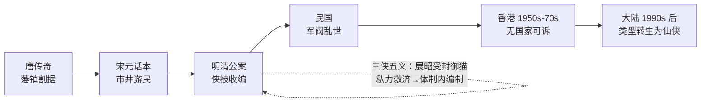

# 武侠小说的批判

> 目的：不是鉴赏，是**结构批判**——把"江湖"当成一个政治经济体来审，追问它对什么避而不谈、靠什么前提成立、为什么在它的黄金时代之后无法再生。
> 本文是讨论底稿，论点可推翻；每轮讨论后追加，不重写。

---

## 0. 标记约定

| 标记 | 含义 |
|---|---|
| 【文本】 | 小说正文可查的具体情节、人物、设定 |
| 【史实】 | 可考的文献、年代、作者生平 |
| 【通说】 | 学界或评论界的通行判断，非铁证 |
| 【推论】 | 由前两者推出，本文自负 |
| 【本稿判断】 | 本文立场，允许被反驳 |

---

## 1. 总纲：三个结构性空白

武侠小说全部建立在三个它自己从不结算的账上：

| 空白 | 内容 | 后果 |
|---|---|---|
| **经济真空** | 门派、镖局、江湖人的钱从哪来 | 江湖被写成一个不生产、只消费的社会；武力因此没有成本约束 |
| **司法真空** | 为什么私力救济是正当的 | 侠的合法性寄生于国家失败；国家一强，类型即失效 |
| **继承真空** | 武功如何跨代传递、如何定价、如何失传 | 全部叙事冲突被压缩成"夺秘笈 / 清理门户 / 叛徒"三个母题 |

【本稿判断】这三条不是缺陷，是**类型的前提**。武侠之所以能成立，正因为它把这三笔账悬置了；也正因为悬置，它无法处理现代性。

---

## 2. 武是什么，侠是什么

### 2.1 武：一次被篡改的字源

- 【史实】甲骨文、金文的"武"作"止 + 戈"，会意为**持戈行进**；现代古文字学释"止"为"趾"（脚、行走），不是"停止"。
- 【史实】"止戈为武"出自《左传·宣公十二年》楚庄王论邲之战："夫文，止戈为武……夫武，禁暴、戢兵、保大、定功、安民、和众、丰财者也。"《说文解字》沿用此说。

【推论】"止戈为武"不是字源，是**春秋贵族对暴力的自我节制宣言**——把"打"重新解释成"为了不打"。
【本稿判断】武侠叙事的全部道德自信（"以武止武""杀是为了不杀""练武是为了不用武"）都建立在这个**拆字误读**之上。类型的第一块基石是一句训诂误读。而楚庄王原话的重点其实是后半句：武的合法性在于它**产出秩序与财富**（禁暴、定功、安民、丰财）——这一点武侠小说反而彻底丢了。

### 2.2 武的出现：暴力分工

三个条件让"武"成为一门可以脱离国家持有的技艺：

| 条件 | 内容 | 后果 |
|---|---|---|
| 技术 | 铁器与步兵兴起（车战衰、步战兴），个体武艺第一次有战场价值 | "能打"可被个人占有 |
| 社会 | 【通说】顾颉刚《武士与文士之蜕化》：古之士皆武士，春秋战国文武分途，失职武士流为游侠 | 出现了**不属于任何人的武力** |
| 传承 | 师徒制，技艺可跨代复制 | 武力成为可积累的资产（见 §4） |

【推论】武的历史意义不是"人能打"，是"**能打的人可以不属于国家**"。在此之前，暴力是统治权的专属物；此后它开始有私人持有者。武侠这一类型，是这个历史缺口在文学上的长期回声。

（互补解释：为什么偏偏是"武"被文人选中、被读者买账，见 §8。）

### 2.3 侠：一个全是否定式的定义

武在社会中本来只有三个位置：

| 位置 | 谁付钱 | 名称 |
|---|---|---|
| 国家 | 俸禄 | 兵、将、捕快 |
| 市场 | 佣金 | 镖师、护院、刺客 |
| 反国家 | 抢 | 盗、匪、寇 |

侠是第四个位置：**拒绝前三种定价的武**。定义由三条否定构成：

- 不领饷 → 不事王侯
- 不收钱 → 仗义疏财
- 不劫掠 → 除暴安良

【本稿判断】侠没有正面定义，只能反面列举。所以武侠小说永远无法证明主角是侠，只能证明他**不是**打手、**不是**官差、**不是**强盗。这解释了类型里的几个怪癖：
- "仗义疏财"地位极高——**疏财是拒绝市场定价的收据**；
- 大侠往往穷、往往不肯做官、往往被通缉——三条否定每去掉一条，侠就退化成上表里的某一格；
- 好人必须比坏人更不赚钱，否则读者无法判定阵营。

### 2.4 武后为什么跟着侠

关键在顺序：**先有武，侠是事后追认。**

1. **武单独存在时没有辩护。** 韩非已经定罪："侠以武犯禁"。一个人能杀而社会不能阻止，这件事本身就是秩序的漏洞，不需要他做错任何事。
2. **追认需要一个发行方。** 国家不给（给了就是兵），市场不给（给了就是镖师），于是只剩"江湖舆论"——一个**没有强制力的第三方**。
3. **所以武侠的道德永远是舆论道德。** 靠"天下人怎么看"执行，靠"后世评说"结算；失信者不是被判刑，是被"江湖不齿"。

【推论】武侠的叙事结构因此被锁死为：**先打，后解释为什么打得对**。每一场打斗后都必须跟一段道义说明，或由旁观者转述，否则读者无法确认这是侠还是匪。这是类型的结构性冗余，也是它写不出"沉默的暴力"的原因——沉默的暴力在舆论体系里无法被追认为侠。

一句话：**武是能力，侠是许可证；在故事内部签发机关不存在，只有见证人。**（故事外部则存在——是审查者与家庭读者，见 §9.4。）

### 2.5 分期：武的五种文学形态

| 时期 | 武的形态 | 合法性来源 | 代表 |
|---|---|---|---|
| 史传（汉） | 体力 + 信义，几乎不写技术 | 司马迁的道德翻案 | 《史记·游侠列传》 |
| 传奇（唐） | 异术（剑术、隐身、药） | 报恩 / 知己 | 聂隐娘、红线 |
| 公案（清） | 技击，纳入官府 | 清官授权 | 《三侠五义》 |
| 民国 | 国术（门派化、内功雏形） | 民族 / 强国保种 | 《江湖奇侠传》《蜀山剑侠传》 |
| 新派（1950s–） | 内力体系 + 招式量化 | 江湖舆论 + 政治寓言 | 金庸、古龙 |

- 【史实】梁启超《中国之武士道》(1904) 把侠国族化；1928 年中央国术馆成立，"国术"成为国家工程。
- 【通说】"侠"字先秦仅见于《韩非子》一类法家语境，作为社会角色的"游侠"要到战国末年养士之风（四公子）才成形。
- 【本稿判断】"内功"是晚出的：唐传奇的侠用异术不用内力，招式的细描要到民国才系统化。武在文学里被不断**内化**（异术 → 气 → 内力 → 境界），每一次内化都把暴力从"物理层面"搬到"不可验证层面"。不可验证，才好辩护。

---

## 3. 江湖不在国家之外，在国家之内

### 3.1 原判与翻案

- 【史实】《韩非子·五蠹》："儒以文乱法，**侠以武犯禁**。"——侠从定义上就是国家法权的对立面。
- 【史实】《史记·游侠列传》反拨："其言必信，其行必果，已诺必诚，不爱其躯，赴士之厄困。"——司马迁把"犯禁"转译成"信义"，这是第一次为私力救济做道德辩护。
- 【通说】王学泰《游民文化与中国社会》：江湖的实体是**脱离宗法共同体的游民社会**，其伦理（义气）是游民在无国家保护下的互助保险。

【推论】"义气"不是道德高地，是**没有法院时的合约执行机制**。它之所以必须用性命担保，是因为没有第三方强制力。

### 3.2 钱的问题

金庸几乎从不写门派的收入来源。《笑傲江湖》里青城派灭福威镖局满门，是全书少数把**暴力直接接到商业**上的地方：镖局是江湖与市场唯一的接口，接口一断，林家的资产（辟邪剑谱）就被重新分配。

【推论】武侠的经济学是：**武力不生产，只重新分配**。所以江湖必须永远存在"可被重新分配的东西"——秘笈、宝藏、掌门之位、女人。这就是麦高芬的生产线。

【本稿判断】写得越"纯"的江湖，越依赖一个隐形的国家补贴：官府提供秩序，门派才有田租；商路提供货源，镖局才有生意。武侠小说从不写这笔补贴，因为一写，"侠"就降格成"武装承包商"。

---

## 4. 武功的产权结构

### 4.1 内力的三个物理属性

| 属性 | 含义 | 叙事后果 |
|---|---|---|
| 累积性 | 越练越强，与年龄正相关 | 老人天然是强者；少年主角必须靠"奇遇"跳级 |
| 身体性 | 不可转移、随死亡归零 | 必须收徒；师承即产权 |
| 不可复制性 | 秘笈可抄，但"练成"不可复制 | 知识资产化 → 盗版（偷学）、专利（门派禁传）、侵权诉讼（清理门户） |

【推论】"清理门户"本质是**产权纠纷**；"叛徒"是**技术泄露**；"夺秘笈"是**恶意收购**。武侠小说的冲突引擎不是侠义，是产权。

### 4.2 文本证据

| 作品 | 争夺对象 | 性质 |
|---|---|---|
| 《射雕英雄传》 | 九阴真经 | 引发第一次华山论剑——用比武给资产定价 |
| 《笑傲江湖》 | 辟邪剑谱 | 镖局家产 → 门派兼并 |
| 《连城诀》 | 连城剑法 + 宝藏 | 剑谱即藏宝图：知识资产与实物资产捆绑 |
| 《倚天屠龙记》 | 屠龙刀 / 倚天剑 | 兵器即期权，内含兵书与秘笈 |

【本稿判断】四部代表作的核心麦高芬**全是资产，没有一个是理想**。这说明类型的深层逻辑是产权而非道义；"侠义"是包裹在产权斗争外面的合法化话术。

### 4.3 折旧问题

内力会随死亡归零，但秘笈不会。所以江湖的长期趋势是**秘笈通胀、高手通缩**：文本里越是晚期，越强调"失传"与"残缺"（降龙十八掌传到后人只剩十二掌）。

【推论】武侠世界是一个**知识存量递增、执行者递减**的经济体——这解释了它为什么总带着挽歌气质。它不是对未来的想象，是对过去的哀悼。

---

## 5. 侠的合法性：一次失败的司法外包

（承接 §2.4：侠的许可证由江湖舆论签发。本节问的是——这张许可证在历史上有没有被别的机关签发过。）

### 5.1 免责条款

武侠为私力救济准备的标准辩护只有一条：**恶人先动手**。

【推论】这条免责条款的成立，预设了两件事：（1）司法已经失效或不可达；（2）恶人的恶是可观测的。两条同时满足，侠才免于"以武犯禁"的原判。所以武侠必须持续生产"官府管不了的恶"——**恶的质量决定了侠的必要性**。

### 5.2 国家能力曲线

- 【史实】清末《三侠五义》：展昭受封"御猫"，侠正式进入官僚系统。**这是类型史上唯一一次"司法外包成功"的实验**，之后被抛弃。
- 【史实】1954 梁羽生《龙虎斗京华》、1955 金庸《书剑恩仇录》起，新派武侠在香港成熟。南来文人 + 殖民地 + 难民社会：**三重意义上的国家缺席**。
- 【推论】武侠的黄金时代总在"国家不在场"的地方。香港不是偶然，是必要条件。

### 5.3 为什么它在大陆失效

【本稿判断】不是因为写坏了，是因为前提没了。当代中国的读者不生活在司法真空里，"恶人先动手"这条免责条款失去经验支撑，于是类型必须换壳：仙侠用"境界"替换"内力"，用"宗门"替换"门派"，用"灵石"替换现金——**它补上了武侠原本缺的经济账，代价是彻底退出人间**。

---

## 6. 力量通胀与体系内卷

| 力量模型 | 成本 | 叙事后果 | 代表 |
|---|---|---|---|
| 内力 | 时间（数十年） | 老人强、少年需奇遇；层级可通胀 | 金庸 |
| 招式 | 几乎为零 | 决斗变成博弈与心理 | 古龙 |
| 境界 | 无限可分（练气→筑基→…） | 数值化、可无限续写 | 仙侠 |

- 【文本】《鹿鼎记》：主角不会武功。金庸用一部反武侠终结了自己的体系——**作者本人先承认了体系破产**，然后封笔（1972）。
- 【文本】古龙的解药：抽掉招式与内力的量化，把决斗压缩成一瞬间的心理对赌（"小李飞刀，例不虚发"）。代价是**动作性消失**——冲突从"怎么打"变成"敢不敢打"。
- 【推论】力量体系的通胀不可避免，因为连载需要不断的强度刺激；通胀的尽头必然是数值化，而数值化的尽头是人间蒸发。

---

## 7. 身体政治：唯一被认真结算的账

- 【文本】《神雕侠侣》杨过断臂；《笑傲江湖》岳不群、林平之自宫。
- 【推论】武侠里所有"代价"都被写成**身体代价**，因为经济代价它不会算。断臂与自宫是类型最诚实的时刻：它承认力量必须用别的东西换，只是它只会用身体记账。这也回到 §2.4——身体是唯一不需要舆论追认就能被看见的证据。
- 【通说】女性角色的三重功能：胜利的奖励（婚配）、秘笈的容器（"得她即得传承"）、暴力的证明（被杀以激怒男主）。这不是作者个人的偏见，是产权叙事对"人"的分类——女性在产权表上没有格，只能作为**资产**或**对价的单位**出现。

---

## 8. 谁在写，写给谁：武力作为替代品

（本节回应一个竞争性解释：武的出现由作者与读者的社会位置决定，而非文学内部逻辑。结论：该解释对**起源期**成立、对**成熟期**不成立；两者错开，正好解释类型的两次转向。）

### 8.1 命题

> 武侠作者多是失意文人（少有真正的武者），需要武力去打破社会桎梏；选择武力而非其他工具与受众有关——早期面向小知识分子，后来面向大众，快意恩仇比绵延千里的阴谋更符合短期快感的摄取。

【本稿判断】三条中，第一条基本成立；第二条要改写（文人要的不是武力，是发言权与评分权）；第三条要加一个**媒介变量**，否则解释不了同一批读者为什么后来读得下《笑傲江湖》和《鹿鼎记》。

### 8.2 第一条：作者确非武者，而且越成熟越不是

| 作者 | 本业 | 与武术的关系 |
|---|---|---|
| 平江不肖生（向恺然） | 留日学生、后参与国术活动组织 | **真习武**，民国少数练家子 |
| 还珠楼主（李寿民） | 机关职员、记者 | 无 |
| 宫白羽 | 报社校对、编辑，潦倒 | 无 |
| 王度庐 | 教师、小职员 | 无 |
| 梁羽生（陈文统） | 岭南大学经济系 →《大公报》编辑 | 无记载 |
| 金庸（查良镛） | 《大公报》记者 →《明报》创办人 | 无 |
| 古龙（熊耀华） | 职业小说家 | 无（有帮派经历传闻，无武学） |

【推论】唯一真正习武的是类型**开端**的平江不肖生；类型一旦能养活职业写手，练家子就被文人替换。**武侠不是武者写的，是文人写的，而且越成熟越是如此。** 这一条对用户的命题是强支持。

### 8.3 第二条改写：文人要的不是武力，是被武力庇护的发言权

失意文人在结构上缺的不是"打人的能力"，是**评价权**——科举是唯一正当出口，落第即结构性失败，而评判标准不在自己手里。

【本稿判断】所以武侠是**代理幻想**（proxy fantasy），不是力量幻想：文人不是在**拥有**武力，是在**指挥**武力。证据：

- 金庸的主角几乎都有文士底子：张无忌通医理，段誉读佛经，令狐冲能谈诗论酒，陈近南文人出身。
- 最能打的人往往最守礼、最讲诺、最"文"；真正粗野的武者（桃谷六仙、裘千丈）是丑角，丁春秋是反派。
- 武力被系统性**去身体化、去粗野化**：不写汗、不写伤、不写脏，写气度。

【推论】真实的武者世界（镖局、帮会、军旅、国术馆）里身体是账本；武侠里身体是修辞。这一条同时解释了 §7 的现象：武侠只会用身体记账，却从不写身体的实感。

### 8.4 第二条补：不只缺力量，更缺一个不会误判你的考场

命题里没提、但可能是最强的补偿物：

【本稿判断】武侠提供了一个**完全可量化、完全公开、不需要推荐人的地位系统**——武功高低、华山论剑、兵器谱排名。它对落第文人最诱人之处不是"我能打"，是"**打赢就是打赢**"：一个不会因门第、籍贯、荐举而误判的考场。

- 【文本】古龙《多情剑客无情剑》的"兵器谱"（百晓生排定）几乎就是科举榜单的镜像：公开排名、逐条对位，名次驱动全部情节。
- 与 §2.3 侠的三条否定自洽：不入编制、不收钱、不靠关系，只靠打赢——三条否定合起来，正是一个**纯绩效社会**的入场条件。

【推论】武侠的深层许诺是**程序正义的替代品**：既然现实中的评估体系不可信，就发明一个只认结果的。这也解释了为什么武侠里"比武"总比"打斗"多——**比武是考试，打斗是事故**。

### 8.5 第三条：快意恩仇 vs 阴谋，要加发行形式这个变量

单用"受众喜欢短期快感"解释力不够：同一批读者后来也能读下去大阴谋结构。真正的差别在**发行形式**——载体怎么收钱，叙事就怎么结算。

#### 8.5.1 发行形式表

| 发行形式 | 收费方式 | 结算周期 | 叙事强制 | 后果 |
|---|---|---|---|---|
| 报纸副刊连载（1920s–70s） | 订阅整份报纸，内容白送 | 天 | 每天一个能独立读完的高潮 | 快意恩仇、单元剧、章末钩子 |
| 租书铺分册（民国–80s 港台/大陆） | 按**册**按天计费 | 册 | 越长越赚钱 | 灌水、无限续写、《蜀山》近二十年未完 |
| 单行本（1970s–） | 一次性买断 | 卷/套 | 一卷之内要能自洽 | 结构完整、可以埋线、作者改稿 |
| 影视（1970s–90s） | 广告 / 收视 | 集 | 每集一高潮 + 片尾悬念 | 场面优先、人物简化、武功视觉化 |
| 网络章节付费（2000s–） | 按千字订阅 + 月票榜 | **章** | 每章必须有爽点，断更即掉榜 | 爽文、日更、字数军备 |

【推论·结算周期定律】**载体的结算周期决定叙事的结算周期。** 结算越频繁，叙事越短促；结算越稀疏，叙事越能延宕。这一条能统一解释 §6 的力量通胀（连载需要持续强度刺激）与本节标题里的"快意恩仇"（日结所以日爽）。

#### 8.5.2 三个可检验的推论

1. **租书铺造长度，报纸造节奏。** 按册计费的分发体系奖励字数，报纸连载奖励节奏。民国武侠动辄数十册、还珠楼主《蜀山剑侠传》1932 年起连载近二十年仍未完结，是前者的产物；金庸每部三四十万字即收，是后者的产物。
2. **修订是体裁转换工程。** 【史实】金庸在 1970 年代、1980 年代两次系统修订全部作品。修订的必要性本身就证明：报纸连载形态与单行本形态对叙事的要求不同，作者自己承认了这一点。
3. **读者关系而非读者品味决定结构。** 金庸自立《明报》后读者由"随机"变"固定"，同期作品从单元剧转向长线权谋（《笑傲江湖》《鹿鼎记》）。**换代的是传播关系，不是读者。**

#### 8.5.3 大陆的入口不是小说

【通说】1980 年代大陆的武侠热，第一媒介是影视而非文本：1982 年《少林寺》、1983 年无线《射雕英雄传》（1985 年引进大陆）先于系统出版培养了读者。同期流通的主力是租书摊与连环画。

【本稿判断】这意味着大陆读者对武侠的**默认记忆是影像化的**：降龙十八掌是特效姿势，不是文字招式。所以大陆后来接手的类型（仙侠）天然按"视觉奇观 + 集数结构"生长，与港台按"连载节奏"生长的武侠不是同一棵树。

#### 8.5.4 网络是报纸的极端化，不是断裂

【通说】起点模式（2000s 起）按章订阅、月票榜排名，反馈周期从"天"压缩到"章"。

【推论】网络类型文不是新物种，是**报纸连载的周期被进一步缩短**：同样的日结逻辑，结算单位从"一天"变成"一章"，于是爽点密度、字数军备、断更惩罚全部等比放大。仙侠/玄幻之所以能取代武侠，除了 §5.3 说的合法性前提消失，还因为它的力量模型（境界，见 §6）**无限可分、可无限续写**——最适合按章结算的发行形式。

一句话：**武侠的形态不是文人想出来的，是发行形式逼出来的；作者只是把结算压力翻译成情节。**

### 8.6 这个命题解释不了谁

【本稿判断】"失意文人"假设解释不了金庸。他办《明报》、写社评、掌握话语权，从任何意义上都不是失意者；而他后期恰恰从"快意恩仇"转向"制度批判"（《笑傲江湖》写权力，《鹿鼎记》写无道德的成功）。

按代际切开：

| 世代 | 作者社会位置 | 作品动力 | 代表 |
|---|---|---|---|
| 民国 | 真失意（宫白羽自嘲"文丐"，王度庐穷困） | **补偿**：悲情、恩仇、身世飘零 | 《十二金钱镖》《卧虎藏龙》 |
| 香港新派 | 成功报人（金庸、梁羽生） | **寓言**：权力如何运作、正派如何腐化 | 《笑傲江湖》《鹿鼎记》 |

【推论】**"失意文人的补偿幻想"是起源期的解释，不是全期的解释。** 类型一旦获得话语权，作者就从"想赢"变成"想解释为什么赢不了"。这不是反驳命题，是把它放回真正有效的时间段。

### 8.7 与 §2.2 的关系

§2.2 的历史条件（铁器、文武分途、师徒制）回答"武为什么在现实中可能存在"；本节回答"为什么偏偏是武被选作文人幻想的载体"。两者互补：

- 历史条件让武力成为**私人可持有、不需第三方执行**的工具；
- 作者位置让这种工具成为**无权者最容易幻想**的工具。

一句话：**武之所以被选中，不是因为它强，是因为它是唯一不需要机构就能兑现的力量。** 计谋要有衙门，法律要有法院，财富要有市场，只有身体不需要对手方。

---

## 9. 侠的两副面孔，与武的四个接口

（承接 §2.4 的结论"武是能力，侠是许可证"。本节问：这张许可证到底由谁签发，以及为什么武非挂着它不可。）

### 9.1 侠的双重性：一个人，还是一种德

| 义项 | 内容 | 是否可验证 | 是否必需武力 |
|---|---|---|---|
| **作为人** | 社会角色：脱离宗法、以武力为业、以信义为契约 | 可（史书列传、帮会名册） | 必需 |
| **作为精神** | 价值取向：侠气、侠骨、义 | 不可（谁都可以自认） | 不必需 |

- 【史实】秋瑾号"鉴湖女侠"，不以技击名——这是"侠"脱离武力、纯作精神使用的现成例子。
- 【文本】金庸晚期走完这条路：从"郭靖式的侠客"到"为国为民，侠之大者"（《神雕侠侣》），再到《鹿鼎记》里完全不会武功的韦小宝——**武被一路剥离，只剩"义气"。**

【本稿判断】两义之间的滑动不是语言巧合，是一个**责任转移装置**：用"精神上的侠"豁免"行为上的暴力"。主角杀人时，评论说"侠之大者"；有人追问后果时，就退回到"那是一种精神"。**一词双指，是类型逃避结算的语法。**

### 9.2 接口一：作者身份——侠是翻译器

- 文人不懂技，只能写德。武术知识有门槛（行话、师承、门派谱系），虚构比调查便宜。
- 所以文人笔下的武只能写成"气度""境界""不战而屈人之兵"——把技转译成德。
- 反证成对：真习武的平江不肖生，技术描写最实、文学声望最低；不习武的金庸，把武彻底道德化、声望最高。

【推论】**侠是让不懂武的人能写武的语法。** 没有这层语法，文人根本无法处理暴力题材。

### 9.3 接口二：时代——侠是时代精神的容器

| 时代 | "义"的内容 | 武的对象 | 代表 |
|---|---|---|---|
| 晚清民国 | 强国保种、尚武精神 | 洋人与衰败旧秩序 | 梁启超《中国之武士道》(1904)、精武体育会(1910) |
| 香港 1950s–70s | 正统与篡逆 | 抽象的魔教与权力野心 | 金庸 |
| 台湾戒严期 | 忠孝节义 | 邪派、叛逆 | 古龙（强去政治化） |
| 大陆 1980s | 民族尊严 | 外国人 | 《霍元甲》(1981) |
| 网络 2000s– | 个人逆袭 | 一切压制我的东西 | 仙侠、爽文 |

【推论】"武必须跟侠"这个**形式**从未变过，"义"的**内容**大约每二十年换一次血。真正稳定的不是道德，是**道德化的需要**。

### 9.4 接口三：出版限制——侠是发行许可证

这是最硬的一条，也修正 §2.4 的说法：许可证的签发机关其实是存在的，是**审查者与家庭读者**。

- 民国：报纸副刊处在家庭阅读环境里，纯暴力即"诲盗"，配道德注脚才叫"教化"。
- 香港：报纸是全家读物，副刊旁边是妇女版与儿童版；殖民政府对政治煽动敏感，把政治批评包成道德故事最安全。
- 台湾戒严期：文艺政策与出版审查对通俗小说构成持续压力。
- 大陆：1950s–70s 武侠被当作封建毒素停止出版；1980s 解禁后仍遭"精神污染"批评。

【本稿判断】**没有侠的武是诲盗，有侠的武是教化**——同一堆文字，只差一句道德注脚。所以侠不是创作选择，是**出版条件**：武侠得以存在，是因为它提供了审查者唯一能签字的格式。

### 9.5 接口四：意识形态——侠是辩护词

- **儒家化**：司马迁的游侠"其行虽不轨于正义"，本是反体制的；要让侠进入正统，必须把他改造成儒家君子（郭靖的忠孝、萧峰的仁义）。"为国为民，侠之大者"是这次改造的完成句。
- **宗教化**：少林、武当提供出世的公正性——不涉利害，故可仲裁。
- **民族主义化**：武的对象从"坏人"换成"外国人"，侠升级为国族。
- **革命话语化**：1980s 大陆接受武侠的条件，是把它读成"反抗压迫"。

【推论】每种意识形态都要垄断"义"的定义权；武侠不断更换"义"的供货方，但保留"武须附义"的形式。

### 9.6 收束：侠是武的通用适配器

四条接口同时失灵，武就不可写、不可宣传、不可发行、不可辩护——那正是韩非的原判，也是武侠在 21 世纪失效的完整解释（§5.3）。

【本稿判断】**侠是武的通用适配器**：一个把"私人暴力"转译成四种体制都能接受之格式的装置。

| 接口 | 输入端 | 输出端 |
|---|---|---|
| 作者 | 不可写的技 | 可写的德 |
| 时代 | 好勇斗狠 | 尚武精神 |
| 出版 | 诲盗 | 教化 |
| 意识形态 | 犯禁 | 义举 |

一句话：**武是硬件，侠是接口协议；协议一换，硬件就插不上了。**

---

## 10. 为什么不能写作恶，为什么必须由好人赢

### 10.1 两个问题其实是同一个

- **入口**：为什么不看"以武作恶"的故事？——因为 §2.3 的三条否定已经在门口把主角位置锁死了。
- **出口**：为什么结局必须好人赢？——因为 §9.6 那张许可证必须在最后兑现。

侠是许可证，许可证要求兑现。入口筛人，出口平账，是同一个装置的两次动作。

### 10.2 先破除一个错误答案：审查

如果结局由审查决定，那么解禁之后它就该消失。事实不是：在付费方完全自由的市场上（网络文学、流媒体），好人赢仍然占绝对多数。

反例也确实存在——网络"反派流/黑暗流"就写作恶为主角，也不需要道德注脚。它出现的前提恰恰是 §8.5.1 那条：**付费方从"审查者与家长"换成了"读者本人"**。

【本稿判断】审查能解释"过去为什么必须写侠"，解释不了"现在为什么仍然写"。审查是必要条件之一，不是机制。

### 10.3 真正的机制：结算

武侠世界没有法院（§3、§5），所以**正义必须由文本自己完成一次结算**。

§2.4 说侠是"事后追认"。追认要成立，需要一次**公开、可见、不可撤销的执行**。好人若不胜，追认就不成立，前面的所有暴力立刻退回成韩非的原判——犯禁。

【本稿判断】结局不是道德的胜利，是**账目的平账**。由此得到一条可检验的判据：**武侠的结局不要求"幸福"，只要求"平账"。**

- 《天龙八部》萧峰自尽——人死了，但宋辽之账平了。
- 《连城诀》狄云归隐雪谷、境遇惨淡——但恶人全部因贪自毙，账平了。
- 《神雕侠侣》襄阳之战——宋未胜，但"守"这个动作本身把账立住了。

三种结局都不幸福，都被读者接受。**读者接受的是平账，不是团圆。**

### 10.4 三条结构约束

| 约束 | 内容 | 缺失后变成什么 |
|---|---|---|
| **公开** | 结算必须有人见证 | 暗杀与悬疑（部分古龙）——侠的公共性消失，只剩"酷" |
| **清偿** | 每一笔越界的暴力都要被抵消 | 悲剧或纯文学（《连城诀》差一点，用"全员贪死"补账） |
| **亲自** | 必须由主角**自己的**武力完成 | 公案（《四大名捕》）——主角不再是侠，是能打的公务员 |

两条推论：

1. **官府的失能是叙事必需，不是政治立场。** 若朝廷出兵退敌，侠就不必要了（§9.6 接口全线失效）。所以武侠里的官府永远又坏又弱——不是因为作者恨官府，是因为**官府一旦有效，主角的武力就不再是唯一支付手段**。
2. **高潮天然是"公审"形态。** 法官、刽子手、执行人是同一个人，观众是全体江湖。私下一对一杀完不算结算——没有见证人，许可证签不下来（§2.4）。这也是为什么武侠写不好"沉默的暴力"。

### 10.5 好人不赢的三次实验，都失败了

类型史上试过三次，每次都以"不再是武侠"收场：

1. **《连城诀》**：让主角惨淡收场，用"恶人因贪同归于尽"补账。这是类型内能走到的极限——账平了，人不赢。再往前一步就出界。
2. **古龙的部分作品**：把结算私有化，一对一、无观众。代价是侠的公共性没了，只剩风度和酷。
3. **《四大名捕》**：让官府成为执行者。这就是 §5.2 里"御猫"路线的重演，结果是侠被编制化，主角换了雇主。

【推论】三次实验的共同点：它们都不是"让恶人赢"，而是**换掉了结算的执行主体或见证机制**。**类型允许坏人赢，不允许账不平。**

### 10.6 以武作恶为什么只能在类型外

- **类型内不可能**：作恶者只能占 §2.3 表里的"市场"（镖师、刺客）或"反国家"（盗匪）两格——那是犯罪故事的位置，不是武侠的位置。写他，就是换了类型。
- **类型外可以**：网络反派流正是这么写的。但它**形式没变**：仍然必须有结算，只是账本从"正义"换成了"逆袭"。同一台机器，换了账本。

【本稿判断】"以武作恶"的故事不是没人看，是它必须换一本账。**读者从不拒绝恶，只是拒绝一本算不清的账。**

### 10.7 最深的一层：读者买的不是正义，是可结算性

武侠同时许诺两样现实中稀缺的东西：**程序正义的替代品**（§8.4 那个"不会误判你的考场"）与**结果正义的保证**。

结局的"好人赢"，实际是读者对**世界可结算性**的一次确认。这不是道德乐观，是认知安抚：世界至少在一个地方是算得清的——打赢就是打赢，欠债就是要还。

【推论】武侠的衰落因此不始于审查（§5.3 的合法性前提消失是另一条腿），而始于**"算得清"这个承诺的失效**。仙侠把结算做得更彻底（数值化、境界化），却也更虚无：胜者得到了数字，数字不再意味着任何东西。

### 10.8 一句话

**不是道德要求结局，是记账要求结局。侠许诺了用暴力平账，结局就必须把账平掉——哪怕平账的代价是主角的命。**

---

## 11. 裁量权的来源，与侠的退场

（承接 §10：侠用暴力平账。本节追问三件事——他凭什么有裁量权、为什么最后必须离开、以及这个"离开"暴露了类型的什么上限。）

### 11.1 失能本身不生成权力

"官府失能"解释了侠的**必要性**，但没有解释他的**管辖权**。空缺是一回事，谁有权填这个空缺是另一回事。这两步之间，类型从不解释——因为一解释，合法性就塌了。

### 11.2 五个候选，四个不合格

| 候选 | 内容 | 为什么不成立 |
|---|---|---|
| 武力 | 能执行即有管辖权 | 无法与匪区分，直接退回韩非的原判 |
| 委托 | 苦主授权代为主持 | 文本里侠多是"路过"，无委托；有委托的形态是镖师与刺客（§2.3 的市场格） |
| 舆论 | 江湖见证给予正当性 | 只能**事后**追认，不能**事前**授权——它给的是免责，不是管辖权 |
| 德性 | 因为他是好人，所以他说了算 | 自证，无法外部检验；结构上与僭主同构 |
| **空缺** | **没有别人在行使** | ✔ 成立 |

### 11.3 真正的来源：空缺授权

【本稿判断】侠的裁量权来自**职位的空缺本身**——在没有主权者的地方，主权者的功能被临时占用。可称之为"**空缺授权**"（占位式裁量）。

关键结论：**裁量权是借的，不是得的。** 它与官府的失能同生，也因此与官府的恢复同灭。

### 11.4 三要素公式

**裁量权 = 失能 × 在场 × 追认**

| 缺哪一项 | 性质改变 |
|---|---|
| 缺失能（官府有效） | 侠变凶徒——杀人者不是侠，是罪犯 |
| 缺在场（无人执行） | 无人可用，账平不了 |
| 缺追认（无人见证） | 私刑——§10.4 的"公开"约束 |

【推论】读者对一个人物是不是"侠"的判定，实际是在核这三项，而不是在核他的品德。这也是为什么武侠必须让官府持续失能：**不是政治立场，是管辖权的来源。**

### 11.5 为什么必须离开：四重不可能

| 维度 | 理由 |
|---|---|
| **法理** | 借来的权力一旦常设，就暴露其非法来源——他从"代行"变成"篡夺"。离开是他保持"侠"身份的最后必要条件 |
| **财政** | 侠不生产（§3.2）。常设秩序要税收与官僚；他若留下就得开始收税，那就成了官府，而他恰恰没有官府的授权来源 |
| **叙事** | 账一平，存在理由即消失（§10.3）。留下就要开新账，就必须有新的恶——于是沦为无限连载 |
| **意识形态** | 帝国只有一个主权者；侠若建制，就是第二主权者，等于叛乱（§9.4 出版条件的深层版） |

【本稿判断】所以"退场"不是抒情，是**结构必需**：侠的合法性建立在"我只是临时占用"这个自我声明上，而退场就是这个声明的兑现。**不走，他就成了他一直在对付的那种人。**

### 11.6 三种收尾，一条比一条危险

| 收尾 | 动作 | 后果 | 例 |
|---|---|---|---|
| **归隐** | 把裁量权退回空缺 | 类型完整、最安全 | 令狐冲、韦小宝 |
| **死** | 以生命完成最后一次平账 | 悲壮，账最清 | 萧峰 |
| **招安** | 把它制度化 | 侠变公务员，类型降级为公案 | 展昭、《四大名捕》 |

【推论】三种收尾的危险度递增，因为它们交出裁量权的方式越来越"制度化"。归隐是彻底放弃，死是彻底清算，招安则是承认"官府其实有效"——而这一承认，直接抽掉了 §11.4 的第一项，侠随之消失。

### 11.7 归隐是三个空白的同一个出口

回到 §1 的三笔账，看归隐一次性解决了什么：

| 空白 | 归隐如何回避 |
|---|---|
| 经济真空 | 不统治 → 不需要财政 |
| 继承真空 | 不留制度 → 不需要解决传承 |
| 司法真空 | 离开 → 不需要建立法院 |

【本稿判断】"归隐"在武侠里出现得如此频繁，不是文人趣味，是**结构性的避难所**：一个动作同时掩埋三笔账。它的高频本身就是类型在收工的证据。

### 11.8 上限：有正义，无主权

- 武侠能写"制度如何变坏"（《笑傲江湖》：并派 → 常设权力 → 独裁），写不了"制度如何变好"——那需要侠建制，而建制即出局（§11.5）。
- 所以武侠的政治想象力上限是**悲剧与挽歌**，与 §4.3 的"秘笈通胀、高手通缩"同源。
- 对照仙侠：仙侠用"**力量即主权**"（境界高即该统治）绕开了授权问题，因此能写宗门、联盟、王朝；代价是彻底放弃正义问题。

一句话：**武侠有正义，无主权；仙侠有主权，无正义。** 两者各占一半，谁也没写出完整的政治。

### 11.9 反例检验：没有一部写成过

- 《倚天屠龙记》是唯一让江湖权力直接转化为国家权力的文本（明教 → 明朝）。金庸的处理是**让主角被排挤出局**：朱元璋设局，张无忌让位。作者清楚这条路通向哪里，所以用主角的退出把它掐断。
- 《书剑恩仇录》：想靠皇帝完成复国——依赖他者的主权，失败。
- 《鹿鼎记》：韦小宝彻底拒绝建制，归隐。最干净的一次交权。
- 《四大名捕》：接受建制，主角成为体制内执行者，类型降级为公案。

【推论】**没有一部主流武侠写成"侠建制而仍是侠"。** 这不是作者胆怯，是类型的定义域。

### 11.10 一句话

**侠的裁量权是借的，所以故事的最后一个动作必然是归还——归隐就是那张借条。**

---

## 12. 侠与匪如何区分，以及正义的化身问题

### 12.1 行为上不可区分

§2.3 的三条否定（不领饷、不收钱、不劫掠）是**行为描述**，不是**资格**。任何人自称即可满足，无需审核。所以：

【本稿判断】**侠与匪在行为层面没有可操作的区别。** 区别只在授权层面。既然没有法院核验，授权只能由叙述来完成——"侠"不是一个身份，是一个**被叙述授予的位置**。

### 12.2 三层授权：追认的三种发行方

| 层级 | 授予者 | 机制 | 可否伪造 |
|---|---|---|---|
| 事前 | 形式资格 | 三条否定 | **可**——自称即可 |
| 事中 | 作者（叙事权） | **视角归属** | 不可——凡人不掌握 |
| 事后 | 结算结果 | 胜者获得命名权 | 不可——输了就没了 |

#### 12.2.1 民众的朴素道德判断：不合格

这是最直觉的答案，恰恰最站不住。武侠文本里，民众判断**经常是错的**，而且这是情节引擎：

- 《笑傲江湖》：令狐冲被诬为淫贼、通魔教，正派群豪信之；
- 《天龙八部》：萧峰被指为契丹胡虏，天下共讨，聚贤庄一战。

【推论】如果民众判断可靠，就没有冤案母题，类型的一大半情节无法成立。**民众不是裁判，是需要被纠正的对象。** 他们提供的是压力，不是授权。

#### 12.2.2 作者的叙事权：真正的机制是视角

读者凭什么断定郭靖是侠、欧阳锋是恶？不是因为行为差异，是因为**我们在谁的脑子里**。

【本稿判断】**武侠的善恶区分是视角技术，不是伦理判断。** 叙述者决定展示谁的内心、给出谁的理由。同一个动作，换一个视角就换一个性质——网络"反派流"正是只换了视角、没换行为，于是整部书读起来完全不同。

由此得到一个尖锐的结论：**"侠"是叙述的产物，不是人物的属性。** 作者手里握着的不是道德判断权，是**人格的授予权**。

#### 12.2.3 结算结果：胜者命名

§10 说过结局必须平账。账平之后，需要有人给死者与生者定性——这个动作由**活下来的人**完成。

【推论】**死掉的好人无法自我确认，需要别人替他补办手续。** 这就是复仇母题的真正功能：**复仇是补办追认程序**。它必须由亲属或徒弟执行，因为只有关系人才有追认资格。这解释了为什么武侠里复仇如此核心，且几乎从不由外人代劳。

### 12.3 小结：侠是三层授权的叠加

> 事前靠自我声明，事中靠视角，事后靠胜负。

三层里有两层不掌握在人物手里。所以侠的"身份"极其脆弱：**一旦叙述者收回视角，或一次输掉结算，侠立刻退回成匪。** 这是类型最古老也最有效的悬念来源——**不是"他能不能赢"，而是"他还算不算侠"。**

### 12.4 蝙蝠侠：不杀是抵押，不是道德

《蝙蝠侠》是同一个问题的现代版本，答案却相反。

- 哥谭有法律、有警察、有 Gordon——**法制存在，只是失能**。所以蝙蝠侠的处境与侠相同：他也占一个空缺。
- 但他必须**不杀**。表面理由是"不愿堕落"，结构上的理由是：**杀人是主权者的专属权力**（生杀予夺）。他一旦开杀，就宣称自己拥有主权；而他没有任何主权来源，只是借用者。
- 所以不杀不是道德洁癖，是**借条上的还款承诺**——一次公开声明："我知道主权不在我这里。"

【本稿判断】**蝙蝠侠的不杀原则，就是 §11 里"归隐"的提前版。** 武侠把交权放在结尾（归隐、死），美漫把交权放在开头（不杀）。一个是事后归还，一个是事前抵押。

### 12.5 杀与不杀，是主权归属的声明

| | 活动环境 | 是否行使主权 | 结果 |
|---|---|---|---|
| 侠 | 官府失能，无主权者 | **杀**——自己充当主权 | 必须在结尾交权（归隐/死） |
| 蝙蝠侠 | 法制存在但失能 | **不杀**——拒绝充当主权 | 可以永久持续 |

一句话：**杀与不杀不是道德高低，是主权归属的差异。** 侠若不杀，就降格为无能的治安员；蝙蝠侠若杀，就立刻变成他一直在抓的那种人。两边的铁律，各有各的不得已。

### 12.6 正义的化身：侠是"天命"的私人版本

回到天子的叙事。

| 环节 | 天命学说 | 侠 |
|---|---|---|
| 事前授权 | 受命于天 | 三条否定（自我声明） |
| 事中标准 | 德（"皇天无亲，惟德是辅"，见《左传·僖公五年》引《周书》） | 视角归属（作者授予） |
| 事后追认 | 鼎革——胜者即天命所归 | 结算——胜者即侠 |

- 【史实】"汤武革命，顺乎天而应乎人"（《易·革卦·彖传》）：天命学说内置了**用结果反证授权**的机制——赢了就是有天命。这是一个精巧的循环论证。
- 【史实】孟子则留了一个缺口："闻诛一夫纣矣，未闻弑君也"——暴君失去天命，故可诛。这是儒家为"私力制裁主权者"开的唯一一道门。

【本稿判断】**侠是"去制度化的君权"。** 他拥有主权者的全部功能——立法（定是非）、司法（判）、执行（杀），却没有任何主权者的制度成本：不纳税、不设官、不继承、不负责。

这解释了类型最深的一层快感：**它提供了君权的全部权力，和零制度成本。** 也解释了 §11 的必然：一个不承担制度成本的主权者，现实中不存在，叙事里也不能持久。他必须退场，因为他的存在方式本身就是不可能的。

（顺带解释了"侠之大者，为国为民"这句话的地位：它是把私人君权**重新挂靠**到国家主权上的最后一次尝试——用"为民"给自己找一个不是自己的授权来源。）

### 12.7 仙侠是一次反动

- 武侠：君权的**临时借用**，所以必须归还（§11）。
- 仙侠：**力量即主权**（境界高即该统治），不需要任何授权，也不需要归还。

【本稿判断】仙侠比武侠更彻底地提供君权幻想——因为它取消了"借"这个环节。代价是 §11.8 说的：它连正义问题都不再提。**武侠至少还要为杀人辩解，仙侠连辩解都省了。**

### 12.8 一句话

**侠不是一种人，是一个被叙述授予、被胜负确认、再被作者收回的位置；而"正义的化身"从来不是某个人，是主权暂时无人认领时，谁先站进去。**

---

## 13. 武是客体还是主体：类型的情节引擎

### 13.1 问题的提出

侠有主体性——他是裁量者（§11），哪怕是借来的。那么武呢？它一直是"被掌握的东西"吗？

【本稿判断】武同时是客体与主体，而且**这个双重身份就是类型的情节引擎**。它在产权层面是纯客体（§4：可夺、可传、可折旧），在实践层面却不断显露自己的意志。

### 13.2 客体面：武是资产

§4 已经论证过：内力累积、身体性、不可复制，因此师承即产权，秘笈即知识资产。这一面里，武完全被动：可以被抢、被偷、被禁、被废、被标价（华山论剑就是一次定价）。

**只要武停在这一面，故事就是产权故事。**

### 13.3 主体面：四条证据

#### 13.3.1 走火入魔：身体有自己的逻辑

- 【文本】崆峒七伤拳，"先伤己，后伤敌"；欧阳锋逆练九阴真经而疯。

【推论】走火入魔是类型里唯一**不需要反派**的冲突：人与自己的工具作战。它证明身体不是意志的顺从执行器——武有它自己的规律，不服从意图。这是"驯服一个他者"，不是"使用一件工具"。

#### 13.3.2 自宫条款：武是甲方

- 【文本】辟邪剑谱卷首："欲练神功，必先自宫。"

【本稿判断】这是全部武侠里最诚实的一句话，因为它把主客体关系说穿了：**条款由武提出，不由人提出。** 人在这里是签约方，不是所有者。

【推论】所以"自宫"不是隐喻，是合同条款；而接受条款，就等于承认武的主体地位。辟邪剑谱是唯一一部**不假装自己是工具**的武功。

#### 13.3.3 人格内置：技术携带目的

- 【文本】练过葵花／辟邪的三个人——东方不败、岳不群、林平之——全部性格畸变，且畸变方向一致。

【推论】**武有一个内置的人格。** 技术不只是手段，它规定了使用者会变成什么样的人。这正是技术哲学的经典命题落到小说里：工具改造主体。

#### 13.3.4 自主扩张：九阴真经的传染史

- 【文本】黄裳为复仇著经 → 黑风双煞盗走下卷 → 华山论剑为之定价 → 梅超风、周芷若各自练成白骨爪。作者早已作古，经书还在行动。

【推论】武会**借人传播自己**。它的目的性不在任何持有者身上，而在它自己身上。每一次易主都不是被抢，是一次**传染**。

### 13.4 双向寄生：侠与武互相需要

- §9 说侠是武的适配器：武要靠侠才能获得合法性出场。
- 本节说反方向：武是侠的载体，侠要靠武才能获得执行力。

【本稿判断】**侠与武是双向寄生**：各自单独都不成立——没有武的侠是无力的道德家，没有侠的武是犯禁的暴力。它们只能合成一个东西才能存在，而合成之后谁支配谁，就是全部情节的来源。

### 13.5 经典情节表：谁掌握谁

| 情节 | 主客体关系 | 结构含义 |
|---|---|---|
| 夺秘笈 / 抢剑谱 | 人想掌握武 | 客体化尝试：把武当财产 |
| 偷学 / 偷师 | 人绕过授权获取武 | 侵犯产权（§4.1） |
| 清理门户 / 叛徒 | 组织想收回对武的控制 | 产权纠纷 |
| **走火入魔** | **武惩罚不合格的持有者** | **主客体反转** |
| **自宫 / 断臂** | **武向人索取代价** | **武是甲方** |
| **杀性难制 / 反噬** | **武改造人的人格** | 技术决定伦理 |
| **秘笈引发连环屠杀** | **武借人扩张** | 技术自主性 |
| 传功 / 输内力 | 武作为礼物转移 | 遗产取代交易（见 §13.6） |
| 废武功 / 散功 | 人试图解约 | 最罕见，见 §13.6 |

【推论】表上半部分是**人支配武**的故事，下半部分是**武支配人**的故事。类型越成熟，重心越往下移。

### 13.6 三个特殊情节族

**（1）传功：作者的作弊，伪装成礼物**

- 【文本】无崖子临终把毕生内力输给虚竹；逍遥派的掌门传承靠灌注。

【推论】传功与 §4.1"内力不可转移"直接冲突——它是对自家规则的每一次例外。而它之所以被允许，是因为叙事需要主角跳过数十年修炼的时间成本。所以：**传功是作者对自己力量体系的一次作弊，而作弊的形态恰好是"把武从资产变成礼物"。** 它几乎总和死亡同时出现，因为礼物只能来自遗产。

**（2）废功：唯一允许的解约，所以几乎不给**

散功是"人与武解除关系"。它在类型里极其罕见，因为**解约一旦完成，人物就不再是武侠人物，故事随即结束**。所以它只能出现在结尾，与归隐、死并列（§11.6）。

它的罕见本身就是证据：类型不允许中途解约，因为那等于自我终结。而凡是写到"武功尽失之后才活成人"的段落（金庸多次在结局处这么做），都是在借解约完成全书的收权。

**（3）飞剑择主：主客体彻底颠倒的异端**

- 【文本】还珠楼主的飞剑有灵性、会择主。

【推论】这是武侠的一个异端分支：人成了剑的容器。也正因为如此，《蜀山》读起来不像江湖，像神话——**当武拥有完整主体性时，类型就不再是武侠了。**

### 13.7 类型史的转向：从"抢东西"到"被东西挑中"

| 阶段 | 主客体格局 | 冲突形态 | 例 |
|---|---|---|---|
| 早期 | 武是纯客体 | 阵营对抗、夺宝 | 《射雕》的九阴真经争夺 |
| 成熟期 | 武显露主体性 | 人与技术 | 《笑傲江湖》的辟邪剑谱 |
| 异端 | 武是纯主体 | 神话 | 《蜀山》的飞剑 |
| 后继 | 武变成系统（境界） | 数值竞争 | 仙侠 |

【本稿判断】**《笑傲江湖》是唯一一部把武写成主体的大长篇。** 辟邪剑谱不是被抢走的东西，它在挑人——岳不群不是抢到了剑谱，是被剑谱选中了。全书真正的反派不是左冷禅也不是岳不群，是那部经书。

这也给 §6 的力量通胀提供了一个新解释：**通胀不只是数值问题，是主体性问题。** 当武被彻底客体化、彻底数值化（境界、等级、面板），它就不再有任何意志，故事也就退回成纯粹的资源竞争——仙侠的爽感正来自这里，它的空洞也正来自这里。

### 13.8 一句话

**人以为自己在练武，其实是武在挑人；武侠的全部经典情节，都是这场主客体官司的判决书。**

---

## 14. 对写作的启示（待展开）

如果按上面的批判写一部武侠，可写与不可写：

| 不写 | 写 |
|---|---|
| 夺秘笈、清理门户、复仇 | 秘笈的**定价与折旧**：谁出钱买、买来怎么保值 |
| 江湖的义气 | 义气作为**无法院社会的合约执行机制**，及其违约成本 |
| 大侠的孤独 | 门派作为**企业**：田租、徒工、师徒契约、破产 |
| 与官府的对立 | 官府与门派的**外包关系**：赏银、招安、白手套 |

【本稿判断】唯一能让武侠重新成立的写法，是把三笔账全部结算：钱哪来、法哪去、功夫怎么传下去。补齐之后它就不再是"武侠"了——这恰恰是写它的理由。

---

## 15. 议程：谜面拆完之后还能挖什么

（本节取代原先的"开放问题"清单。原有九问不删，全部归入下列三层；新问题另行标出。）

### 15.1 已经立住的主干（六句话）

1. 武是能力，侠是许可证；故事内部只有见证人，故事外部是审查者与家长（§2.4、§9.4）。
2. 侠是武的通用适配器，四个接口：可写、可宣传、可发行、可辩护（§9.6）。
3. 结局不是道德胜利，是平账；**类型允许坏人赢，不允许账不平**（§10.4）。
4. 裁量权是借的，所以结尾必须归还——归隐就是那张借条（§11）。
5. 侠不是身份，是一个被叙述授予、被胜负确认、被作者收回的位置（§12）。
6. 武不是纯客体；人与武双向寄生，经典情节是这场主客体官司的判决书（§13）。

### 15.2 先自攻：本文最可能错在哪

四条薄弱处，按危险程度排序：

| # | 薄弱处 | 后果 | 修补代价 |
|---|---|---|---|
| 1 | **取样偏差**：全文以金庸为中心，古龙只作对照，梁羽生、温瑞安、大陆新武侠基本缺席 | 现有结论可能只是"金庸的结构"，不是"武侠的结构" | 中——需读文本 |
| 2 | **全称判断**：§11.9 断言"没有一部写成侠建制而仍是侠"，一部反例即塌 | 该论断是全文承重墙 | 低——找反例即可（原问题 7） |
| 3 | **过度政治化**：把侠读成授权问题，解释不了与正义无关的魅力——古龙的风度、孤独、距离感 | 美学维度全文未碰 | 高——需另一套语言 |
| 4 | **三空白过于整齐**：三项会不会只是三种常见省略？ | 若可互相化约，§1 的总纲失效 | 中——需证明其不可化约 |

### 15.3 外部验证：四份档案

理论推到这里已经到顶，往下要走史料。四条线，按性价比排序：

**（1）武术史的内化曲线——最值钱的一份**

假设：**火器普及使武术的实战价值趋零，而它的叙事价值反而上升；武侠的黄金时代恰好是武术失去军事意义的时代。**

- 可查：明清门派化 → 1928 中央国术馆的"国术"工程 → 1950s 后的竞技化/表演化。
- 若成立，§2.5 那条"武被不断内化（异术→气→内力→境界）"就有了物质基础，而不只是文学趣味。
- **原问题 4（古龙式去量化是不是唯一解）应在这条曲线下重答**——去量化可能不是叙事选择，是实战性彻底消失后的必然。
- **原问题 9（技术类比能走多远）同属这一份档案。**

**（2）真实江湖的仲裁机制**

- 可查：洪门、青帮、漕帮的帮规与"讲茶"、镖局行规、清代商会。
- 用途：把 §3.1"义气＝无法院社会的合约执行机制"从【推论】变成实证。
- **原问题 5 在史料层面已有答案**：江湖确实长出过仲裁机构。于是问题反转为——**为什么现实里长得出来，小说里长不出来？**（本文的答案是 §11.5 的"建制即出局"，但需要史料反证。）
- **原问题 1 同属这一份档案。**

**（3）司法史的实测**

- 可查：宗族械斗、乡约、保甲、讼师的实际运作。
- 用途：检验"司法真空"是真的，还是文学夸张。若基层秩序比小说里严密得多，那武侠的前提就是**读者的一种想象需求**，而不是社会事实——这会把 §5 整节从"结构分析"改成"心理分析"，但结论反而更强。

**（4）跨文化对照实验——性价比最高的一次**

- 事实：武侠在英语世界几乎不成立，而武士道（有主君）与西部片（有警长与法律）都成立。
- 这是天然的控制变量：同样"武力＋个人"，授权结构不同，类型命运不同。
- 用途：一次同时检验"授权论"（§11）与"适配器论"（§9.6）。**若授权结构能预测类型的跨文化存活率，本文的核心假设就被外部证实了。**

### 15.4 内部未解：三条理论线

1. **"公平的考场"能否推广**（原问题 2、3、6 的汇合）。§8.4 说武侠卖的其实是"程序正义的替代品"。若这条能同时解释体育片、职场文、修仙文、电竞文，那"武侠"就不是一个类型，而是**绩效幻想**的一个子类——这是唯一能让这份稿子超出类型批评的题目，也最容易写空。
2. **不可靠叙述**（原问题 8）。既然侠是叙述授予的位置（§12），那么叙述者一旦说谎，类型就被打开。**这是唯一能真正推翻本文而非补充本文的方向。**
3. **性别视角的重写**。§7 说女性在产权表上没有格。从女性视角重写，是修补类型，还是证明它不可修补？——这个问题决定 §7 是"历史局限"还是"结构必然"。

### 15.5 优先级

| 顺序 | 做什么 | 理由 |
|---|---|---|
| 1 | 15.3-(1) 武术史内化曲线 | 给全文补物质基础，可查证，成本最低 |
| 2 | 15.3-(4) 跨文化对照 | 一次对照同时检验两个核心假设 |
| 3 | 15.2-(2) 找反例 | 承重墙，必须先加固 |
| 4 | 15.4-(1) 绩效幻想 | 上限最高，但最容易写成空话 |

### 15.6 一句话

**谜面已经拆完。剩下的不是更多解释，是四份档案和一次对照实验。**

---

## 16. 参考文献与可查线索

（写作/考据时回查用，未逐条核验的标"待核"。）

| 线索 | 用途 | 状态 |
|---|---|---|
| 《韩非子·五蠹》"侠以武犯禁" | §2.1、§3.1 原判 | 已引 |
| 《史记·游侠列传》 | §3.1 翻案 | 已引 |
| 《左传·宣公十二年》"止戈为武" | §2.1 | 已引 |
| 《左传·僖公五年》引《周书》"皇天无亲，惟德是辅" | §12.6 | 已引 |
| 《易·革卦·彖传》"汤武革命" | §12.6 | 已引 |
| 《孟子》"闻诛一夫纣矣" | §12.6 | 已引 |
| 顾颉刚《武士与文士之蜕化》（《史林杂识初编》） | §2.2 文武分途 | 已引 |
| 王学泰《游民文化与中国社会》 | §3.1 游民社会 | 已引 |
| 陈平原《千古文人侠客梦》 | 类型史底本 | 待核 |
| 梁启超《中国之武士道》(1904) | §9.3 国族化 | 已引 |
| 1928 中央国术馆 | §2.5、§15.3 | 待核 |
| 平江不肖生《江湖奇侠传》(1922) | §2.5、§8.2 | 已引 |
| 还珠楼主《蜀山剑侠传》(1932 起) | §8.5.2、§13.6 | 已引 |
| 梁羽生《龙虎斗京华》(1954)、金庸《书剑恩仇录》(1955) | §5.2、§8.5 | 已引 |
| 金庸两次系统修订（1970s、1980s） | §8.5.2 体裁转换 | 待核年份 |
| 洪门／青帮帮规、"讲茶" | §15.3-(2) | 待查 |
| 清代宗族械斗与乡约档案 | §15.3-(3) | 待查 |
| 武侠英译接受史 | §15.3-(4) | 待查 |
