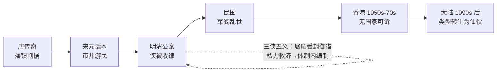

# 武侠小说的批判

> 目的：不是鉴赏，是**结构批判**——把"江湖"当成一个政治经济体来审，追问它对什么避而不谈、靠什么前提成立、为什么在它的黄金时代之后无法再生。
> 本文是讨论底稿，论点可推翻；每轮讨论后追加，不重写。

---

## 0. 标记约定

| 标记 | 含义 |
|---|---|
| 【文本】 | 小说正文可查的具体情节、人物、设定 |
| 【史实】 | 可考的文献、年代、作者生平 |
| 【通说】 | 学界或评论界的通行判断，非铁证 |
| 【推论】 | 由前两者推出，本文自负 |
| 【本稿判断】 | 本文立场，允许被反驳 |

---

## 1. 总纲：三个结构性空白

武侠小说全部建立在三个它自己从不结算的账上：

| 空白 | 内容 | 后果 |
|---|---|---|
| **经济真空** | 门派、镖局、江湖人的钱从哪来 | 江湖被写成一个不生产、只消费的社会；武力因此没有成本约束 |
| **司法真空** | 为什么私力救济是正当的 | 侠的合法性寄生于国家失败；国家一强，类型即失效 |
| **继承真空** | 武功如何跨代传递、如何定价、如何失传 | 全部叙事冲突被压缩成"夺秘笈 / 清理门户 / 叛徒"三个母题 |

【本稿判断】这三条不是缺陷，是**类型的前提**。武侠之所以能成立，正因为它把这三笔账悬置了；也正因为悬置，它无法处理现代性。

---

## 2. 武是什么，侠是什么

### 2.1 武：一次被篡改的字源

- 【史实】甲骨文、金文的"武"作"止 + 戈"，会意为**持戈行进**；现代古文字学释"止"为"趾"（脚、行走），不是"停止"。
- 【史实】"止戈为武"出自《左传·宣公十二年》楚庄王论邲之战："夫文，止戈为武……夫武，禁暴、戢兵、保大、定功、安民、和众、丰财者也。"《说文解字》沿用此说。

【推论】"止戈为武"不是字源，是**春秋贵族对暴力的自我节制宣言**——把"打"重新解释成"为了不打"。
【本稿判断】武侠叙事的全部道德自信（"以武止武""杀是为了不杀""练武是为了不用武"）都建立在这个**拆字误读**之上。类型的第一块基石是一句训诂误读。而楚庄王原话的重点其实是后半句：武的合法性在于它**产出秩序与财富**（禁暴、定功、安民、丰财）——这一点武侠小说反而彻底丢了。

### 2.2 武的出现：暴力分工

三个条件让"武"成为一门可以脱离国家持有的技艺：

| 条件 | 内容 | 后果 |
|---|---|---|
| 技术 | 铁器与步兵兴起（车战衰、步战兴），个体武艺第一次有战场价值 | "能打"可被个人占有 |
| 社会 | 【通说】顾颉刚《武士与文士之蜕化》：古之士皆武士，春秋战国文武分途，失职武士流为游侠 | 出现了**不属于任何人的武力** |
| 传承 | 师徒制，技艺可跨代复制 | 武力成为可积累的资产（见 §4） |

【推论】武的历史意义不是"人能打"，是"**能打的人可以不属于国家**"。在此之前，暴力是统治权的专属物；此后它开始有私人持有者。武侠这一类型，是这个历史缺口在文学上的长期回声。

（互补解释：为什么偏偏是"武"被文人选中、被读者买账，见 §8。）

### 2.3 侠：一个全是否定式的定义

武在社会中本来只有三个位置：

| 位置 | 谁付钱 | 名称 |
|---|---|---|
| 国家 | 俸禄 | 兵、将、捕快 |
| 市场 | 佣金 | 镖师、护院、刺客 |
| 反国家 | 抢 | 盗、匪、寇 |

侠是第四个位置：**拒绝前三种定价的武**。定义由三条否定构成：

- 不领饷 → 不事王侯
- 不收钱 → 仗义疏财
- 不劫掠 → 除暴安良

【本稿判断】侠没有正面定义，只能反面列举。所以武侠小说永远无法证明主角是侠，只能证明他**不是**打手、**不是**官差、**不是**强盗。这解释了类型里的几个怪癖：
- "仗义疏财"地位极高——**疏财是拒绝市场定价的收据**；
- 大侠往往穷、往往不肯做官、往往被通缉——三条否定每去掉一条，侠就退化成上表里的某一格；
- 好人必须比坏人更不赚钱，否则读者无法判定阵营。

### 2.4 武后为什么跟着侠

关键在顺序：**先有武，侠是事后追认。**

1. **武单独存在时没有辩护。** 韩非已经定罪："侠以武犯禁"。一个人能杀而社会不能阻止，这件事本身就是秩序的漏洞，不需要他做错任何事。
2. **追认需要一个发行方。** 国家不给（给了就是兵），市场不给（给了就是镖师），于是只剩"江湖舆论"——一个**没有强制力的第三方**。
3. **所以武侠的道德永远是舆论道德。** 靠"天下人怎么看"执行，靠"后世评说"结算；失信者不是被判刑，是被"江湖不齿"。

【推论】武侠的叙事结构因此被锁死为：**先打，后解释为什么打得对**。每一场打斗后都必须跟一段道义说明，或由旁观者转述，否则读者无法确认这是侠还是匪。这是类型的结构性冗余，也是它写不出"沉默的暴力"的原因——沉默的暴力在舆论体系里无法被追认为侠。

一句话：**武是能力，侠是许可证；许可证的签发机关不存在，只有见证人。**

### 2.5 分期：武的五种文学形态

| 时期 | 武的形态 | 合法性来源 | 代表 |
|---|---|---|---|
| 史传（汉） | 体力 + 信义，几乎不写技术 | 司马迁的道德翻案 | 《史记·游侠列传》 |
| 传奇（唐） | 异术（剑术、隐身、药） | 报恩 / 知己 | 聂隐娘、红线 |
| 公案（清） | 技击，纳入官府 | 清官授权 | 《三侠五义》 |
| 民国 | 国术（门派化、内功雏形） | 民族 / 强国保种 | 《江湖奇侠传》《蜀山剑侠传》 |
| 新派（1950s–） | 内力体系 + 招式量化 | 江湖舆论 + 政治寓言 | 金庸、古龙 |

- 【史实】梁启超《中国之武士道》(1904) 把侠国族化；1928 年中央国术馆成立，"国术"成为国家工程。
- 【通说】"侠"字先秦仅见于《韩非子》一类法家语境，作为社会角色的"游侠"要到战国末年养士之风（四公子）才成形。
- 【本稿判断】"内功"是晚出的：唐传奇的侠用异术不用内力，招式的细描要到民国才系统化。武在文学里被不断**内化**（异术 → 气 → 内力 → 境界），每一次内化都把暴力从"物理层面"搬到"不可验证层面"。不可验证，才好辩护。

---

## 3. 江湖不在国家之外，在国家之内

### 3.1 原判与翻案

- 【史实】《韩非子·五蠹》："儒以文乱法，**侠以武犯禁**。"——侠从定义上就是国家法权的对立面。
- 【史实】《史记·游侠列传》反拨："其言必信，其行必果，已诺必诚，不爱其躯，赴士之厄困。"——司马迁把"犯禁"转译成"信义"，这是第一次为私力救济做道德辩护。
- 【通说】王学泰《游民文化与中国社会》：江湖的实体是**脱离宗法共同体的游民社会**，其伦理（义气）是游民在无国家保护下的互助保险。

【推论】"义气"不是道德高地，是**没有法院时的合约执行机制**。它之所以必须用性命担保，是因为没有第三方强制力。

### 3.2 钱的问题

金庸几乎从不写门派的收入来源。《笑傲江湖》里青城派灭福威镖局满门，是全书少数把**暴力直接接到商业**上的地方：镖局是江湖与市场唯一的接口，接口一断，林家的资产（辟邪剑谱）就被重新分配。

【推论】武侠的经济学是：**武力不生产，只重新分配**。所以江湖必须永远存在"可被重新分配的东西"——秘笈、宝藏、掌门之位、女人。这就是麦高芬的生产线。

【本稿判断】写得越"纯"的江湖，越依赖一个隐形的国家补贴：官府提供秩序，门派才有田租；商路提供货源，镖局才有生意。武侠小说从不写这笔补贴，因为一写，"侠"就降格成"武装承包商"。

---

## 4. 武功的产权结构

### 4.1 内力的三个物理属性

| 属性 | 含义 | 叙事后果 |
|---|---|---|
| 累积性 | 越练越强，与年龄正相关 | 老人天然是强者；少年主角必须靠"奇遇"跳级 |
| 身体性 | 不可转移、随死亡归零 | 必须收徒；师承即产权 |
| 不可复制性 | 秘笈可抄，但"练成"不可复制 | 知识资产化 → 盗版（偷学）、专利（门派禁传）、侵权诉讼（清理门户） |

【推论】"清理门户"本质是**产权纠纷**；"叛徒"是**技术泄露**；"夺秘笈"是**恶意收购**。武侠小说的冲突引擎不是侠义，是产权。

### 4.2 文本证据

| 作品 | 争夺对象 | 性质 |
|---|---|---|
| 《射雕英雄传》 | 九阴真经 | 引发第一次华山论剑——用比武给资产定价 |
| 《笑傲江湖》 | 辟邪剑谱 | 镖局家产 → 门派兼并 |
| 《连城诀》 | 连城剑法 + 宝藏 | 剑谱即藏宝图：知识资产与实物资产捆绑 |
| 《倚天屠龙记》 | 屠龙刀 / 倚天剑 | 兵器即期权，内含兵书与秘笈 |

【本稿判断】四部代表作的核心麦高芬**全是资产，没有一个是理想**。这说明类型的深层逻辑是产权而非道义；"侠义"是包裹在产权斗争外面的合法化话术。

### 4.3 折旧问题

内力会随死亡归零，但秘笈不会。所以江湖的长期趋势是**秘笈通胀、高手通缩**：文本里越是晚期，越强调"失传"与"残缺"（降龙十八掌传到后人只剩十二掌）。

【推论】武侠世界是一个**知识存量递增、执行者递减**的经济体——这解释了它为什么总带着挽歌气质。它不是对未来的想象，是对过去的哀悼。

---

## 5. 侠的合法性：一次失败的司法外包

（承接 §2.4：侠的许可证由江湖舆论签发。本节问的是——这张许可证在历史上有没有被别的机关签发过。）

### 5.1 免责条款

武侠为私力救济准备的标准辩护只有一条：**恶人先动手**。

【推论】这条免责条款的成立，预设了两件事：（1）司法已经失效或不可达；（2）恶人的恶是可观测的。两条同时满足，侠才免于"以武犯禁"的原判。所以武侠必须持续生产"官府管不了的恶"——**恶的质量决定了侠的必要性**。

### 5.2 国家能力曲线

- 【史实】清末《三侠五义》：展昭受封"御猫"，侠正式进入官僚系统。**这是类型史上唯一一次"司法外包成功"的实验**，之后被抛弃。
- 【史实】1954 梁羽生《龙虎斗京华》、1955 金庸《书剑恩仇录》起，新派武侠在香港成熟。南来文人 + 殖民地 + 难民社会：**三重意义上的国家缺席**。
- 【推论】武侠的黄金时代总在"国家不在场"的地方。香港不是偶然，是必要条件。

### 5.3 为什么它在大陆失效

【本稿判断】不是因为写坏了，是因为前提没了。当代中国的读者不生活在司法真空里，"恶人先动手"这条免责条款失去经验支撑，于是类型必须换壳：仙侠用"境界"替换"内力"，用"宗门"替换"门派"，用"灵石"替换现金——**它补上了武侠原本缺的经济账，代价是彻底退出人间**。

---

## 6. 力量通胀与体系内卷

| 力量模型 | 成本 | 叙事后果 | 代表 |
|---|---|---|---|
| 内力 | 时间（数十年） | 老人强、少年需奇遇；层级可通胀 | 金庸 |
| 招式 | 几乎为零 | 决斗变成博弈与心理 | 古龙 |
| 境界 | 无限可分（练气→筑基→…） | 数值化、可无限续写 | 仙侠 |

- 【文本】《鹿鼎记》：主角不会武功。金庸用一部反武侠终结了自己的体系——**作者本人先承认了体系破产**，然后封笔（1972）。
- 【文本】古龙的解药：抽掉招式与内力的量化，把决斗压缩成一瞬间的心理对赌（"小李飞刀，例不虚发"）。代价是**动作性消失**——冲突从"怎么打"变成"敢不敢打"。
- 【推论】力量体系的通胀不可避免，因为连载需要不断的强度刺激；通胀的尽头必然是数值化，而数值化的尽头是人间蒸发。

---

## 7. 身体政治：唯一被认真结算的账

- 【文本】《神雕侠侣》杨过断臂；《笑傲江湖》岳不群、林平之自宫。
- 【推论】武侠里所有"代价"都被写成**身体代价**，因为经济代价它不会算。断臂与自宫是类型最诚实的时刻：它承认力量必须用别的东西换，只是它只会用身体记账。这也回到 §2.4——身体是唯一不需要舆论追认就能被看见的证据。
- 【通说】女性角色的三重功能：胜利的奖励（婚配）、秘笈的容器（"得她即得传承"）、暴力的证明（被杀以激怒男主）。这不是作者个人的偏见，是产权叙事对"人"的分类——女性在产权表上没有格，只能作为**资产**或**对价的单位**出现。

---

## 8. 谁在写，写给谁：武力作为替代品

（本节回应一个竞争性解释：武的出现由作者与读者的社会位置决定，而非文学内部逻辑。结论：该解释对**起源期**成立、对**成熟期**不成立；两者错开，正好解释类型的两次转向。）

### 8.1 命题

> 武侠作者多是失意文人（少有真正的武者），需要武力去打破社会桎梏；选择武力而非其他工具与受众有关——早期面向小知识分子，后来面向大众，快意恩仇比绵延千里的阴谋更符合短期快感的摄取。

【本稿判断】三条中，第一条基本成立；第二条要改写（文人要的不是武力，是发言权与评分权）；第三条要加一个**媒介变量**，否则解释不了同一批读者为什么后来读得下《笑傲江湖》和《鹿鼎记》。

### 8.2 第一条：作者确非武者，而且越成熟越不是

| 作者 | 本业 | 与武术的关系 |
|---|---|---|
| 平江不肖生（向恺然） | 留日学生、后参与国术活动组织 | **真习武**，民国少数练家子 |
| 还珠楼主（李寿民） | 机关职员、记者 | 无 |
| 宫白羽 | 报社校对、编辑，潦倒 | 无 |
| 王度庐 | 教师、小职员 | 无 |
| 梁羽生（陈文统） | 岭南大学经济系 →《大公报》编辑 | 无记载 |
| 金庸（查良镛） | 《大公报》记者 →《明报》创办人 | 无 |
| 古龙（熊耀华） | 职业小说家 | 无（有帮派经历传闻，无武学） |

【推论】唯一真正习武的是类型**开端**的平江不肖生；类型一旦能养活职业写手，练家子就被文人替换。**武侠不是武者写的，是文人写的，而且越成熟越是如此。** 这一条对用户的命题是强支持。

### 8.3 第二条改写：文人要的不是武力，是被武力庇护的发言权

失意文人在结构上缺的不是"打人的能力"，是**评价权**——科举是唯一正当出口，落第即结构性失败，而评判标准不在自己手里。

【本稿判断】所以武侠是**代理幻想**（proxy fantasy），不是力量幻想：文人不是在**拥有**武力，是在**指挥**武力。证据：

- 金庸的主角几乎都有文士底子：张无忌通医理，段誉读佛经，令狐冲能谈诗论酒，陈近南文人出身。
- 最能打的人往往最守礼、最讲诺、最"文"；真正粗野的武者（桃谷六仙、裘千丈）是丑角，丁春秋是反派。
- 武力被系统性**去身体化、去粗野化**：不写汗、不写伤、不写脏，写气度。

【推论】真实的武者世界（镖局、帮会、军旅、国术馆）里身体是账本；武侠里身体是修辞。这一条同时解释了 §7 的现象：武侠只会用身体记账，却从不写身体的实感。

### 8.4 第二条补：不只缺力量，更缺一个不会误判你的考场

命题里没提、但可能是最强的补偿物：

【本稿判断】武侠提供了一个**完全可量化、完全公开、不需要推荐人的地位系统**——武功高低、华山论剑、兵器谱排名。它对落第文人最诱人之处不是"我能打"，是"**打赢就是打赢**"：一个不会因门第、籍贯、荐举而误判的考场。

- 【文本】古龙《多情剑客无情剑》的"兵器谱"（百晓生排定）几乎就是科举榜单的镜像：公开排名、逐条对位，名次驱动全部情节。
- 与 §2.3 侠的三条否定自洽：不入编制、不收钱、不靠关系，只靠打赢——三条否定合起来，正是一个**纯绩效社会**的入场条件。

【推论】武侠的深层许诺是**程序正义的替代品**：既然现实中的评估体系不可信，就发明一个只认结果的。这也解释了为什么武侠里"比武"总比"打斗"多——**比武是考试，打斗是事故**。

### 8.5 第三条：快意恩仇 vs 阴谋，要加发行形式这个变量

单用"受众喜欢短期快感"解释力不够：同一批读者后来也能读下去大阴谋结构。真正的差别在**发行形式**——载体怎么收钱，叙事就怎么结算。

#### 8.5.1 发行形式表

| 发行形式 | 收费方式 | 结算周期 | 叙事强制 | 后果 |
|---|---|---|---|---|
| 报纸副刊连载（1920s–70s） | 订阅整份报纸，内容白送 | 天 | 每天一个能独立读完的高潮 | 快意恩仇、单元剧、章末钩子 |
| 租书铺分册（民国–80s 港台/大陆） | 按**册**按天计费 | 册 | 越长越赚钱 | 灌水、无限续写、《蜀山》近二十年未完 |
| 单行本（1970s–） | 一次性买断 | 卷/套 | 一卷之内要能自洽 | 结构完整、可以埋线、作者改稿 |
| 影视（1970s–90s） | 广告 / 收视 | 集 | 每集一高潮 + 片尾悬念 | 场面优先、人物简化、武功视觉化 |
| 网络章节付费（2000s–） | 按千字订阅 + 月票榜 | **章** | 每章必须有爽点，断更即掉榜 | 爽文、日更、字数军备 |

【推论·结算周期定律】**载体的结算周期决定叙事的结算周期。** 结算越频繁，叙事越短促；结算越稀疏，叙事越能延宕。这一条能统一解释 §6 的力量通胀（连载需要持续强度刺激）与本节标题里的"快意恩仇"（日结所以日爽）。

#### 8.5.2 三个可检验的推论

1. **租书铺造长度，报纸造节奏。** 按册计费的分发体系奖励字数，报纸连载奖励节奏。民国武侠动辄数十册、还珠楼主《蜀山剑侠传》1932 年起连载近二十年仍未完结，是前者的产物；金庸每部三四十万字即收，是后者的产物。
2. **修订是体裁转换工程。** 【史实】金庸在 1970 年代、1980 年代两次系统修订全部作品。修订的必要性本身就证明：报纸连载形态与单行本形态对叙事的要求不同，作者自己承认了这一点。
3. **读者关系而非读者品味决定结构。** 金庸自立《明报》后读者由"随机"变"固定"，同期作品从单元剧转向长线权谋（《笑傲江湖》《鹿鼎记》）。**换代的是传播关系，不是读者。**

#### 8.5.3 大陆的入口不是小说

【通说】1980 年代大陆的武侠热，第一媒介是影视而非文本：1982 年《少林寺》、1983 年无线《射雕英雄传》（1985 年引进大陆）先于系统出版培养了读者。同期流通的主力是租书摊与连环画。

【本稿判断】这意味着大陆读者对武侠的**默认记忆是影像化的**：降龙十八掌是特效姿势，不是文字招式。所以大陆后来接手的类型（仙侠）天然按"视觉奇观 + 集数结构"生长，与港台按"连载节奏"生长的武侠不是同一棵树。

#### 8.5.4 网络是报纸的极端化，不是断裂

【通说】起点模式（2000s 起）按章订阅、月票榜排名，反馈周期从"天"压缩到"章"。

【推论】网络类型文不是新物种，是**报纸连载的周期被进一步缩短**：同样的日结逻辑，结算单位从"一天"变成"一章"，于是爽点密度、字数军备、断更惩罚全部等比放大。仙侠/玄幻之所以能取代武侠，除了 §5.3 说的合法性前提消失，还因为它的力量模型（境界，见 §6）**无限可分、可无限续写**——最适合按章结算的发行形式。

一句话：**武侠的形态不是文人想出来的，是发行形式逼出来的；作者只是把结算压力翻译成情节。**

### 8.6 这个命题解释不了谁

【本稿判断】"失意文人"假设解释不了金庸。他办《明报》、写社评、掌握话语权，从任何意义上都不是失意者；而他后期恰恰从"快意恩仇"转向"制度批判"（《笑傲江湖》写权力，《鹿鼎记》写无道德的成功）。

按代际切开：

| 世代 | 作者社会位置 | 作品动力 | 代表 |
|---|---|---|---|
| 民国 | 真失意（宫白羽自嘲"文丐"，王度庐穷困） | **补偿**：悲情、恩仇、身世飘零 | 《十二金钱镖》《卧虎藏龙》 |
| 香港新派 | 成功报人（金庸、梁羽生） | **寓言**：权力如何运作、正派如何腐化 | 《笑傲江湖》《鹿鼎记》 |

【推论】**"失意文人的补偿幻想"是起源期的解释，不是全期的解释。** 类型一旦获得话语权，作者就从"想赢"变成"想解释为什么赢不了"。这不是反驳命题，是把它放回真正有效的时间段。

### 8.7 与 §2.2 的关系

§2.2 的历史条件（铁器、文武分途、师徒制）回答"武为什么在现实中可能存在"；本节回答"为什么偏偏是武被选作文人幻想的载体"。两者互补：

- 历史条件让武力成为**私人可持有、不需第三方执行**的工具；
- 作者位置让这种工具成为**无权者最容易幻想**的工具。

一句话：**武之所以被选中，不是因为它强，是因为它是唯一不需要机构就能兑现的力量。** 计谋要有衙门，法律要有法院，财富要有市场，只有身体不需要对手方。

---

## 9. 对写作的启示（待展开）

如果按上面的批判写一部武侠，可写与不可写：

| 不写 | 写 |
|---|---|
| 夺秘笈、清理门户、复仇 | 秘笈的**定价与折旧**：谁出钱买、买来怎么保值 |
| 江湖的义气 | 义气作为**无法院社会的合约执行机制**，及其违约成本 |
| 大侠的孤独 | 门派作为**企业**：田租、徒工、师徒契约、破产 |
| 与官府的对立 | 官府与门派的**外包关系**：赏银、招安、白手套 |

【本稿判断】唯一能让武侠重新成立的写法，是把三笔账全部结算：钱哪来、法哪去、功夫怎么传下去。补齐之后它就不再是"武侠"了——这恰恰是写它的理由。

---

## 10. 开放问题（下一轮讨论）

1. 武侠的"义"能否在没有国家的条件下真的执行？历史上游民会社（洪门、青帮）的仲裁机制是怎么运作的，代价是什么？
2. 秘笈经济学：知识资产的保密成本 vs 收益，什么条件下门派会选择"公开教学"（少林 vs 华山）？
3. 如果结算经济账，"侠"还剩什么？还是说侠本来就只是**司法真空下的临时仲裁者**，司法一恢复就该退场？
4. 古龙式的"去量化"是不是唯一的反通胀解？还有没有第三条路（例如把通胀写成主题本身）？
5. 侠的许可证既然只有见证人，能否**制度化**？即：江湖有没有可能长出一套仲裁机构（武林大会、掌门联席会议），而这套机构为什么在文本里总是失败的？
