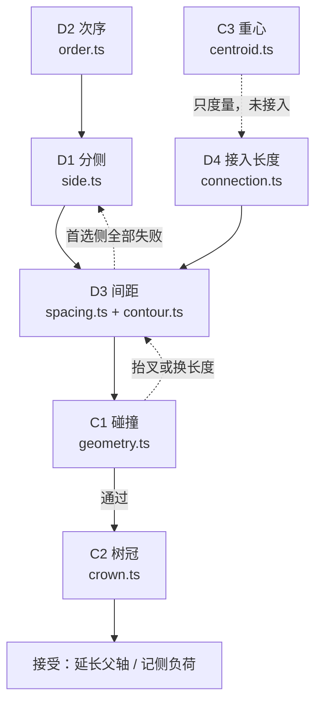

# 树形谱系生成算法

一句话：

> 谱系图的「自然」不是画出来的。它是**把一条条可判定的约束丢进有限搜索**之后，最后剩下的那个形状。

所以本文不按「先画树干、再挂相框」讲，而按**约束从哪来 → 怎么拆成阶段 → 每个阶段搜什么 → 失败了怎么办 → 怎么证明没有退步**来讲。全部数字都能用仓库里的命令复现，见最后一节。

---

# 零、先把「这是什么问题」答对

因为它决定了后面所有设计。

**问题**：给定一棵有根树、每个人一个相框，怎么画成「像树」的谱系图？这是图形学问题、美化问题，还是别的？

三个递进的答案：

## 答案一（多数人停在这）

```text
谱系图 = 树 + 布局算法 + SVG 绘制
```

三个事实都对，但解释不了任何设计：

- 主干为什么必须一直冒尖？
- 为什么接入段偏偏是 80，不是 60 或 120？
- 为什么分叉搜索从 `above + below + gap = 54` 开始，而不是只让相框上方空出来？

## 答案二（好一点）

```text
谱系图 = 一组可读性约束下的可行解
```

有取舍感了，但没说清**约束从哪来**、**谁来满足**。

## 答案三（可操作的）

```text
谱系图 = 数据契约 + 可读性约束 + 有限搜索 + 可重放验收
```

每一个非平凡设计，原因只有四类：

| 类别 | 形态 | 例 |
| :--- | :--- | :--- |
| **数据契约** | 输入允许什么 | 输入是有根树，不是 DAG，所以不做多人婚配、共享子女 |
| **可读性硬约束** | 必须满足，否则不出版 | 枝不穿框、框不重叠、父子边可追踪、人物朝上 |
| **搜索自由度** | 可以试，试完要选一个 | 侧别 ±1、分叉高度 `step`、接入长度阶梯 |
| **演化证据** | 上一轮怎么验证的 | 每加一个自由度，先有反例，再有不漂移的 A/B |

**判据**：任取一个常量或规则，问它属于上面哪一类。四类都解释不了，它多半是作者偏好或没清理的技术债——这也是[第十节](#十参数的归属判据)那张表的作用。

## 它不是什么

| 不是 | 为什么 |
| :--- | :--- |
| 力导向 / 物理仿真 | 同一输入可能给不同输出，直接违反「同一输入同一结果」；而且没人能解释「这两个框为什么挤」 |
| tidy tree（Reingold–Tilford 一类） | 节点中心就是分叉点，父节点没有属于自己的枝轴；子节点等距、边正交，画不出主干—分枝—枝梢的收细 |
| 分层 DAG（d3-dag 一类） | 它画的是父子边本身，不是每个节点自己的枝轴；上一版以此为基础的设计已随「独占枝轴」的采纳一并撤回 |
| 全局最优打包器 | 组合空间不接受证明；产品要的是「有界时间内出图，或给出可定位的失败」 |
| 装饰性树 | 叶片、纹理不能遮住布局缺陷，需求把「装饰从属于已通过验收的结构」写成硬规则 |

更准确的类比：**带几何门禁的递归打包（bin packing）+ 树的确定性遍历**。不是绘图，是求解。

---

# 一、输入与验收：先把硬约束和软目标分开

## 1.1 数据边界

输入是 `TreeNode = { id, children }`，进布局前必须全部成立：

| 规则 | 不合格的后果 |
| :--- | :--- |
| 恰好一个根 | 多根或零根拒绝 |
| 无环 | 环在递归里会无限下钻 |
| 无共享子节点 | 同一对象被两个父亲引用，人数负载会重复计 |
| ID 唯一 | 侧负荷、冲突归属、相框定位全部按 ID 索引 |

这些由 `src/validate-tree.ts` 在**没有任何坐标之前**判完。不把「多人婚配、共享子女」的 DAG 静默复制成树——那是另一个需求，不是已取消的承诺。

## 1.2 硬约束 / 软目标

| 级别 | 内容 | 判断方式 |
| :--- | :--- | :--- |
| 硬 | 人物与父子边完整、可追踪、不虚构 | 布局返回的坐标集必须覆盖全部节点；输入不变 |
| 硬 | 根在下、整体向上、存在连续主干与收细枝梢 | 枝轴方向受 70° 上限；每个节点必须冒尖 |
| 硬 | 相框与文字不互相覆盖，非关联枝不遮人物 | 几何门禁；标签用 `textLength` 夹在框内；最终场景整棵复核一次 |
| 硬 | 确定性：同一输入同一结果 | 布局是纯函数，不读时间、不用随机数 |
| 软 | 少交叉、紧凑、视觉平衡、自然姿态 | 验收指标（第八节），只降不升 |
| 软 | 允许不对称 | 不用「左右人数相等」替代视觉平衡 |

最容易写错的一条是最后一行：**单侧大子树不能被压扁成对称**。需求明确禁止为了居中去动关系、顺序和间距。

## 1.3 视觉参考只提供外观

参考图只能观察「主干连续、分枝收细、框挂在枝上、冠形不对称」这些外观；**从像素反推不出父子关系**。所以实验不把参考图里的人名猜成数据集，也不复制纹理和原作资产。

---

# 二、结构规则：每个节点独占笔直枝轴

这是整棵树的骨架，也是被否决方案最多的一条。

## 2.1 规则

1. 每个节点**独占**一条笔直枝轴：父轴上的分叉点 → 本节点相框 → 自由末端；相框以上的部分是它的「冒出部分」。
2. 子节点从父枝轴上的**分叉点**生长，不从父相框中心长。
3. 有**两个及以上**子节点时，任何子枝都不得与父轴共线，首轮固定 ±32°。
4. 恰好**一个**子节点时，子枝**继承父轴方向**（相对角 0°），父轴在该分叉点结束，两段等宽相接，拼成连续主干。
5. 所有枝轴必须保持向上：绝对角超过 70° 就翻面，翻面仍超限直接抛错，不允许画「向下枝」逃避碰撞。
6. 子相框中心沿接入段距分叉点优先 80；只有整棵候选在完整门禁下放不下时，才拉长接入段。
7. 相框保持水平；间距用旋转不变的中心距，而不是轴对齐缝隙。

```text
            ^           ← tip = max(最高叉, 本叉预留) + 44
            │
       n2 ──┼── n3      ← 子枝与父轴 ±32°（本行压平仅为标注）
            │
            │
      ┌─────┴─────┐
      │    n1     │     ← 相框中心沿接入段距分叉点 80
      └─────┬─────┘
            │
            │
            o           ← 本节点枝轴起点；父轴在此继续上升
```

## 2.2 为什么首叉是 54，不是 33

相框 `above = 21 / below = 21 / gap = 12`。要让分叉「跑到相框上方」，直觉是 `above + gap = 33` 就够。

但离开相框的那段枝轴会被**上方兄弟**扫过：兄弟在更高的分叉点上向另一侧生长时，枝带会横掠过本节点的上半段。所以预留必须覆盖整个相框再加缝：

```text
firstForkHeight = above + below + gap = 54
```

`src/layout/spacing.ts` 里就是这一行。对默认相框，它把首叉从 33 抬到 54，多出的 21 就是「别人扫过来时你还占着的位置」。

## 2.3 独子为什么必须共线

主干的自然形态里，一根只有单传的树干不应该无缘无故偏一下。规则改成「恰好一个子节点 → 相对角 0°」之后：

| 现象 | 修改前 | 修改后 |
| :--- | ---: | ---: |
| `axisMoment` p50（全体人物横向一阶矩） | 0.513 | **0.344** |
| `branchMoment` p95（分叉节点两侧平衡） | 0.845 | **0.778** |
| 基础接入占比（接入长度仍为 80 的比例） | 0.911 | **0.961** |
| aspect p50（高 / 宽） | 1.572 | **1.377** |
| aspect p95 / max | 2.208 / 2.673 | 3.365 / **7.552** |
| height max | 1396.7 | 1499.1 |

主干不再逐层漂移，代价是**直链条不再靠左右折射扩宽**，于是又细又高。验收门槛按流程重新冻结（见第八节），不是把指标改到「看起来能过」。

## 2.4 被拒绝的替代

| 方案 | 为什么不行 |
| :--- | :--- |
| 多子树时选一枝延续父轴 | 等于在兄弟之间选「主干」，某个孩子凌驾于其它孩子之上；且违背「每个节点独占枝轴」 |
| 所有子节点都在父节点中心分叉 | 父节点没有独立的分叉区间，树干被子节点共享 |
| 共享一条跨代主干 | 更像真树的领导枝，但节点无法独占枝轴 |
| 只在父框上方加装饰短桩 | 不改变连接结构，子节点仍可能共线 |
| 轴对齐包围盒间距 | 子树是被**旋转**后拼上去的，旋转后 AABB 判定会拒绝自己原本合法的子树——实测被否决 |

共线也不是无条件放行：只允许**端到端相接**（子枝起点 = 父枝终点）。共线但中段重叠，仍然是 `branch-branch` 冲突。

---

# 三、阶段、回退边与不变量

## 3.1 它不是一个五步流水线

用户视角的五步是：分侧 → 单侧排序 → 单侧间距 → 左右重心 → 树冠相对根。作为**阅读顺序**成立；作为**求解顺序**不成立，因为：

- 排序与间距共用「分叉高度」这一个自由度；
- 重心与树冠共用「父轴长度」这一个自由度。

所以契约写成：**五个决策/约束点 + 三条回退边 + 一个共享输入（已占用空间）**。

## 3.2 阶段表

| 阶段 | 模块 | 角色 | 自由度 |
| :--- | :--- | :--- | :--- |
| D1 分侧 | `src/layout/side.ts` | 决策 | 每人 1 bit |
| D2 次序 | `src/layout/order.ts` | 启发式 | 排列 |
| D3 占用预算 | `src/layout/contour.ts` | 下界（跳过无望的步） | — |
| D3 走廊预留 | `src/layout/contour.ts` | 约束 | — |
| D3 间距 | `src/layout/spacing.ts` | 决策 | 每叉 1 个标量 |
| D4 接入长度 | `src/layout/connection.ts` | 决策 | 每枝 1 个标量 |
| 裸主干比例 | `src/layout/index.ts` | 决策（固定点） | 根的第一级分叉下限 |
| C1 碰撞 | `src/geometry.ts` | 约束 | — |
| C2 树冠 | `src/layout/crown.ts` | 约束 | — |
| C3 重心 | `src/layout/centroid.ts` | 度量，**未接入** | — |
| 挂载外观 | `src/mount.ts` | 渲染 | 只通过 envelope 影响间距 |

## 3.3 回退边



| 回退边 | 含义 | 状态 |
| :--- | :--- | :--- |
| D3 → D1 | 首选侧所有「长度 × 高度」都放不下 → 换另一侧 | 已实现，受全局 32 次预算限制 |
| C1 → D3 | 本叉冲突 → 抬高分叉重试；仍不行 → 下一个接入长度 | 已实现 |
| C3 → D4 | 重心超阈值 → 调整接入长度 | **未实现**，只输出诊断值 |

只有一种错误能触发 D3→D1：`NoPlacementError`（`code === 'STEM_NO_PLACEMENT'`）。参数错、输入错、最终装配错一律向上抛，**不重试**——重试会把「配置写错了」伪装成「这棵树画不出来」。

## 3.4 不变量

1. `layoutStemScene` 是纯函数：不读文件、不写文件、不改输入、不依赖时间或随机数。
2. 阶段之间只传值：长度阶梯返回新数组，附着返回新子树，求解器不写父几何。
3. **接受之后**才延长父轴：`segments[0].to = stems[0].tip = accepted.tip`（独子延续时改接子枝起点）。
4. 侧负荷只统计已接受的子树；失败尝试不留痕。
5. 全部候选失败时抛错，附带节点与冲突对；不返回带冲突的「成功图」。
6. 最终仍对整个场景做一次 C1 复核。

---

# 四、逐阶段：公式与代码

## D1 分侧

```ts
let sign = leftLoad <= rightLoad ? 1 : -1;
if (leftLoad === rightLoad) {
  const left = Math.abs(parentAngle + params.tilt);
  const right = Math.abs(parentAngle - params.tilt);
  if (left > right) sign = -1;
  else if (right > left) sign = 1;
  else sign = depth % 2 ? -1 : 1;
}
```

四条规则，按优先级：**轻侧优先 → 更接近垂直的一侧 → 深度奇偶交替 → 超 70° 翻面一次，翻面仍超限直接抛错**。

平局的第二、三条是整段里最容易被忽略的：平分时先回弯到更接近垂直的方向，两侧一样近才按深度交替。否则单链会一级一级往同一侧漂。

## D2 次序

```ts
.sort((a, b) => b.node.load - a.node.load || a.index - b.index)
```

子树人数降序，输入顺序只用来破平局。**处理顺序不等于最终高度**：每个候选都从同一初始高度开始搜索，重枝先处理只保证它「先挑位置」，不保证它最后更低。

输入数组顺序不等同出生顺序——需求里写死了它只用于确定性破平局。

## D3 间距

```text
首叉高    first    = above + below + gap
分叉下限  floor    = max(first, 上次分叉 + minForkGap)
搜索窗    maxHeight = max(first,
                       top - bottom
                       + 2 * hypot(width/2 + gap, above + below + gap)
                       + tip)
步数      steps    = min(maxHeightSteps, ceil((maxHeight - first) / step))
抬叉余量  reserved = height + (attempt > 0 ? step : 0)
```

- `top` 是已放几何的最高点，`bottom` 是候选几何相对最低点减首叉高。
- 窗口里的 `2 * hypot(...)` 是上下各让一帧的中心安全距。
- `step = 6`：高度不是连续变量，是 6 一格的有界扫描。

## D3 预算：先算一个下界，跳过无望的步

`frameBudget` 对每一对「候选框 × 已放框」检查：列向距离够近、纵向还没拉开时，抬到多高才能清开。取最大值作为扫描起点。

```ts
if (dx >= gap) continue;                       // 列向已经够远，永不碰撞
const vertical = Math.sqrt(gap * gap - dx * dx);
const dy = (p.y + shift) - (q.y + shift);
if (Math.abs(dy) >= vertical) continue;        // 一上一下，抬多高都修不好
const needed = q.y + vertical - p.y;
```

它只是**跳过**，不是裁决：门禁仍然是权威。预算没覆盖到的枝—框、枝—枝冲突照样由 C1 判。这一步把候选高度扫描从「每个都试」压到「从能行的地方开始」——首版实现时，200 棵树里跳过了 1 986 / 33 109 个候选高度，输出逐字节不变。

## D3 走廊：为「还没放上去的兄弟」留空间

这是唯一一条**替未来预留**的规则。附着时要求候选子树的所有相框都不进入父轴走廊：

```text
|frame.x| ≥ frame.width / 2 + gap = 24 + 12 = 36
```

判定**不设高度上限**：一个高于当前树冠的框，恰恰就是后续兄弟抬高枝轴时会扫到的那一个。把前瞻限制在当前冠高，实测退化成「等于关闭这条规则」。

延续段（独子）跳过这条——那条父轴不会再有兄弟需要扫过。

## D4 接入长度

```ts
const lengths = [params.connect];
for (let extra = params.connectionIncrement; lengths.at(-1)! < params.maxConnect; extra *= 2) {
  const next = Math.min(params.maxConnect, params.connect + extra);
  if (next === lengths.at(-1)) throw new RangeError('Connection increment is below numeric precision');
  lengths.push(next);
}
```

默认阶梯 `80 → 104 → 128 → 176 → 272 → 464 → 848 → 1616`（增量从 24 开始翻倍）。

它只在**失败之后**才用：先试 80，所有分叉高度都冲突了才拉长。200 棵树里 96.1% 的接入段仍是最初的 80。

## C1 碰撞：三类判定

```text
frame-frame    框中心距 < hypot(w + gap, above + below + gap)
branch-frame   枝胶囊（中心线 + 最大半宽 + 舍入余量）到框外接圆的距离
branch-branch  胶囊间距，但合法分叉例外
```

框的「中心」不是相框中心，而是按 `(above − below) / 2` 偏移后的外接圆心。这样非对称挂载（比如挂牌挂在枝轴下方）会自己多占空间，而对称相框逐字节退化为旧行为。

合法分叉只有三种（`sin` 是两条枝轴方向的夹角正弦，`EPS = 1e-8`）：

```ts
if (a.owner === b.forkOwner || b.owner === a.forkOwner) {
  const [parent, child] = a.owner === b.forkOwner ? [a, b] : [b, a];
  if (sin <= EPS) {
    return Math.hypot(child.from.x - parent.to.x, child.from.y - parent.to.y) < EPS;
  }
  return pointDistance(child.from, parent.from, parent.to) < EPS;
}
```

1. 父子且共线：只允许端到端相接（独子延续）。
2. 父子且不共线：必须在分叉点相交。
3. 兄弟且同一个分叉点、方向不同。

**不能按「它们有亲缘关系」一概豁免**：不同分叉点的兄弟照样会交叉，无关联擦碰也照样要判。

## C2 树冠

```ts
export function crownTip(maxFork: number, reservedHeight: number, tip: number): Point {
  return { x: 0, y: Math.max(maxFork, reservedHeight) + tip };
}
```

父轴必须比**最高分叉**再高出 `tip = 44`，而不是比当前这个分叉高 44。`reserved` 是抬叉时多留的一个 `step`，也参与碰撞判定——不然下一个兄弟会把刚抬起来的分叉擦掉。

## 裸主干比例：一个有界固定点

`trunkShare = 0.4` 要求裸主干占整棵可见高度的 40%。但如果把根的第一级分叉抬高，整棵树就变高，比例又变了——所以要在**整棵布局外面**再套一层迭代：

```ts
let built = attempt();
for (let pass = 0; pass < 4; pass++) {
  const next = floorOf(built);
  if (Math.abs(next - ctx.trunkFloor) <= 0.5) break;
  ctx.trunkFloor = next;
  ctx.budget.remaining = params.maxSideTrials;
  built = attempt();
}
```

六节点基线的实测轨迹（分叉下限 → 该轮最高枝梢 → 下一轮下限）：

| 轮次 | 起始下限 | 本轮最高枝梢 | 反算下限 |
| :--- | ---: | ---: | ---: |
| 0 | 54.00 | 291.64 | 104.06 |
| 1 | 104.06 | 341.69 | 124.08 |
| 2 | 124.08 | 361.72 | 132.09 |
| 3 | 132.09 | 369.72 | **135.29** |

第 4 轮用 135.29 布局后最高枝梢是 372.93，对应目标下限 136.57：**残差 1.28，实际比例 156.29 / 393.93 = 0.3968**。这是有界工程策略（最多 4 轮、容差 0.5），不是收敛证明；文档里写明了这一点。

---

# 五、六节点基线：一组真实数字

输入 6 人，根有 3 个孩子（3 人子树 + 2 个叶子）。配置：相框 48×42，`gap = 12`，`tilt = 32°`，`connect = 80`，`tip = 44`，`step = 6`，`trunkShare = 0.4`。

| id | 父 | 子树人数 | 分叉点 | 相框中心 | 轴角 | 宽 start/frame/tip |
| :--- | :--- | ---: | --- | --- | ---: | --- |
| n0 | — | 6 | 轴起点 (0, 0) | (0, 0) | 0° | 4.90 / 4.90 / 1.37 |
| n1 | n0 | 3 | (0, 135.29) | (−42.39, 203.13) | 32° | 2.69 / 3.46 / 1.30 |
| n2 | n1 | 1 | (−71.01, 248.93) | (−71.01, 328.93) | 0° | 1.91 / 2.00 / 1.30 |
| n3 | n1 | 1 | (−71.01, 248.93) | (−142.91, 284.00) | 64° | 1.91 / 2.00 / 1.30 |
| n4 | n0 | 1 | (0, 135.29) | (42.39, 203.13) | −32° | 2.69 / 2.00 / 1.30 |
| n5 | n0 | 1 | (0, 219.29) | (42.39, 287.13) | −32° | 2.69 / 2.00 / 1.30 |

读这张表能看出四件事（布局内部 `+y` 向上，根在 (0,0)；SVG 输出时取 `−y`，所以表里 y 越大越靠上）：

1. **n1 与 n4 共用同一个分叉点**。兄弟从同一点向两侧生长是合法的，因为方向不同；门禁只要求「同点、异向」。
2. **n5 与 n4 同侧但不同高度**。n1 是重枝，先占了左侧；轻侧优先把 n4、n5 都推去右侧，于是在根轴上叠了两个分叉（135.29 / 219.29）。这正是 D3 间距存在的原因。
3. **n2 回到 0°**。n1 已偏 32°，平局时选「更接近垂直」的一侧，于是 n2 相对角 −32°，绝对角 0。剩下 n3 只能去 64°——距 70° 上限只剩 6°。这是「固定 ±32°、只搜侧别」的直接后果。
4. **n5 的相框中心 x = 42.39**，越过走廊 36 才被接受；任何 `|x| < 36` 的框都会被走廊规则直接拒绝，因为根轴还要继续上升。

输出：`viewBox` 宽 344.17、高 517.93，SVG 写整数 `345 × 518`；aspect = 1.505。高度里的 100 单位底部留白（`render.bottomPadding`）与四周 24 单位留白一起计入 M3、M5、M6，所以这几个是**画布**指标，不是纯几何指标。

---

# 六、几何门禁：为什么用圆和胶囊

## 6.1 轴对齐矩形在旋转下失效

子树是**先在自己的局部坐标里建好，再整体旋转 + 平移**拼到父轴上的。如果间距用 AABB：

- 同一个子树，旋转 32° 后包围盒换了一个方向，原本合法的位置被判非法；
- 反过来，两个斜放的框可能包围盒不交、实际却重叠。

所以框用**外接圆**、枝用**胶囊**，两者旋转不变：

```text
框圆半径   = hypot(width + stroke, above + below + stroke) / 2
框心距下限 = hypot(width + gap, above + below + gap)      // 48×42、gap 12 → 80.72
枝半径     = max(start, frame, tip) / 2 + collisionMargin
```

代价是保守：对角方向「刚好贴边」的紧凑排布会被拒绝。文档承认这一点，并把「不宣称像素级最紧解」写成契约。

## 6.2 坐标舍入也是几何

SVG 按 2 位小数输出。半个格子的对角误差是 `sqrt(2) × 0.5 × 10^-decimals ≈ 0.0071`，所以 `collisionMargin ≥ 0.02` 不是随手填的余量，而是配置校验里的一条断言：

```text
collisionMargin ≥ sqrt(2) * 0.5 * 10^(-decimals)
```

把小数位改到 1 位，这条断言会先炸，而不是让图悄悄叠在一起。

## 6.3 门禁是「整棵复核」，不是「只查新节点」

```ts
const assembled: GeometryScene = {
  positions: [...geometry.positions, ...candidate.positions],
  segments: [{ ...geometry.segments[0]!, to: parentTip }, ...geometry.segments.slice(1), ...candidate.segments],
};
conflict = geometryConflicts(assembled, frame, ctx.widths, ctx.render, true)[0] ?? null;
```

每次候选都把**已放子树 + 新子树 + 延长后的父轴**整体重新判定。这样冲突定位永远可解释（谁和谁），代价是每次候选 O(n²)。实测中位 45 次门禁调用/棵——先用正确性换掉增量结构，是这里的明确取舍。

---

# 七、搜索是有界的，失败是显式结果

## 7.1 四个搜索维度

| 维度 | 候选 | 上界 |
| :--- | :--- | :--- |
| 侧别 | 首选侧 → 另一侧 | 全树共享 32 次备用侧尝试 |
| 分叉高度 | `first + k·step` | `maxHeightSteps = 20 000`，预算可跳步 |
| 接入长度 | 8 个（80…1616） | `connectionLadder` |
| 主干下限 | 固定点 4 轮 | 每轮整棵重排 |

每一次递归里是 `侧别 × 长度 × 高度` 三层嵌套，但每一层都有硬上界，且顺序固定，所以同一输入必然同一结果。

## 7.2 反例史：每次只加一个自由度

| 轮次 | 反例 | 加的自由度 | 结果 |
| :--- | :--- | :--- | :--- |
| A | 12 节点 / 31 节点满二叉树穿框 | 补齐框—框、枝—框、枝—枝判定 | 显式拒绝，不再输出带遮挡的「成功图」 |
| B | 同上 | 只拉长**一条**接入段（80 → 272） | 12 节点 461×996 → 546×715；满二叉树 1275×1194 → 1376×913 |
| S | 9 节点：最后一片叶子要延长根轴，撞上已放后代 | 首选侧失败后换侧，共享 32 次预算 | 接受 150 → 160，原成功图零漂移；**9 节点仍拒绝** |
| 走廊 | 同一个 9 节点 + `mixed` 族 | 附着时预留父轴走廊 | 200 / 0 全部出图；9 节点 340×593，最长接入 104 |
| 独子 | 主干的单传段被无谓偏转 | 恰一个孩子 → 0° 共线 | 见 2.3 的代价表 |
| 裸主干 | 主树干偏低，树冠占比过大 | 比例 + 固定点迭代 | 基线高 436.6 → 517.9 |

注意 S 那一行：**新自由度没有解决最初的反例**。它救回了另外 10 棵树，于是保留；9 节点留作失败边界，直到走廊规则才解决。这条纪律比结果重要——不删失败输入，也不宣称「已修好」。

## 7.3 「拒绝」不等于「无解」

有限搜索失败只说明**本搜索没找到解**，不证明约束系统不可行。所以：

- 失败必须抛错并带冲突对（`owners: [a, b]`），不返回缺节点的图；
- 文档统一写「有限搜索失败」，不写「这棵树画不出来」；
- 200 棵随机树（种子 19，2–19 节点）当前 200 接受 / 0 拒绝，但仍不宣称任意规模完备。

---

# 八、验收：先定义什么叫「退步」

## 8.1 冻结指标

`bun run metrics` 在固定 200 棵语料上计算四项形状指标和两项预算，写入 `output/metrics/metrics.json` 并断言门槛。

| 指标 | 定义 | 当前值 | 门槛 |
| :--- | :--- | :--- | :--- |
| M1 接受数 | 200 棵中成功出图 | **200** | ≥ 200 |
| M2 拒绝数 | 显式 `STEM_NO_PLACEMENT` | **0** | ≤ 0 |
| M3 树冠比例 | 高 / 宽 | p50 **1.833** · p95 **3.439** · max **10.35** | 1.9 / 3.5 / 10.4 |
| M4 分叉平衡 | 每个 ≥2 子节点的父节点，子节点相对父中心的 `abs(Σx) / Σabs(x)`，取平均 | p50 **0.533** · p95 **0.778** | p95 ≤ 0.9 |
| M5 画布宽 | 包围盒 | p50 **486.2** · max **975.6** | 490 / 980 |
| M6 画布高 | 包围盒 | p50 **895.4** · max **2270.6** | 900 / 2280 |
| M7 基础接入占比 | 接入仍为 80 的枝比例 | **0.961** | ≥ 0.89 |
| M8 基线形状 | 六节点 aspect / axisMoment / branchMoment | 1.505 / 0.503 / 0.667 | 精确相等 |
| M9 搜索代价 | 门禁调用 / 预算跳步 | **12 822 / 1 015**，中位 45 次/棵 | 不设门槛，只做诊断 |

`axisMoment`（全体人物横向一阶矩）**不做门槛**：链式树天然等于 1，用它卡会产生假失败，只作为诊断值输出（p50 0.344）。真正有意义的是 M4，只看分叉节点。

## 8.2 三次重新冻结

| 轮次 | 触发 | 代价 | 判定 |
| :--- | :--- | :--- | :--- |
| 走廊 | 40 棵树显式拒绝 | 宽 p50 +15%、高 p95 +11%、基础接入 0.993 → 0.911 | 完整性是硬约束，紧凑是软目标：接受 |
| 独子共线 | 用户判定「单传必须共线」 | aspect p95 2.208 → 3.365、max 2.673 → 7.552 | 形状变差，但结构正确：重新冻结门槛 |
| 裸主干 40% | 主干视觉偏低 | 高 p50 665 → 895、max 1499 → 2271，宽不变 | 比例是可调视觉参数，不是算法结论 |

冻结流程写死在文档里：**指标失败时不得直接放宽门槛**，先判断是形状退步还是门槛需要重新冻结；后者必须同时更新文档、`tests/metrics.ts` 的 `THRESHOLDS` 和 `CHANGELOG.md`。

## 8.3 被这套指标否决的方案

固定最小分叉间距（`minForkGap`，在同一父节点的连续分叉之间加轴向最小缝；下表在走廊预留之前的 160 棵基线上测）：

| gap | 接受 | aspect p50 | width max | 基础接入占比 |
| ---: | ---: | ---: | ---: | ---: |
| 0 | 160 | 1.568 | 767.5 | 0.993 |
| 6 | 150 | 1.555 | 775.3 | 0.991 |
| 12 | 150 | 1.553 | 778.5 | 0.996 |
| 24 | 150 | 1.546 | 791.2 | 0.996 |

形状只改善 1.4%，却固定损失 10 棵树，画布最宽处反而变大。原因是间距被抬高后父轴变长，后续子树可用空间更小。

结论：**净负收益，默认 0**。参数保留、默认关闭，记录在案——不是偷偷删掉。

## 8.4 渲染层不变量（指标之外）

指标只覆盖坐标，不覆盖「画出来能不能读」。`src/render.ts` 改动静态时必须同时满足：

| 项 | 断言 | 为什么 |
| :--- | :--- | :--- |
| 自包含配色 | 不含 `fill="var(...)"`；根节点带 `color="#111"`；每个框 `fill="#fff"` | `var()` 在表现属性里无效，裸栅格器会把框涂黑、文字同色 |
| 标签适配 | 估算宽度超框内宽时输出 `textLength` + `lengthAdjust` | 长姓名不越框，短标签不受影响 |
| 分叉盖缝 | 分叉点补实心圆盘、接触多边形加同色细描边 | 两条厚枝会在腋部留一个白 V |

---

# 九、坐标算完才开始画

## 9.1 枝干轮廓：三段宽度 + smoothstep

每个节点有三个宽度：`start`（离开父轴处）、`frame`（相框处）、`tip`（枝梢）。绘制时按相框在枝轴上的位置 `frameT` 分两段插值：

```ts
return t <= frameT
  ? start + (frame - start) * (frameT ? ease(t / frameT) : 1)
  : frame + (tip - frame) * ease((t - frameT) / (1 - frameT));
```

`ease(u) = u²(3 − 2u)`。线性斜切会让枝干在相框附近迅速变细、看起来「断了一截」；smoothstep 让它在相框处保持饱满，过了相框再快速收细。

宽度公式本身也是几何的一部分：

```text
own   = clamp(sqrt(子树人数) * 2, 1.7, 11)
start = 父节点 own * 0.55
tip   = max(1.3, own * 0.28)
```

`sqrt(人数)` 让枝宽随规模增长但次线性增长；55% 保证子枝比父枝细；tip 下限保证最末梢仍然可见（1.3 是绘制下限，1.7 是宽度策略的下限）。

## 9.2 四个「画出来才发现」的修补

| 现象 | 根因 | 修法 |
| :--- | :--- | :--- |
| 子枝从主干侧面「顶出一个角」 | 父枝到分叉处已经收细，子枝起点却按自己的 `start` 画 | 子枝起点夹到父枝**在该分叉处**的宽度 |
| 相邻多边形之间一条白缝 | 抗锯齿在接缝处露出背景 | 同色 0.8 细描边 |
| 两条厚枝之间一个白 V | 平头端盖没有覆盖叉口 | 分叉点画实心圆，半径 = 最宽子枝起点 × thickness / 2 |
| 独子接缝处宽度跳变 | 父枝用 `tip` 收尾，子枝从 `start` 开始 | 检测到「子枝起点 = 父枝终点」时，父枝改用子枝的 `start` 收尾 |

最后一条是几何与绘制的对齐点：布局只保证**位置**接上，绘制必须保证**宽度**接上。

## 9.3 绘制参数不参与判定

`render.stem = { thickness, fill, texture }` 里只有 `fill`/`texture` 影响像素。`thickness` 是**只影响绘制**的倍数：

| thickness | 200 棵树里非关联枝视觉相接的对数 |
| ---: | ---: |
| ×2 | 0 |
| ×3 | 7 |
| ×6.7（默认） | 25 |

碰撞半径仍用 `render.width` 算出的宽度。所以加粗不会让任何一棵树布局失败，但密集树里可能「画得比预留宽」。这是显式承认的取舍，不是漏判。

## 9.4 挂载是一等公民，但要先进布局

```ts
export type Mount = {
  readonly name: string;
  envelope(frame: FrameConfig, render: RenderConfig): FrameConfig;
  draw(input: MountInput): string;
};
```

- `envelope` 在初始化阶段**替换** `state.frame`：换成圆形徽章、挂牌，间距自动变大；先按矩形排完再硬塞形状，就会重叠。
- `draw` 只拿局部坐标（`(0,0)` 是枝轴挂载点，`+y` 向下），渲染器负责 `translate`。
- `assertMount` 在画之前就拒绝 `<script>`、`<foreignObject>`、`<image>`、`<iframe>`、`<animate>`、`on*=`、外部 `href`、`url(` 和 `javascript:`；并用固定探针调用两次，不幂等直接报错。
- 挂载不参与布局判定：换一个同 envelope 的挂载，同一棵树不会重排。

---

# 十、参数的归属判据

回到第零节那条判据：任取一个常量，问它属于哪一类。回答不了「为什么这样设计」的，就是债。

常量还多两种归属，第零节的四类装不下：**已被否决的假设**（保留参数、默认关闭）和**纯绘制/纯视觉**（不改几何）。

| 参数 | 值 | 归属 | 依据 |
| :--- | :--- | :--- | :--- |
| `tilt` | 32° | 固定自由度 | 只有侧别被搜索；64° 父枝的两个孩子只能在 6° 余量里挤，是缺角度候选的直接后果 |
| `maxAngle` | 70° | 硬约束 | 超限翻面，仍超即抛错；不允许向下枝 |
| `connect` | 80 | 搜索初值 | 阶梯第一个候选，只在失败后拉长 |
| `maxConnect` | 1616 | 搜索上界 | `connect + 1536`，增量翻倍 |
| `connectionIncrement` | 24 | 搜索粒度 | 翻倍序列的起点，并有精度保护 |
| `tip` | 44 | 硬约束 | 父轴必须冒尖；抬叉时另加一个 `step` |
| `step` | 6 | 搜索粒度 | 高度扫描步长，也是抬叉余量 |
| `minForkGap` | 0 | **已否决的假设** | 实测净负收益，参数保留、默认关闭 |
| `trunkShare` | 0.4 | 可调视觉参数 | 文档明示「不是算法结论」；改它必须重跑指标表 |
| `frame.gap` | 12 | 上游契约 | 来自挂载 envelope，不是布局自己编的 |
| `collisionMargin` | 0.02 | 数值安全垫 | 被 `decimals` 断言约束 |
| `stem.thickness` | 6.7 | 纯绘制 | 不进碰撞，只影响视觉相接对数 |

这张表比代码注释有用：看到 `thickness` 就知道改它不会动几何；看到 `tilt` 就知道「想让它自然一点」等于新增一个自由度，需要反例和 A/B。

## 一条不合格的答案

> 「树看起来太挤了，把所有间距调小一点。」

它同时违反两条：间距已经由外接圆 + `gap` 决定，调小会让门禁在别处失败；而且没有指标、没有 A/B、没有反例，改完只能靠眼睛说「好像好了」。同一句话换成：

> 「M5 宽 p50 = 486.2，想把走廊从 `width/2 + gap` 收窄到 `width/2`，代价是接受数从 200 掉到多少？」

才是可执行的。

---

# 十一、还没解决

| 缺口 | 现象 | 量级 |
| :--- | :--- | :--- |
| 圆距 vs 矩形距 | 框之间用 80.72 的旋转不变中心距，但垂直堆叠其实只需 54：每条垂直链每层多花 ≈26.7 | aspect p95 3.439、max 10.35 的主要来源；改成矩形判定属独立改动，需单独冻结 |
| 固定 ±32°，无角度候选 | 32° 父枝的两个孩子，一个回正、另一个 64°，只剩 6° 余量 | 新自由度，未纳入 |
| C3 未成为约束 | `axisMoment` 只输出，不触发回退 | 需要先写阈值断言，再决定是否回退 D4 |
| D4 被动 | 正常路径几乎总是 80 | 若 C3 接入，可让长度进入主动搜索 |
| 规模 | 200 棵语料 2–19 节点 | 折叠 / 分页 / 自适应缩放未设计 |
| S4 未完成 | 枝条仍是直线段，挂接式相框只是接口预留 | 弯枝、细枝、叶片都没做 |

---

# 十二、复现与工程组织

```sh
bun install
bun run generate     # config.json -> data/one-subtree.json -> output/one-subtree-D.svg
bun run typecheck
bun run test
bun run metrics      # 200 棵冻结语料 + 门槛断言
bun run experiments  # A/B、换侧、fork-gap、走廊
```

一次 `run()` 的八步，只有首尾两组碰磁盘，中间全是纯函数——所以任何一步失败，上一版输出文件原样保留：

```text
┌─────────────────────────────────────────────────────────────┐
│                      只读 / 校验（3）                       │
│ ┌─────────────────┐ ┌─────────────────┐ ┌─────────────────┐ │
│ │   loadConfig    │ │  readTreeFile   │ │  validateTree   │ │
│ │ 读 JSON + 校验  │ │JSON / YAML 解析 │ │单根/无环/唯一ID │ │
│ └─────────────────┘ └─────────────────┘ └─────────────────┘ │
├─────────────────────────────────────────────────────────────┤
│                         纯函数（3）                         │
│ ┌─────────────────┐ ┌─────────────────┐ ┌─────────────────┐ │
│ │ initializeTree  │ │ layoutStemScene │ │   applyLayout   │ │
│ │ 无坐标树 + 负载 │ │ 递归布局 + 门禁 │ │  原子写回坐标   │ │
│ └─────────────────┘ └─────────────────┘ └─────────────────┘ │
├─────────────────────────────────────────────────────────────┤
│                       绘制与落盘（2）                       │
│           ┌─────────────────┐ ┌─────────────────┐           │
│           │     stemSvg     │ │    writeFile    │           │
│           │ 枝干/相框/标签  │ │   整文件替换    │           │
│           └─────────────────┘ └─────────────────┘           │
└─────────────────────────────────────────────────────────────┘
```

工程组织只有四条约定：

1. **状态是两态快照**。`initialized` 有结构、无坐标；`laid-out` 才有 `geometry`。渲染器拒绝 `initialized`，`applyLayout` 拒绝重复 / 未知 / 缺失的节点，永远不发布会半成品。
2. **类型只有一个来源**。`TreeNode`、配置、状态、坐标全部来自 Zod schema，不维护第二份 TS 接口。
3. **策略数字全在配置里**。角度、接入长度与增量、高度搜索上界、侧别预算、宽度曲线、画布留白、小数位、字体、路径——拼错字段直接报错，不静默兜底。
4. **目录归属**：`src/` 只放布局、几何、渲染与入口，且**不 import `tests/`**；断言、实验驱动、固定输入在 `tests/`；结论与证据在 `docs/`、`output/`。

```text
|- src/
|  |- pipeline.ts       · 30 行：串起八步
|  |- config.ts         · 148 行：参数白名单
|  |- parse.ts          · 36 行
|  |- validate-tree.ts  · 81 行：单根 / 环 / 共享子节点
|  |- state.ts          · 61 行：两态快照
|  |- data.ts           · 80 行：Zod 唯一类型来源
|  |- geometry.ts       · 98 行：保守门禁
|  |- render.ts         · 104 行：只读 laid-out
|  |- mount.ts          · 83 行：挂载 + envelope
|  |- layout/
|  |  |- index.ts       · 116 行：递归 + 预算 + 复核
|  |  |- side.ts        · 34 行：D1 分侧
|  |  |- order.ts       · 13 行：D2 次序
|  |  |- spacing.ts     · 33 行：D3 间距
|  |  |- contour.ts     · 53 行：D3 预算 / 走廊
|  |  |- connection.ts  · 16 行：D4 长度
|  |  |- search.ts      · 70 行：单侧求解
|  |  |- placement.ts   · 29 行：刚性附着
|  |  |- bounds.ts      · 21 行：占用
|  |  |- crown.ts       · 9 行：C2 树冠
|  |  |- centroid.ts    · 28 行：C3 度量
|  |  |- types.ts       · 25 行
\- tests/               · src/ 不 import
```

---

一句话收尾：

> 让树「自然」的不是曲线和纹理，是**每条枝都独占轴线、每次分叉都被几何判定、每个新自由度都拿反例换**。剩下不好看的部分，是还没被测量的缺口，不是可以靠调参藏起来的细节。
