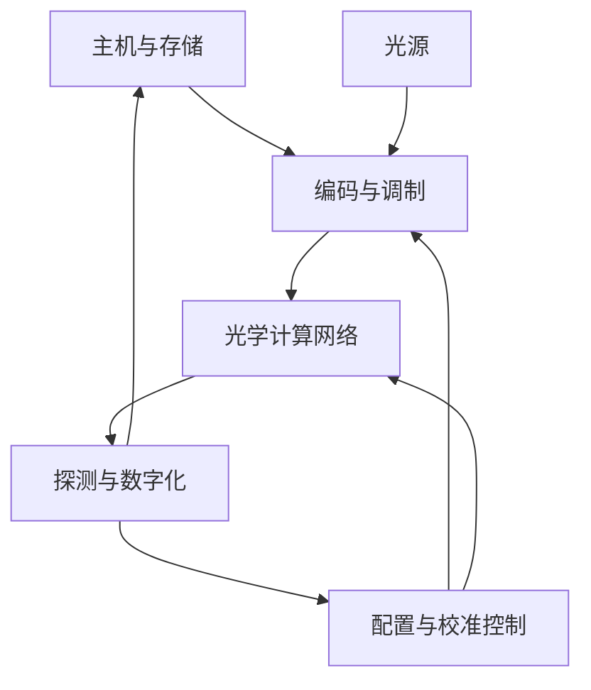
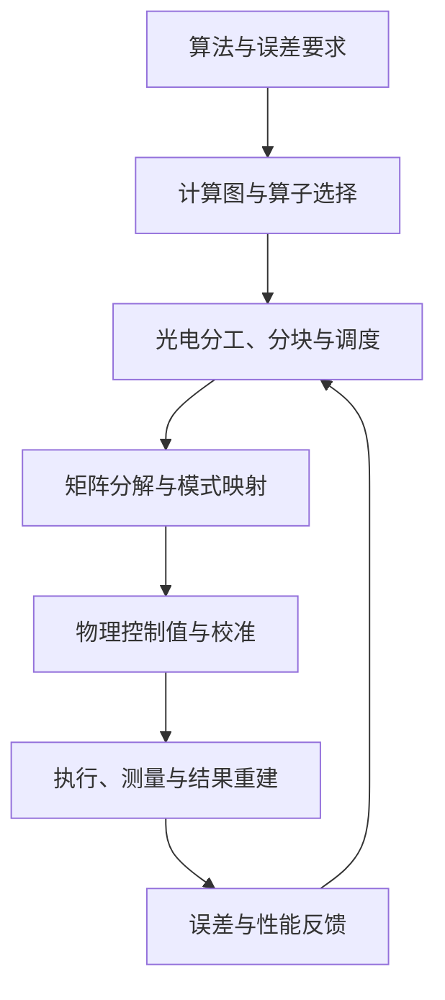

# 光子计算机系统设计：从电磁场到可编程整机

> 面向系统理解的数学与工程指南  
> 调研日期：2026 年 11 月 7 日  
> 范围：跨平台的原理、架构、设计方法和验证流程；不展开具体芯片型号、工艺参数或采购方案。

## 如何阅读

本文类比经典电子计算机的设计，把光子计算分成物理、器件、电路、体系结构、软件与系统工程几层。目标是回答：**信息如何进入光场，物理过程如何执行计算，结果如何保存和读出，以及这些模块怎样形成一台可编程、可验证的机器。**

本篇不是某一种“光 CPU”的蓝图。经典模拟光子计算、数字光逻辑、概率计算与量子光子计算共享部分器件，但不能直接混成一种计算模型。本文先介绍共同基础，再明确各自分支。

公式采用教学用理想模型；只要损耗、带宽、噪声、反射或非线性不可忽略，就需要升级模型。数值示例是计算示例，不代表产品指标。文中 [R 编号] 指向末尾联网核验的原始论文、作者材料、大学课程或官方技术文档；未逐条引用的计算、比较和设计流程为本文的解释性推导与综合。

### 目录

1. 计算路线与经典计算机类比
2. 系统全景与数学工具
3. 光如何表示数据
4. 电磁场、介质与波导
5. 耦合器、相位器与干涉仪
6. 光源与相干性
7. 调制、探测与光电接口
8. 谐振器、滤波器与波长复用
9. 光子矩阵计算
10. 光子模拟计算与动态系统
11. 数字光逻辑与非线性
12. 随机数、概率计算与光子采样
13. 光子存储与状态保持
14. 可编程光学网络
15. 互连、路由、扇出与同步
16. 计算架构与数据流
17. 存储层次与数据搬运
18. 编译、运行时与控制接口
19. 标定、反馈、训练与诊断
20. 数值精度、噪声与误差传播
21. 性能、能耗与扩展性
22. 材料、制造与封装
23. 仿真、测试与可靠性
24. 量子光子计算的额外要求
25. 一个完整的矩阵计算设计案例
26. 从需求到系统的制作流程
27. 学习路线与分阶段实验
28. 常见误解、术语与公式索引
29. 参考资料

---

## 1. 先选择计算路线，再谈制作

### 1.1 光子计算并不等于把晶体管替换成光学器件

计算机需要的是状态表示、变换、控制、通信与读出。它们可以由不同物理系统承担。光子系统的优势候选来自传播、干涉、频谱和空间并行等性质；是否成为系统优势，必须连同接口、功耗和精度评估。

| 路线 | 数据对象 | 基本运算 | 状态与控制 | 典型目标 |
| --- | --- | --- | --- | --- |
| 经典数字光计算 | 具有容差范围的离散逻辑值 | 布尔门、算术、状态转移 | 逻辑恢复、寄存器、控制流 | 数字逻辑与专用数字处理 |
| 经典模拟光计算 | 振幅、相位、功率、连续状态 | 线性变换、卷积、非线性动力学 | 器件参数、反馈、光电控制 | 线性代数、信号处理、神经网络 |
| 经典概率光计算 | 随机变量与目标分布 | 随机更新、采样、随机优化 | 噪声与耦合控制 | 概率推断、生成与优化 |
| 量子光子计算 | 光学模式的量子态 | 幺正演化、测量、条件操作 | 辅助态、前馈、纠错 | 量子算法与量子模拟 |
| 光互连系统 | 通信符号 | 编码、传输、交换、解码 | 路由与链路控制 | 连接电子计算单元 |

最后一项尤其要区分：光负责传数据的系统，不一定用光完成数值运算。随机源使用量子涨落，也不自动让整机成为量子计算机。

### 1.2 与经典计算机逐层对应

| 电子计算机       | 光子系统中的对应问题         | 类比边界                   |
| ----------- | ------------------ | ---------------------- |
| 晶体管         | 调制、开关、非线性、增益与恢复    | 没有一个通用光学器件天然承担晶体管的全部作用 |
| 电线          | 波导、自由空间光路、光纤       | 光路还累积相位、色散、偏振变化        |
| 加法器 / 乘法器   | 干涉、衰减、功率求和、相干探测    | 必须说明作用于场还是功率           |
| 时钟          | 符号时钟、脉冲时序、采样时钟     | 光载波频率不是指令频率            |
| 寄存器         | 延迟、双稳态、材料状态或电子缓冲   | 不同方式保存的对象不同            |
| SRAM / DRAM | 电子存储、光学权重存储、光缓存    | 光存储与随机访问主存不能直接画等号      |
| CPU/GPU 控制器 | 主机、FPGA/ASIC、驱动与反馈 | 光学数据路径通常仍需要控制平面        |
| 指令集         | 运算描述、配置协议、执行约定     | 可编程光学网络不必有传统指令集        |
| 编译器         | 分解、映射、缩放、调度、器件配置   | 必须考虑模拟误差与实物校准          |
| 主板与封装       | 光电封装、连接、供电、温控      | 光学对准和反射是额外约束           |

**系统设计的起点是任务、误差与资源约束，而不是先选一个漂亮的光学器件。**

## 2. 系统全景与数学工具

### 2.1 一个经典光电混合系统的闭环

这张图表示数据路径和控制闭环；物理实现可以是自由空间、光纤、集成光路或混合封装。全光系统也需要解释光源、配置和测量如何完成。

### 2.2 数学工具各管什么

| 数学工具              | 用途              |
| ----------------- | --------------- |
| 复数、相量             | 振幅、相位、相干叠加      |
| 线性代数、SVD、本征分解     | 模式、矩阵网络、可实现性    |
| 麦克斯韦方程、边界条件       | 器件内部电磁场         |
| 常微分方程、矩阵指数        | 模式耦合、腔、动态网络     |
| 傅里叶 / 拉普拉斯 / Z 变换 | 光谱、衍射、滤波、延迟与反馈  |
| 概率、随机过程、功率谱       | 光子计数、噪声、采样      |
| 数值分析、条件数          | 精度要求、误差放大、求解稳定性 |
| 控制论、系统辨识          | 校准、漂移补偿、闭环稳定性   |
| 优化、自动微分、伴随法       | 设计器件、配置电路、训练模型  |
| 量子态、算符、测量理论       | 非经典光源、量子门、量子采样  |

### 2.3 本文符号约定

- 采用时间因子 $e^{-i\omega t}$，前向传播为 $e^{i\beta z}$。
- $a$：经过功率归一化的经典模式振幅，$|a|^2=P$，单位可取 W。
- $\mathcal E$：电场相量；不能不经模式归一化就把 $|\mathcal E|^2$ 当成总功率。
- $\alpha$：功率沿长度的衰减系数，$P(L)=P(0)e^{-\alpha L}$。
- $\kappa$：依上下文表示空间耦合系数或腔能量衰减率，二者单位不同。
- $\hat a$：量子湮灭算符，与经典振幅 $a$ 区分。
- 无源、无损、互易是三个不同条件；无源器件仍可能有损，互易器件也不一定无损。

---

## 3. 光如何表示数据

### 3.1 从连续电磁场到有限维向量

把窄带光场展开到一组模式上：

$$
\mathcal E(\mathbf r)=\sum_j a_j\mathbf e_j(\mathbf r).
$$

选定空间模式、偏振、波长和时间槽后，数据就可以编码到系数 $a_j$ 中。数字符号由编码和判决规则赋予，光场本身不会“知道”某个振幅表示整数 3。

### 3.2 振幅编码与功率编码

**振幅编码：令 $a_j=s_xx_j$。若 $x_j<0$，可采用相位差 $\pi$：

$$
-x=e^{i\pi}x.
$$

此时功率是 $P_j=|s_xx_j|^2$，并非正比于 $x_j$。

**功率编码：**对 $x_j\geq0$，令 $P_j=s_px_j$，则振幅大小为 $\sqrt{s_px_j}$。两种编码的调制器映射、计算规则和读出方式不同。

**差分编码：**对实数 $x=x^+-x^-$，使用两路非负功率。优点是兼容功率测量；代价是额外端口、功率和差分误差。加入正偏置再减去偏置也是一种方法，但偏置会占动态范围。

### 3.3 多路并行的自由度

| 复用方式 | 向量索引放在哪里 | 主要代价 |
| --- | --- | --- |
| 空间复用 | 不同波导、像素、光束 | 面积、布线、探测阵列 |
| 波分复用 WDM | 不同载波频率 | 光谱资源、滤波、色散、波长稳定 |
| 时分复用 TDM | 不同时间槽 | 串行延迟、同步、缓冲 |
| 模分复用 | 不同横向模式 | 模式耦合与分离 |
| 偏振复用 | 不同偏振态 | 偏振控制与串扰 |

这些维度并非总能直接相乘为独立通道数。共享器件、有限带宽和串扰会限制可用自由度。

### 3.4 相干叠加与非相干求和

两路相干光的功率：

$$
P=|a_1+a_2|^2
=|a_1|^2+|a_2|^2+2\operatorname{Re}(a_1a_2^*).
$$

最后一项随相位变化。所谓“非相干求和”，实际要求探测时间平均后的交叉项可以忽略，例如互不相干输入，或不同光频的拍频被探测带宽滤除。若拍频落在接收带宽内，不能直接写成 $P=P_1+P_2$。

### 3.5 量子编码

单光子双轨编码：

$$
|0_L\rangle=|1,0\rangle,\qquad |1_L\rangle=|0,1\rangle.
$$

$$
|\psi\rangle=\alpha|0_L\rangle+\beta|1_L\rangle,
\qquad |\alpha|^2+|\beta|^2=1.
$$

这里的 $\alpha,\beta$ 是概率振幅。一次测量不会把两个复数完整读出来；需要重复制备与不同测量设置才能估计量子态。

## 4. 电磁场、介质与光波导

### 4.1 麦克斯韦方程与材料响应

$$
\nabla\cdot\mathbf D=\rho_f,\quad
\nabla\cdot\mathbf B=0,\quad
\nabla\times\mathbf E=-\partial_t\mathbf B,\quad
\nabla\times\mathbf H=\mathbf J_f+\partial_t\mathbf D.
$$

在线性、局域介质中，频域内 $\mathbf D=\boldsymbol\varepsilon(\omega)\mathbf E$。介电常数可以是复数、张量并依赖频率；复数部分描述吸收或增益，张量描述各向异性。

在无源、非磁性区域：

$$
\nabla\times\nabla\times\mathbf E
=k_0^2\boldsymbol\varepsilon_r\mathbf E,
\qquad k_0=\omega/c.
$$

不能在折射率剧烈变化的矢量结构中，无条件用一个标量 Helmholtz 方程替代它。

### 4.2 模式是本征解，不是微小光线

对沿 $z$ 均匀的波导：

$$
\mathbf E_m(x,y,z)=\mathbf e_m(x,y)e^{i\beta_mz}.
$$

求解边界条件后得到模式形状和 $\beta_m$。有效折射率为：

$$
n_{\mathrm{eff},m}=\beta_m/k_0.
$$

常见介质波导依靠高折射率区域约束场。全反射提供直观解释，但精确模式由波动方程决定，场通常延伸到包层。实际也存在光子晶体、反谐振等其他导光机制。

### 4.3 波导执行相位、损耗与延迟

$$
a(L)=a(0)e^{-\alpha L/2}e^{i\beta L}.
$$

$$
\phi=\beta L,\qquad
v_g=\left(\frac{d\beta}{d\omega}\right)^{-1},\qquad
\tau_g=L\frac{d\beta}{d\omega}=\frac{n_gL}{c}.
$$

相速度 $\omega/\beta$ 与群速度不同。传送窄带包络和同步脉冲通常关心群延迟。

### 4.4 色散：不同频率走出不同相位

在载频附近：

$$
\beta(\omega)=\beta_0+\beta_1\Omega+\frac12\beta_2\Omega^2+\cdots,
\quad \Omega=\omega-\omega_0.
$$

$\beta_1$ 决定群延迟；$\beta_2$ 导致群速度色散，会改变脉冲形状和宽度。波分与高速时分系统都要计算色散预算。

### 4.5 功率、模式重叠与损耗

总功率来自坡印廷矢量积分：

$$
P=\frac12\operatorname{Re}\iint
(\mathbf E\times\mathbf H^*)\cdot\hat{\mathbf z}\,dA.
$$

器件间耦合效率由电磁模式匹配决定。在相同偏振和适当归一化的标量近似中：

$$
\eta_{\mathrm{overlap}}
=\frac{|\iint u_1^*u_2\,dA|^2}
{\iint|u_1|^2dA\;\iint|u_2|^2dA}.
$$

弯曲辐射、表面粗糙散射、材料吸收和接口失配都会损耗功率。上述波动与模式理论可从大学光子学课程系统学习。[R 1, R 2]

## 5. 耦合器、相位器与干涉仪

### 5.1 两模式耦合

去掉公共传播相位，对无损对称耦合器采用约定：

$$
i\frac{d}{dz}\begin{bmatrix}a_1\\a_2\end{bmatrix}
=\begin{bmatrix}0&\kappa_c\\\kappa_c&0\end{bmatrix}
\begin{bmatrix}a_1\\a_2\end{bmatrix}.
$$

$$
\mathbf a(L)=
\begin{bmatrix}
\cos\theta&-i\sin\theta\\
-i\sin\theta&\cos\theta
\end{bmatrix}\mathbf a(0),
\qquad \theta=\kappa_cL.
$$

从第一路输入时，第二路功率占比为 $\sin^2\theta$。$\theta=\pi/4$ 为等功率分束。两波导传播常数失配时，不能只用这个对称模型；耦合效率也会受失配抑制。

### 5.2 移相器

理想移相器：

$$
a_{\mathrm{out}}=e^{i\phi}a_{\mathrm{in}},\qquad
\phi=k_0n_{\mathrm{eff}}L.
$$

可通过改变长度、温度、载流子浓度或电场调节 $n_{\mathrm{eff}}$。实际移相通常还伴随损耗和非线性控制曲线。

### 5.3 MZI 的数学结构

$$
U_{\mathrm{MZI}}=B_2
\begin{bmatrix}e^{i\phi_1}&0\\0&e^{i\phi_2}\end{bmatrix}B_1.
$$

在理想平衡情况下，两个输出端口的功率可按端口约定写成：

$$
P_1=P_{\mathrm{in}}\cos^2\frac{\Delta\phi}{2},\qquad
P_2=P_{\mathrm{in}}\sin^2\frac{\Delta\phi}{2}.
$$

实际采用哪种分束器相位约定，可能交换正弦、余弦所在端口，但功率互补关系不变。

**作用：**开关、可调分束器、强度调制器、两模式旋转、矩阵网格基本单元。

### 5.4 散射矩阵是电路层的统一接口

$$
\mathbf b=S(\omega,\mathbf u)\mathbf a.
$$

$\mathbf a$ 为各端口入射模式，$\mathbf b$ 为出射模式，$\mathbf u$ 为控制量。在适当功率归一化下：

- 无损且完整计入端口：$S^\dagger S=I$。
- 无源：$S^\dagger S\preceq I$。
- 互易且采用兼容端口定义：$S=S^T$。

只截取前向透射子矩阵 $T$，即使整个系统无损，$T$ 也未必酉，因为还可能有反射或其他输出端口。无反馈、反射可忽略的级联可用矩阵相乘；一般多端口互连要解端口连接方程。官方器件建模工作流也采用散射参数构建紧凑模型。[R 3]

## 6. 光源：能源、载波与相干性

### 6.1 激光器为何需要增益和反馈

简化的单模激光速率方程可写成：

$$
\frac{dS}{dt}=\left(G(N)-\frac1{\tau_p}\right)S+\beta_{\mathrm{sp}}R_{\mathrm{sp}},
$$

$$
\frac{dN}{dt}=R_p-R_{\mathrm{rec}}(N)-G(N)S.
$$

$S$ 为腔内光子数，$N$ 为载流子或激发粒子数，具体定义决定各系数单位。阈值条件近似为增益抵消损耗：$G(N_{\mathrm{th}})=1/\tau_p$。

**作用：**提供光能与载波，也为相干计算提供相位参考。设计需要功率、线宽、强度噪声、效率、调谐范围和稳定性。

### 6.2 相干时间与路径差

一阶相干函数：

$$
g^{(1)}(\tau)=
\frac{\langle E^*(t)E(t+\tau)\rangle}
{\langle |E(t)|^2\rangle}.
$$

对理想 Lorentz 线形、线宽 $\Delta\nu$，场相干包络为 $e^{-\pi\Delta\nu|\tau|}$。若取下降到 $1/e$ 的时间，$\tau_c=1/(\pi\Delta\nu)$。稳定干涉既需要延迟差适合相干时间，也需要计算期间相对相位足够稳定。

### 6.3 光频梳

频率集合：

$$
f_m=f_{\mathrm{offset}}+mf_{\mathrm{rep}}.
$$

它提供多个有结构的载波，可用于波分并行。但梳齿功率不一定相等，各通道的噪声、权重和探测拍频仍需处理。[R 7]

### 6.4 单光子与压缩光源

衰减激光产生的相干态有泊松光子数分布，不是理想确定单光子源。量子系统可能采用单发射体、预示式成对光子源或压缩光源。

理想双模压缩态：

$$
|\psi\rangle=\sqrt{1-\lambda^2}\sum_{n=0}^{\infty}\lambda^n|n,n\rangle,
\qquad 0\leq\lambda<1.
$$

提高成对产生率会同时增加多对事件。光源亮度、纯度、不可区分性和收集效率需要共同优化。

## 7. 调制、探测与光电接口

### 7.1 调制器：把电信号编码到光

电光效应使折射率随电场变化。在适当晶向和标量近似下，Pockels 效应：

$$
\Delta n\approx-\frac12n^3rE.
$$

移相器常用半波电压 $V_\pi$ 描述：

$$
\Delta\phi\approx\pi\frac{V}{V_\pi}.
$$

热光移相近似为：

$$
\Delta\phi\approx k_0L\frac{dn_{\mathrm{eff}}}{dT}\Delta T,
\qquad \Delta T\approx R_{\mathrm{th}}P_h.
$$

热调节通常要计入保持功耗和热时间常数；电光调节则要计入驱动电压、电容、损耗和电极带宽。

强度调制可以由 MZI 将相位差转为透射率：

$$
P_{\mathrm{out}}=P_{\mathrm{in}}
\cos^2\left(\frac{\pi V}{2V_\pi}+\phi_b\right).
$$

因此数字数值到电压的映射一般不是简单线性，需要偏置与逆响应校准。

### 7.2 直接探测

$$
i_{\mathrm{ph}}=\mathcal R P,
\qquad \mathcal R=\eta\frac{q}{h\nu}.
$$

$\eta$ 为量子效率，$\mathcal R$ 为响应度。光电流可用跨阻放大器转换为电压，在低频简化为 $v_{\mathrm{out}}\approx-R_fi_{\mathrm{ph}}$。实际带宽和稳定性受探测器电容、放大器和反馈网络限制。[R 4]

直接探测得到功率，不直接给出场的正负和相位。

### 7.3 平衡相干探测为何能读出振幅

设信号为 $a$，本振为 $\ell$，用一个按合适相位约定的平衡混合器形成：

$$
c=(a+\ell)/\sqrt2,\qquad d=(a-\ell)/\sqrt2.
$$

两路功率相减：

$$
|c|^2-|d|^2=2\operatorname{Re}(a\ell^*).
$$

本振足够稳定时，差分电流正比于一个场正交分量。再改变本振相位 $\pi/2$，或用 I/Q 混合器，可恢复另一分量。

如果信号和权重分别编码在两个场中，同一个恒等式还能产生双线性乘积；对时间积分即可累加点积。该机制有专门的光电矩阵计算架构研究。[R 8]

### 7.4 ADC、DAC 与完整信号链

经典模拟加速器常见路径：数字数据 → DAC → 驱动 → 调制 → 光学运算 → 光电探测 → 放大/积分 → ADC → 数字后处理。

理想均匀量化，步长为 $\Delta$，且误差可近似独立均匀时：

$$
\sigma_q^2=\Delta^2/12.
$$

这个模型不覆盖削顶、差分非线性、时钟抖动和相关量化误差。不能用 ADC 的标称位数直接代表光学运算的实际精度。

### 7.5 单光子探测器是另一类读出

需区分仅报告“点击”的阈值探测器与可分辨光子数的探测器。量子实验还关心暗计数、探测效率、死时间、时间抖动与多光子分辨能力；它们不能直接用模拟光电二极管的线性电流模型全部描述。

## 8. 谐振器、滤波器与波长复用

### 8.1 环形谐振条件

$$
\beta(\omega_m)L_r=2\pi m.
$$

近似自由光谱范围：

$$
\mathrm{FSR}_f\approx\frac{c}{n_gL_r}.
$$

在群折射率近似不变的范围内，相邻谐振频率间隔由绕行时间决定。

一个单总线环的简化透射系数为：

$$
t(\omega)=\frac{r-a_re^{i\theta}}{1-r a_re^{i\theta}},
$$

其中 $r$ 是耦合区自耦合振幅，$a_r$ 为单圈振幅保留系数，$\theta$ 是单圈相位。谐振改变传输幅度和相位，可用作滤波、权重与相位控制。

### 8.2 寿命、线宽与速度

腔内振幅模型：

$$
\frac{da}{dt}=\left(i\Delta-\frac{\kappa_r}{2}\right)a+
\sqrt{\kappa_{\mathrm{ex}}}\,s_{\mathrm{in}}.
$$

其中 $\kappa_r$ 是总能量衰减率。输入停止后：

$$
|a(t)|^2=|a(0)|^2e^{-\kappa_rt},\qquad
\tau_E=1/\kappa_r,\qquad Q=\omega_0/\kappa_r.
$$

简单单模模型的功率线宽 $\Delta\omega=\kappa_r$。高 Q 有利于窄带选择和场增强，却会增加响应时间、波长与温度敏感性；这是一项结构性权衡。

### 8.3 波分系统的组成

光频梳/多激光源、复用器、解复用器、波长选择器、权重库、探测器共同组成波分数据路径。不同波长输入会经历不同的器件矩阵 $T(\omega)$，所以“同一个网格”不能未经验证就认为对所有波长执行同一个矩阵。[R 9]

---

## 9. 光子矩阵计算

### 9.1 基本机制：叠加原理就是线性映射

对固定配置、线性且满足所选模式模型的网络：

$$
\mathbf y=T\mathbf x.
$$

这里 $\mathbf x,\mathbf y$ 是场振幅。输入的每一分量传播到各输出，物理叠加得到加权和。

若系统完整、无损，则 $T^\dagger T=I$。因此纯无损模式网络自然实现酉变换，而非任意放大矩阵。

### 9.2 任意矩阵的 SVD 实现

对 $W\in\mathbb C^{M\times N}$：

$$
W=U\Sigma V^\dagger.
$$

输入端执行 $V^\dagger$，对角通道执行奇异值缩放，输出端执行 $U$。矩形矩阵可通过辅助模式、补零或专用矩形结构实现对应映射。

若采用无源实现，取 $s\geq\sigma_{\max}(W)$：

$$
\widetilde W=W/s,
\qquad \sigma_i(\widetilde W)\leq1.
$$

于是可用衰减实现奇异值，最后在读出端乘回 $s$。缩放保证物理可实现，但输出变弱与噪声之间的关系仍要计算。

任意 $N\times N$ 酉矩阵可分解为两模式变换与相位变换；Reck 和 Clements 工作分别给出经典的网格构造，常见通用结构需要约 $N(N-1)/2$ 个两模式单元，另有相位控制。[R 5, R 6]

### 9.3 三类常见矩阵乘法

| 方式 | 编码与运算 | 优点候选 | 主要约束 |
| --- | --- | --- | --- |
| 相干干涉网格 | 复振幅上执行 $T\mathbf x$ | 自然支持复数与符号 | 相位稳定、损耗、校准与读出 |
| 波分/强度加权 | 非负功率加权，探测求和 | 可降低部分相位要求 | 带符号映射、波长串扰、功率分配 |
| 相干探测点积 | 输入场与权重场混合，差分积分 | 动态权重、时间积分 | 权重生成、本振、探测与调度 |

相干网格的实验神经网络示例见 [R 10]；光频梳结合材料权重的张量计算示例见 [R 7]。它们是不同架构，不应把一种架构的资源或指标直接用于另一种。

### 9.4 功率权重不能只看一个透射率

若 $p_j$ 编码非负输入，$r_{ij}$ 是分给输出 $i$ 的功率比例，$t_{ij}$ 是分支功率透射率：

$$
p_{\mathrm{out},i}=\sum_j r_{ij}t_{ij}p_j.
$$

同一个输入的无源扇出满足 $\sum_i r_{ij}\leq1$。因此有效权重是 $r_{ij}t_{ij}$，并非每个输出都免费获得一份完整输入功率。用差分端口表示正负权重时，同样要计入分光和读出资源。

### 9.5 矩阵乘法、矩阵乘矩阵与参数写入

固定 $W$ 的向量流可以重复经过同一网络。对 $Y=WX$，若 $X$ 有 B 列，可按时间依次送入，或用额外模式并行；不是一个 N 通道网络天然同时容纳任意多列。

可重用的关键是权重驻留：一次配置执行 B 个输入时：

$$
E_{\mathrm{per\ vector}}=E_{\mathrm{run}}+E_{\mathrm{configure}}/B.
$$

权重变化频繁时，重配置时间与写入能耗可能决定性能。

### 9.6 连续多层线性网络仍然是线性网络

$$
W_3W_2W_1\mathbf x=W_{\mathrm{eff}}\mathbf x.
$$

没有中间非线性、测量反馈或其他额外机制时，多层结构并不会仅因层数增加而得到一般非线性表达能力。这一点也适用于线性衍射层的级联。

## 10. 光子模拟计算与动态系统

### 10.1 模拟计算是把目标数学关系映射到物理方程

可以实现的对象包括线性变换、积分与微分、卷积、线性方程、常微分方程及非线性动态系统。难点不仅是形式相似，还包括输入输出缩放、边界条件、稳定性和可用精度。

### 10.2 傅里叶光学

理想标量、近轴、薄透镜并采用前后焦面配置时，一维光场可写为：

$$
E_f(\xi)=C\int E_{\mathrm{in}}(x)
\exp\left(-i\frac{2\pi}{\lambda f}x\xi\right)dx.
$$

$C$ 包含比例和整体相位；空间频率对应 $k_x=2\pi\xi/(\lambda f)$。实际有限孔径、像差、像素和偏振会改变传递函数。

### 10.3 卷积、微分与积分

$$
y=h*f=\mathcal F^{-1}[H(k)F(k)].
$$

频域滤波器决定目标运算：

| 运算 | 理想频域响应 | 实际问题 |
| --- | --- | --- |
| 一阶微分 | $H(k)=ik$ | 高频增益，噪声放大，幅度需缩放 |
| 二阶微分 | $H(k)=-k^2$ | 更强高频敏感性 |
| 二维拉普拉斯 | $H=-k_x^2-k_y^2$ | 孔径与空间带宽 |
| 积分 | $H(k)=1/(ik)$ | 零频奇点，需定义常数与正则化 |
| 平滑 | 低通 $H(k)$ | 分辨率与噪声折中 |

被动系统不可能在无限带宽内实现无限增益；算子必须定义有效频带与缩放。

### 10.4 衍射网络

自由空间传播可以写成积分核：

$$
E_{\ell+1}(\mathbf r)=\int K_\ell(\mathbf r,\mathbf r')
\,t_\ell(\mathbf r')E_\ell(\mathbf r')\,d\mathbf r'.
$$

层的复透射率 $t_\ell$ 与传播核 $K_\ell$ 决定映射。训练过程优化层参数，随后由物理传播执行。已有多层被动衍射计算实验。[R 11]

但若材料和传播均线性，探测前整体仍是线性场映射；末端平方律探测提供非线性输出，不能因此等同于每层都有激活函数的电子神经网络。

### 10.5 反馈求解线性方程

若设计离散时间迭代：

$$
\mathbf z_{k+1}=A\mathbf z_k+\mathbf b,
$$

在 $\rho(A)<1$ 时收敛到：

$$
\mathbf z_*=(I-A)^{-1}\mathbf b.
$$

为了求解 $M\mathbf z=\mathbf b_0$，可构造：

$$
A=I-\gamma M,\qquad \mathbf b=\gamma\mathbf b_0.
$$

若 M 对称正定，可取 $0<\gamma<2/\lambda_{\max}(M)$ 保证该理想迭代收敛。一般矩阵要另外检查谱半径与收敛性。物理系统仍需等待收敛，损耗、延迟和条件数都会影响结果。

### 10.6 连续时间与储备池计算

$$
\dot{\mathbf z}=A\mathbf z+B\mathbf u,
\qquad \mathbf y=C\mathbf z+D\mathbf u.
$$

连续线性系统内部稳定性取决于 A 的本征值实部是否小于零。有延迟时需分析包含 $e^{-s\tau}$ 的特征方程，不能只检查静态矩阵。

储备池模型常写为：

$$
\mathbf z_{k+1}=f(W_r\mathbf z_k+W_{\mathrm{in}}\mathbf u_k),
\qquad \mathbf y_k=W_{\mathrm{out}}\mathbf z_k.
$$

光学腔、延迟和非线性可提供动态状态。常见方法主要训练读出层，但记忆能力、稳定性与任务表现取决于整个动力学；环路本身不保证有效计算。[R 12]

## 11. 数字光逻辑与非线性

### 11.1 真值表只是第一步

若用功率范围表示 0/1，一个门不仅要在理想输入点给出正确输出，还要允许下一级识别、抵抗噪声、提供足够扇出并避免相互干扰。

对标量恢复映射 $p_{k+1}=F(p_k)$，希望 0 和 1 附近是稳定固定点：

$$
F(p_0)=p_0,\quad F(p_1)=p_1,\quad
|F'(p_0)|<1,\quad |F'(p_1)|<1.
$$

这样小扰动在级联中被压缩。完整门电路还涉及多输入、负载、噪声裕量、传播延迟和重定时。光逻辑可用性的讨论长期强调这些系统条件。[R 13]

### 11.2 线性求和加阈值

对 a,b∈{0,1}，教学模型：

$$
\mathrm{AND}(a,b)=\Theta(a+b-1.5),
\qquad
\mathrm{OR}(a,b)=\Theta(a+b-0.5).
$$

求和可用光学方法；阈值与恢复需要材料非线性、光电判决或其他机制。NOT 通常需要参考/偏置能量，不能要求一个无源衰减器在零输入时自行产生有光输出。

线性干涉配合特定编码和末端判决可以实现部分布尔功能，但通用级联逻辑还需要上述信号恢复机制。

### 11.3 非线性材料响应

张量关系在简化标量情形下写成：

$$
P=\varepsilon_0\left(\chi^{(1)}E+\chi^{(2)}E^2+\chi^{(3)}E^3+\cdots\right).
$$

Kerr 模型：

$$
n=n_0+n_2I,\qquad \Delta\phi=k_0n_2IL.
$$

对有效模式，常写 $\Delta\phi=\gamma P L_{\mathrm{eff}}$，其中 $\gamma$ 包含材料、频率和模式重叠。将光强依赖的相位放入 MZI 或腔，可转成光强依赖的输出。

其他机制包括饱和吸收、增益饱和、载流子和热效应。不同机制的速度、功率、噪声、迟滞与恢复时间不同；“有非线性”不等于“适合低能耗高速逻辑”。

### 11.4 状态机与通用计算

有了组合门，仍需状态：

$$
\mathbf s_{t+1}=F(\mathbf s_t,\mathbf x_t),\qquad
\mathbf y_t=G(\mathbf s_t,\mathbf x_t).
$$

实现寄存器、计数器、控制器，需要可靠保持状态、写入、复位、同步和读取。数字通用计算还要程序与数据寻址、条件执行和异常处理。一个矩阵网格本身并没有这些语义。

## 12. 随机数、概率计算与光子采样

### 12.1 先分清三个目标

| 目标 | 输出是什么 | 如何评价 |
| --- | --- | --- |
| 随机数发生 | 接近独立均匀的比特 | 熵率、偏差、相关性、可预测性 |
| 目标分布采样 | 指定 $p(x)$ 的样本 | 分布误差、混合时间、样本有效性 |
| 量子光子采样 | 指定量子实验的测量结果 | 态与器件误差、分布验证、经典模拟成本 |

把一个噪声源接入系统，并不会自动得到所需的目标分布。

### 12.2 单光子分束随机数

$$
|1,0\rangle\longrightarrow
\frac{|1,0\rangle+i|0,1\rangle}{\sqrt2}.
$$

理想测量两个出口，概率各为 1/2。现实中要处理不同探测效率、暗计数、死时间和多光子事件；只统计得到“看似均匀”不足以证明不可预测。

### 12.3 相干光的光子数统计

理想相干光在固定时间窗的检测计数：

$$
N\sim\mathrm{Poisson}(\mu),\quad
P(N=n)=e^{-\mu}\mu^n/n!,
$$

$$
\mathbb E[N]=\mu,\qquad \mathrm{Var}(N)=\mu.
$$

计数不是均匀分布；要提取均匀比特，需要概率模型与后处理。

### 12.4 真空涨落与随机性提取

定义正交分量：

$$
\hat X=(\hat a+\hat a^\dagger)/\sqrt2,\qquad
\hat P=(\hat a-\hat a^\dagger)/(i\sqrt2).
$$

在此约定下真空态有 $\mathrm{Var}(X)=\mathrm{Var}(P)=1/2$。平衡零差探测可以测量其中一个分量，产生连续随机输出。实际输出还混有电子噪声、漂移与带宽相关性。

普通离散最小熵：

$$
H_{\min}(X)=-\log_2\max_xP(X=x).
$$

面对外部侧信息时，要用条件最小熵。使用合适的带种子量子安全提取器，输出长度大致受平滑条件最小熵减去安全余量限制；提取器不会无中生有创造熵。已有实验把有限带宽、ADC 缺陷及量子侧信息纳入模型。[R 14]

### 12.5 经典概率计算与 Ising 模型

目标能量：

$$
E(\mathbf s)=-\sum_{i<j}J_{ij}s_is_j-\sum_i h_is_i,
\quad s_i\in\{-1,+1\}.
$$

若目标是 Boltzmann 分布：

$$
p(\mathbf s)=Z^{-1}e^{-\beta E(\mathbf s)}.
$$

局部场 $H_i=\sum_{j\ne i}J_{ij}s_j+h_i$ 对应条件更新：

$$
P(s_i=+1\mid\mathbf s_{\setminus i})
=\frac1{1+e^{-2\beta H_i}}.
$$

光学网络可参与计算局部场，噪声参与随机更新。但必须证明实际更新规则、噪声和调度对应目标稳态。最小化能量、找到较好解和正确采样 Boltzmann 分布是不同任务。

### 12.6 玻色采样

采用约定 $\hat a_j^\dagger\mapsto\sum_iU_{ij}\hat b_i^\dagger$。对输入和输出 Fock 占据数分别为 $\mathbf n,\mathbf m$ 的理想不可区分光子：

$$
P(\mathbf m\mid\mathbf n)
=\frac{|\mathrm{Per}(U_{\mathbf m,\mathbf n})|^2}
{\prod_i m_i!\prod_j n_j!}.
$$

子矩阵按输出占据数重复行、按输入占据数重复列。积和式为：

$$
\mathrm{Per}(A)=\sum_{\sigma\in S_N}\prod_iA_{i,\sigma(i)}.
$$

相对于行列式，没有置换奇偶符号；多条不可区分路径的振幅发生干涉。经典模拟困难性的论证依赖复杂性假设、分布条件及误差定义，不能从“出现 permanent”直接推出每个实验都超越经典计算。[R 15]

两不可区分单光子进入平衡分束器时，理想符合事件消失，即 Hong–Ou–Mandel 干涉。它是检查光子不可区分性的重要工具，也说明量子多光子干涉与两束经典光的平均功率干涉不是同一件事。

## 13. 光子存储与状态保持

### 13.1 先定义要保存什么

- 保存正在传播的经典光信号：缓冲与延迟。
- 保存连续动态状态：腔、载流子、反馈网络。
- 保存权重或比特：材料状态或电子存储。
- 保存未知量子态：量子存储。

这些都可能被称为“光存储”，但容量、寿命、访问与读出方式不同。

### 13.2 延迟线与循环缓冲

$$
\tau=n_gL/c.
$$

若 $n_g=4$，延迟 1 ns 需要 7.5 cm 光路。令输入符号率为 R，可容纳时间槽数约为 $R\tau$，但损耗、脉冲间隔和开关开销限制实际使用。

环路每圈功率保留比例为 $\eta$ 时，k 圈后 $P_k=P_0\eta^k$。加入放大器可以补偿平均功率，但也引入噪声与稳定性问题。

### 13.3 腔存储与带宽

腔的能量寿命由第 8 节给出。单模高 Q 腔不等于同时具有大容量、宽带、长时间的随机访问存储；耦入与耦出也需要设计。不要把腔的高 Q 单独当作“主存已经解决”。

### 13.4 材料非易失存储

以相变状态 s 为例，设复有效折射率：

$$
\widetilde n(s)=n(s)+in_{\mathrm{im}}(s),
\qquad
 t(s)=e^{ik_0\widetilde n(s)L}.
$$

材料状态改变后，读出光的透射率和相位改变。保存的是材料构型，原来的光子无需留在器件中。需研究写能耗、写入延迟、耐久性、保持、读扰动、漂移和多级状态可分辨性。多级非易失光子存储已有实验基础。[R 16]

### 13.5 双稳态与动态记忆

若系统 $\dot s=F(s,u)$ 对同一输入存在两个稳定平衡点，就可以用不同稳定状态编码比特。写入需要跨越状态边界；噪声可能引发跳变；有些双稳态需要持续供能，因此并非非易失。

### 13.6 量子存储

理想单轨映射示意：

$$
(\alpha|0\rangle+\beta|1\rangle)_{\mathrm{光}}|g\rangle
\to |0\rangle_{\mathrm{光}}(\alpha|g\rangle+\beta|s\rangle).
$$

需要保存相干性与关联，而非测出一个经典比特再记录。指标包括存取效率、保真度、噪声、带宽、存储时间、多模容量和按需读出能力。2026 年仍有集成量子存储效率与多模能力的原始实验进展，不能笼统说“光子无法存储”。[R 17]

## 14. 可编程光学网络

### 14.1 可编程性的对象

| 层次 | 改变什么 | 例子 |
| --- | --- | --- |
| 参数可调 | 单器件的物理响应 | 相位、透射、谐振频率 |
| 线性变换可编程 | 输入到输出的矩阵 | MZI 网格、权重阵列 |
| 路由与滤波可编程 | 路径、延迟和反馈连接 | 通用波导网格 |
| 算法可编程 | 运算序列与调度 | 光电混合执行系统 |
| 通用计算 | 广泛程序的有效执行 | 另需状态、控制与资源体系 |

“通用线性变换”中的通用，不能直接解释为“通用计算机”。

### 14.2 前馈网格与循环网格

前馈结构：

$$
T(\boldsymbol\theta)=T_K(\theta_K)\cdots T_1(\theta_1).
$$

适合静态矩阵映射。循环网络存在内部反馈。在频域简化模型中：

$$
\mathbf z=A(\omega)\mathbf z+B(\omega)\mathbf x,
$$

$$
T(\omega)=C(\omega)[I-A(\omega)]^{-1}B(\omega)+D(\omega).
$$

只有在对应频率逆存在且系统满足稳定性时才有意义。接近谐振可以增强某些响应，也会增加灵敏度、等待时间与不稳定风险。

### 14.3 配置问题是受约束优化

$$
\min_{\mathbf u}\;
\|T_{\mathrm{measured}}(\mathbf u)-T_{\mathrm{target}}\|_F^2
+\lambda P_{\mathrm{control}}(\mathbf u),
$$

约束包括控制范围、功率、可用端口、稳定性和器件故障。目标也可以直接是任务损失，而非逐元素矩阵误差。

自配置网络可以利用局部监测和逐级调节减少对完整器件模型的依赖，但依赖可观测性、拓扑和监测精度，并非任意网络都能简单局部调好。[R 18]

### 14.4 矩阵配置与输入调制分开看

权重可能长期固定，输入则持续高速变化。输入数据速率、权重更新速率、整个网络的重新校准速率可以相差很大。报告“高速可编程”时必须说明具体是哪一项。

## 15. 互连、路由、扇出与同步

### 15.1 扇出遵守能量分配

无源均分为 F 路：

$$
P_{\mathrm{branch}}\leq P_{\mathrm{in}}/F.
$$

如果每个接收端都需要固定光子数，增大扇出就需要增大源功率或改变精度与架构。经典场可以通过分束复制波形形状，但不能无代价复制光能；未知量子态还受到不可克隆定理约束。

### 15.2 交叉、交换与反射

需要区分波导交叉与真正的光学交换：前者尽量让两路独立穿过，后者选择连接关系。路由规划还要考虑插损、串扰、路径差、偏振和反射。

反射进入激光器或形成寄生腔可能改变系统行为。普通互易元件不能仅凭几何布局就变成真正的单向隔离器。

### 15.3 时序的四个尺度

1. 光载波周期：约由 $1/\nu$ 决定。
2. 数据符号周期：由调制与接收速度决定。
3. 传播和积分延迟：决定结果何时可用。
4. 配置与反馈周期：决定参数何时稳定、能否及时修正。

光的载波处于很高频率，并不表示系统每个载波周期执行一次独立数值运算。

### 15.4 同步与带宽

基带信号在理想严格带限、均匀采样条件下，需要采样率超过两倍最高频率才能无混叠重建。实际还要滤波余量。时间抖动 $\delta t$ 对快速变化信号的误差近似为：

$$
\delta x\approx \frac{dx}{dt}\delta t.
$$

干涉稳定性还需约束相对相位：

$$
\delta\phi\approx k_0\left(n_{\mathrm{eff}}\delta L+L\delta n_{\mathrm{eff}}\right).
$$

波分通道的群延迟差、时间槽对齐和电子采样时钟是不同的同步问题。

## 16. 计算架构与数据流

### 16.1 先决定光电分工

| 功能 | 可选实现 | 选择依据 |
| --- | --- | --- |
| 线性乘加 | 光学阵列、电子阵列 | 并行度、精度、接口成本 |
| 非线性 | 光学材料、电子电路、数字程序 | 响应速度、能耗、可编程性 |
| 权重保存 | 材料、模拟控制状态、电子存储 | 写频率、保持成本、漂移 |
| 中间激活 | 光延迟、腔、电子缓冲 | 生命周期、容量、访问模式 |
| 调度控制 | 电子主机、FPGA/ASIC 等 | 分支、通信与实时要求 |
| 随机过程 | 光噪声、电子噪声、数字算法 | 目标分布与可验证性 |

光电混合并不代表设计不完整；应按完整任务成本分配功能。2026 年已有把光学阵列、电子接口、校准和软件接口集成起来的原始系统研究。[R 19]

### 16.2 权重驻留与输出驻留

- **权重驻留：**反复使用已配置矩阵，减少权重写入。
- **输入复用：**一个输入用于多组输出或权重，支付扇出/缓冲成本。
- **输出驻留：**分块点积的部分和在积分器或存储中累加，减少重复读写。

这与 GPU/张量加速器的数据流优化有共同问题：让昂贵的数据尽可能多次复用。

### 16.3 分块矩阵运算

若阵列只能处理局部块：

$$
y_i=\sum_j W_{ij}x_j
\quad\Rightarrow\quad
\mathbf y^{(p)}=\sum_qW^{(p,q)}\mathbf x^{(q)}.
$$

需要显式安排：块的加载顺序、部分和保存、数值缩放、输出累计位宽、是否能够重叠读写和计算。模拟累加器可能饱和；每块数字化则增加转换次数。

### 16.4 一层神经网络的完整执行

$$
\mathbf h_{\ell+1}=f(W_\ell\mathbf h_\ell+\mathbf b_\ell).
$$

光学网络可能只完成 $W_\ell\mathbf h_\ell$。偏置、激活、归一化、残差、softmax、状态缓存及数据重排需要明确实现位置；不得把线性核吞吐量等同于完整模型吞吐量。

### 16.5 “逻辑并行”如何落地

对每个并行维度，都要问：是否有对应独立载波/空间模式、调制资源、光功率、探测资源与存储带宽？时间串行的 N 个权重脉冲虽可由一个积分器求点积，但仍占用 N 个时间槽。

## 17. 存储层次与数据搬运

### 17.1 四类数据分别设计

| 数据 | 生命周期 | 典型要求 |
| --- | --- | --- |
| 程序与执行描述 | 长 | 可靠、可寻址、可更新 |
| 模型权重/网络配置 | 中至长 | 配置复用、保持与版本一致 |
| 输入输出 | 短 | 带宽、缓冲、批处理 |
| 中间状态/部分和 | 短至中 | 容量、累加精度、访问顺序 |

不必强迫四类数据都存于光域。若光学存储无法提供所需访问方式，电子存储加光学计算仍是完整方案。

### 17.2 数据搬运下界

运算量 C、有效算力 R、需搬运数据量 D、有效带宽 B，则在理想充分重叠时：

$$
T\geq\max(C/R,D/B).
$$

若不能重叠，时间更接近求和；还需加配置、同步与等待。运算强度 $I=C/D$ 给出：

$$
R_{\mathrm{effective}}\leq\min(R,I B).
$$

D 的统计边界应写清，例如主存到缓存、缓存到 DAC，或整机外部输入输出。不同边界对应不同瓶颈。

### 17.3 缓存与配置一致性

物理权重、软件缓存的权重、校准参数必须对应同一版本。否则即使数据值正确，也可能用旧校准驱动新权重。运行时至少应关联：逻辑矩阵版本、物理映射、温度/波长条件、校准版本、有效时间和健康状态。

---

## 18. 编译、运行时与控制接口

### 18.1 编译过程

主要步骤：

1. 明确目标算子与数值范围，识别适合卸载到光域的部分。
2. 选择场编码或功率编码，处理负数、复数、偏置与缩放。
3. 根据阵列尺寸分块，安排时间、空间、波长与部分和。
4. 用 SVD、两模式分解或结构化映射得到理想器件参数。
5. 使用校准模型将理想相位/透射率转换为电压、电流或写入脉冲。
6. 生成配置、输入、采样、同步与后处理命令。
7. 检查误差预算、硬件资源、超范围情况与任务精度。

### 18.2 一个最低限度的运行时接口

| 接口语义 | 应包含的信息 |
| --- | --- |
| 配置 | 目标变换、物理资源、校准版本、稳定等待 |
| 提交 | 输入地址、形状、编码、批量、缩放 |
| 执行 | 触发、符号时钟、积分窗口、依赖关系 |
| 读出 | ADC 数据、增益、偏置、有效性状态 |
| 重建 | 符号/复数恢复、缩放、块累加 |
| 健康管理 | 温度、光功率、漂移、饱和、坏通道 |

这相当于硬件与软件之间的执行契约。状态和错误应可观测，例如“输入超出功率范围”“配置未稳定”“读出饱和”“校准失效”。

### 18.3 硬件感知训练与数值替代

可把噪声、量化与参数误差放进训练：

$$
\min_W\mathbb E_{\eta,\Delta W}
\mathcal L\big(f_{\mathrm{hw}}(W+\Delta W,\eta),\mathrm{target}\big).
$$

它可能提高容错性，但不是所有误差都可被训练吸收。漂移超出模型、削顶和严重不可观测误差仍需系统解决。

## 19. 标定、反馈、训练与诊断

### 19.1 标定是什么

标定建立目标数值与实际物理响应之间的映射：

$$
\boldsymbol\theta=f(\mathbf u,\mathbf T,\boldsymbol\lambda,\text{历史状态}).
$$

其中控制量 $\mathbf u$ 可能包含电压、加热功率或写入脉冲。材料迟滞意味着仅知道当前电压可能不足以知道当前状态。

### 19.2 局部响应与热串扰

$$
\Delta\boldsymbol\phi\approx J\Delta\mathbf u,
\qquad J_{ij}=\partial\phi_i/\partial u_j.
$$

J 若不是对角矩阵，逐个独立调相位可能互相破坏。可通过联合求解、迭代反馈或正则化更新控制量：

$$
\Delta\mathbf u=(J^TJ+\lambda I)^{-1}J^T\Delta\boldsymbol\phi.
$$

这只是局部线性方法，较大变化需重新线性化；控制范围也必须约束。

### 19.3 观测什么，决定能校准什么

探测输出功率 $|T\mathbf x|^2$ 通常不能靠一次输入确定完整复矩阵 T。需要设计探测输入、相位参考或额外监测端口，解决可辨识性。不同参数也可能给出相同外部行为，未必能逐个恢复真实物理参数，但可以标定有效输入输出映射。

监测分光会消耗功率，探测器、电线和读出也占面积，因此可观测性必须从架构阶段设计。

### 19.4 参数梯度与在位训练

若 $\mathbf y=T(\boldsymbol\theta)\mathbf x$，损失梯度可用链式法则：

$$
\frac{\partial\mathcal L}{\partial\theta_k}
\propto\operatorname{Re}\left[
\mathbf g^\dagger
\frac{\partial T}{\partial\theta_k}\mathbf x
\right],
$$

比例约定取决于复数梯度定义，$\mathbf g$ 表示相应输出伴随量。可用有限差分、数字模型自动微分、伴随法，或在满足条件的网络中用物理测量获得梯度信息。具体在位反向传播方案见原始研究 [R 20]。

有限差分每个参数分别扰动通常成本随参数数目增长；伴随法可让大量参数共享少量场求解，但目标数、激励数、边界条件和非线性仍影响成本。

### 19.5 故障定位分层

| 现象 | 候选原因 | 区分方式 |
| --- | --- | --- |
| 全部输出变弱 | 源功率、耦合、公共损耗 | 输入/输出功率监测、参考路径 |
| 相干结果波动 | 相位、波长、偏振漂移 | 参考干涉、固定测试向量 |
| 某通道固定偏差 | 权重、探测增益、串扰 | 单通道扫描、交换端口 |
| 高速时才出错 | 带宽、抖动、色散、建立时间 | 变速率、脉冲响应 |
| 只在大输入出错 | 削顶、饱和、非线性 | 扫描输入幅度 |
| 重配后才出错 | 未稳定、旧校准、迟滞 | 等待时间扫描、版本检查 |

控制变量实验应让源、输入、网络、读出尽可能分别可测，否则无法区分算法问题与硬件问题。

## 20. 数值精度、噪声与误差传播

### 20.1 确定性误差与随机误差分开建模

$$
\hat{\mathbf y}=(W+\Delta W)(\mathbf x+\delta\mathbf x)+\boldsymbol\eta.
$$

忽略二阶小量：

$$
\delta\mathbf y\approx W\delta\mathbf x+\Delta W\mathbf x+\boldsymbol\eta.
$$

$$
\|\delta\mathbf y\|\leq
\|W\|\|\delta\mathbf x\|+\|\Delta W\|\|\mathbf x\|+\|\boldsymbol\eta\|.
$$

稳定偏差可能校准；独立零均值噪声可以通过平均降低；相关噪声、漂移和削顶不能靠同样方式解决。

### 20.2 散粒噪声与光子预算

理想相干光计数相对标准差：

$$
\sigma_N/\mu=1/\sqrt\mu.
$$

若用“相对 RMS 误差约 $2^{-b}$”定义一个教学精度目标：

$$
\mu\gtrsim2^{2b}.
$$

这里 $\mu$ 是被探测的平均光子数。此式不等于所有架构每次 MAC 的统一下限，也不能直接当作 ADC 的 b 位 ENOB。差分相消、信号归一化、共享探测和任务容错都会改变对应关系。

示例：取波长 1550 nm，单光子能量约 $1.28\times10^{-19}$ J。上述定义下 b=8 对应约 65,536 个探测光子，即约 8.4 fJ 的探测光能。若探测量子效率为 $\eta_d$、光路传输为 $\eta_p$、激光电光效率为 $\eta_l$：

$$
E_{\mathrm{laser,electrical}}
\gtrsim\frac{\mu h\nu}{\eta_d\eta_p\eta_l}.
$$

还未计入驱动、读出和控制。该示例用于揭示精度—能量关系，不代表实测系统指标。[R 8]

### 20.3 电流噪声

在简单泊松检测和单边功率谱约定下：

$$
S_i^{\mathrm{shot}}=2qI,
\qquad i_{n,\mathrm{rms}}^2\approx2qIB_e.
$$

热噪声电阻的电压谱密度为 $4k_BTR$。实际接收链需合并放大器电压/电流噪声、反馈电阻、暗电流与频率响应；不能将相关噪声不加检查地按独立方差相加。[R 4]

### 20.4 动态范围与相消

若两大数相减得到小结果，虽然绝对误差较小，相对误差仍可能很大。例如 $y=x_1-x_2$ 且两者接近时，噪声来自两条强信号，小输出并不意味着小噪声。

因此评估矩阵计算不能只给一个全局相对误差；还应报告绝对误差、归一化误差、不同幅度区间表现与任务指标。

### 20.5 条件数与求解问题

求解 $A\mathbf z=\mathbf b$ 时，小扰动的相对放大与 $\kappa(A)=\|A\|\|A^{-1}\|$ 有关。病态问题即使传播非常快，也可能需要高精度输入和测量、预条件化或迭代修正。

“物理系统自动求逆”不意味着绕过条件数、收敛时间和读出精度。

### 20.6 误差预算示例

| 误差来源 | 预算对象 | 控制手段 |
| --- | --- | --- |
| 输入量化 | $\delta\mathbf x$ | 位宽、缩放、编码校准 |
| 网络设置 | $\Delta W$ | 标定、监测、温控 |
| 相位与波长 | 时间变化的 T | 参考、锁定、补偿 |
| 光子噪声 | 统计方差 | 光能、积分、平均 |
| 接收噪声 | 读出方差与偏置 | 接收器、带宽、增益 |
| 输出量化 | 数字化误差 | ADC 范围、位宽 |
| 模型误差 | 结构化偏差 | 改善模型、测量验证 |

只有在误差近似独立且模型适用时，才可用平方和分配总 RMS 预算。

## 21. 性能、能耗与扩展性

### 21.1 定义统计边界

| 指标 | 必须交代 |
| --- | --- |
| 运算吞吐量 | MAC 还是 OPS；是否只数光核；实际利用率 |
| 延迟 | 输入编码、传播、积分、数字化和等待是否计入 |
| 能耗 | 激光电功率、驱动、ADC/DAC、控制、存储是否计入 |
| 精度 | 输入分布、动态范围、噪声、校准条件 |
| 可编程性 | 输入速率、权重更新、全网络重配分别多快 |
| 面积与扩展 | 光学区、电子区、封装、散热、外部设备 |

### 21.2 理想阵列吞吐量

N×N 阵列每秒接受 $R_s$ 个完整向量，按常用实数 MAC 口径：

$$
R_{\mathrm{MAC}}=N^2R_s.
$$

若一个 MAC 计 2 OPS，则为 $2N^2R_s$。复数运算、结构化矩阵、时间复用和稀疏操作应另定义口径。需要 N 路输入每周期可用且 N 路输出被接收，才能达到这个理想流速。

### 21.3 延迟模型

$$
T_{\mathrm{first\ result}}\approx
T_{\mathrm{encode}}+T_{\mathrm{propagate}}+
T_{\mathrm{integrate}}+T_{\mathrm{read}}+T_{\mathrm{post}}.
$$

流水稳定后的向量间隔由最慢级和共享资源决定。首次响应延迟、稳态吞吐、批处理完成时间是不同指标。

### 21.4 能耗模型

$$
E_{\mathrm{task}}=
E_{\mathrm{source}}+E_{\mathrm{input}}+E_{\mathrm{weights}}+
E_{\mathrm{read}}+E_{\mathrm{memory}}+
E_{\mathrm{control}}+E_{\mathrm{post}}.
$$

持续控制功率要乘以任务占用时间：$E_{\mathrm{hold}}=P_{\mathrm{hold}}T$。不能因为网络对光场的变换是无源的，就把维持其配置所需的电功率忽略。

### 21.5 损耗随深度累积

经过 d 个单元，各单元功率传输为 $\eta_k$：

$$
\eta_{\mathrm{total}}=\prod_{k=1}^{d}\eta_k.
$$

若相同则 $\eta^d$。dB 口径下插入损耗相加。要保持探测光子数，源功率至少需按总损耗补偿；增益会附带噪声和额外功耗。

### 21.6 电路深度与算法复杂度

把一个矩阵固化在器件中，可以在一次传播中作用于输入，但构造和配置一般稠密矩阵仍需要处理大量参数。面积、参数写入、输入输出与精度成本不会因此消失。应分别报告：配置复杂度、传播深度、在线执行时间、物理资源和重复使用次数。

### 21.7 Amdahl 定律

若原任务中比例 p 的时间被加速 S 倍，其余不变：

$$
S_{\mathrm{overall}}=\frac1{(1-p)+p/S}.
$$

这还是忽略新增接口开销的理想上界。若线性核很快但数据整理、非线性与存储占据大部分时间，整体收益有限。

### 21.8 Landauer 极限的正确位置

$k_BT\ln2$ 是标准条件下每个逻辑不可逆比特擦除的热力学下限，不是“每个乘法至少耗这些能量”的通用公式。可逆传播、模拟运算和数字擦除的操作定义不同；完整系统仍要计入制备、控制、测量和复位成本。比较应在相同任务、精度和系统边界下进行。

### 21.9 用约束定位下一步优化

| 首先受限的资源 | 可观察证据 | 优先考虑的方向 |
| --- | --- | --- |
| 输入输出带宽 | 光核空闲，等待编码或读出 | 数据复用、批处理、减少转换次数 |
| 权重更新 | 配置时间占任务大部分 | 权重驻留、映射缓存、适合的写入机制 |
| 探测信噪比 | 误差随光子数变化明显 | 光功率、积分、低噪声接收、任务精度调整 |
| 相位稳定 | 固定输入下结果持续漂移 | 参考、温控、缩短路径差、闭环校准 |
| 总损耗 | 深层网络需要过高源功率 | 降低深度、器件损耗、分块与架构调整 |
| 热与控制功耗 | 保持配置比执行更耗能 | 控制复用、低保持功耗或非易失配置 |
| 存储容量 | 中间状态频繁外传 | 分块顺序、缓冲层次与数据驻留 |
| 数值条件 | 特定任务误差异常放大 | 预条件化、缩放、迭代修正与混合精度 |

这些措施需要重新验证代价。例如减少探测带宽可以降低噪声，但也可能降低吞吐；增加并行度可能降低延迟，却增加扇出功率和接口资源。

## 22. 材料、制造与封装

### 22.1 材料平台决定能实现哪些器件

| 材料类别 | 常见作用 | 需要研究的限制 |
| --- | --- | --- |
| 硅 | 紧凑波导、载流子调制、与电子工艺集成 | 光源集成、热效应、材料与非线性损耗 |
| 氮化硅 | 低损耗传输、谐振、频梳等 | 调制/光源需其他机制或异质集成 |
| 铌酸锂等电光材料 | 高速相位与强度调制、非线性 | 加工、光电极设计与集成 |
| III–V 半导体 | 光源、增益与探测等 | 异质集成、热管理、制造兼容性 |
| 相变材料 | 非易失权重与可重构响应 | 吸收、写入、耐久与漂移 |
| 稀土掺杂材料/其他量子介质 | 相干光物质接口与量子存储 | 带宽、效率、噪声、温度条件 |

这不是性能排行榜。不同波长、模式、结构和工艺下结果不同；完整系统可以使用多种材料。

### 22.2 制作流程

需求规格 → 原理图和模型 → 器件/网络设计 → 版图 → 工艺规则检查 → 制造 → 晶圆/裸片测试 → 封装 → 校准 → 系统验收。

制造可能包括薄膜生长/沉积、光刻、刻蚀、掺杂、金属电极、包层、材料键合等。具体步骤随平台改变，不存在适用于所有光子计算机的统一工艺配方。

### 22.3 PDK 与紧凑模型

PDK 应提供工艺层、设计规则、验证过的器件及其模型，并可能附带版图生成和检查工具。设计者需要知道模型的波长、温度、偏振、功率范围及统计误差；超出有效范围就不能继续信任模型。官方 PDK 与封装设计包说明见 [R 21, R 22]。

### 22.4 制造误差如何进入系统

$$
\delta\beta\approx
\frac{\partial\beta}{\partial w}\delta w+
\frac{\partial\beta}{\partial h}\delta h+
\frac{\partial\beta}{\partial n}\delta n.
$$

宽度 w、厚度 h、材料折射率的偏差会改变相位和耦合。既有局部随机偏差，也有整片相关偏差；Monte Carlo 应使用有依据的相关模型，而非默认所有参数独立。

可调器件能修正部分误差，但需要调节范围、控制功耗和可观测性。制造后可调不是对制造容差的无限补偿。

### 22.5 封装从架构阶段开始

封装包含光纤与芯片耦合、激光连接、电子驱动/接收芯片、供电、高速信号、散热与机械稳定。需预留端口、测试结构和热路径；否则核心器件即使工作，也可能无法装成稳定系统。[R 22]

### 22.6 逆向设计与伴随法

令设计变量为 p，场满足 $A(p)e=b$，目标为实数 $\mathcal L(e,p)$。在一个简化实变量模型中，解伴随方程：

$$
A^T\lambda=\frac{\partial\mathcal L}{\partial e},
$$

若 b 与 p 无关：

$$
\frac{d\mathcal L}{dp}
=\frac{\partial\mathcal L}{\partial p}
-\lambda^T\frac{\partial A}{\partial p}e.
$$

复数电磁问题要采用一致的共轭/实部约定。其价值是避免为每个几何参数分别做完整有限差分求解。制造最小特征、曲率、刻蚀偏差、带宽和热约束应进入优化目标或约束；漂亮的仿真图案不自动可制造。官方伴随求解器文档见 [R 23]。

## 23. 仿真、测试与可靠性

### 23.1 分层模型

| 层 | 模型 | 要回答的问题 |
| --- | --- | --- |
| 电磁 | FDTD、FEM、模式求解等 | 场、模式、耦合、反射与损耗 |
| 器件 | S 参数、耦合模、响应曲线 | 给定条件的输入输出 |
| 电路 | 端口互连、反馈、时域仿真 | 网络传输与动态稳定性 |
| 信号链 | 驱动、探测、ADC/DAC | 编码、带宽与噪声 |
| 架构 | 事件、调度、带宽与功耗模型 | 整体性能与资源瓶颈 |
| 应用 | 数值误差与任务评估 | 是否完成目标计算 |

不应每次运行任务都做全芯片三维电磁仿真。通常先提取器件模型，再组成高层模型，最后用实测回标。

### 23.2 FDTD 的基本思想

在空间和时间网格离散麦克斯韦旋度方程，交错更新电场与磁场。需满足稳定性条件、采用合适吸收边界并做网格收敛检查。更细网格增加空间单元数，也缩短稳定时间步；高 Q 结构还需要足够长仿真时间。[R 24]

### 23.3 不能省略的模型验证

- 功率守恒/无源性：是否出现不合理的能量增加。
- 互易性：适用条件下端口响应是否一致。
- 带宽与因果性：插值后的响应是否物理合理。
- 数值收敛：网格、时间窗口、模式数改变后结果是否稳定。
- 参考面与归一化：端口相位、功率和单位是否一致。

### 23.4 系统测试不只输入随机向量

| 测试类型 | 目的 |
| --- | --- |
| 单端口/基向量 | 检查每个输入到输出的响应 |
| 带参考的复振幅测试 | 恢复相位与符号 |
| 全幅度扫描 | 检查线性区、削顶、动态范围 |
| 频率/速率扫描 | 检查带宽、色散、建立时间 |
| 温度与时间扫描 | 检查漂移和校准有效期 |
| 相消、近奇异与困难输入 | 检查误差放大 |
| 真实任务 | 检查系统效用 |
| 长时间与重配置循环 | 检查可靠性与可重复性 |

### 23.5 可靠性与恢复

记录源功率、温度、探测偏置、控制状态和校准版本。支持上电自检、参考运算、坏通道屏蔽、重校准、备用路径和任务重试。材料写入耐久、激光老化与封装漂移都可能改变有效工作区。

不应对所有软硬件故障采用同一种恢复策略：校准可恢复的漂移、永久失效的器件和随机一次性异常应分别处理。

## 24. 量子光子计算的额外要求

### 24.1 经典复振幅不等于量子多比特态

N 个经典模式的复振幅构成 N 维向量；n 个量子比特的一般纯态需要 $2^n$ 个概率振幅。但量子态不能被逐项直接读出，制备与操作也受物理约束。不能用一束分成许多路径的经典激光就宣称获得可用的多量子比特计算能力。

### 24.2 单比特与纠缠操作

双轨编码的单光子可以用分束器和相位器实现单比特酉变换。不同光子编码的双比特纠缠门更困难：普通被动线性光学不能直接为任意双轨输入提供无需其他资源的确定性通用纠缠门。

KLM 使用辅助光子、探测与前馈构建有效量子计算路线。[R 25] 现代融合式方案则从小纠缠资源态与纠缠投影测量组织计算，需连同纠错分析理解。[R 26]

### 24.3 前馈与光延迟

测量一个模式后，后续操作依赖测量结果。于是总前馈时间包括探测、电子处理、通信和开关建立时间。在相关光子等待这段时间时，需要延迟/存储，随之增加损耗。量子前馈与经典“慢速配置矩阵”不是同一个时序问题。

### 24.4 损耗与不可区分性

若某实验要求 n 个光子全部存活，且独立单光子总生存概率为 $\eta$，简单模型中成功概率为 $\eta^n$。实际可有复用、预示、容错与可接受缺失事件，因此不能将该式当成所有架构的总成功率，但它清楚说明损耗预算为何重要。

光子频谱、时间、偏振和空间模式的不匹配会降低多光子干涉质量。需分别测量不可区分性、暗计数、多对污染与门/测量误差。

### 24.5 纠错与整机资源

还要学习逻辑量子比特、码距、稳定子测量、译码、资源态制备和容错阈值。高条件保真度若以“成功探测到所有光子”为前提，不等于低损耗、确定性、高成功率的逻辑门。2025 年可制造光子量子模块研究明确区分了条件测量指标与损耗。[R 27]

### 24.6 高斯与非高斯资源

高斯态、线性光学、压缩与高斯测量构成重要工具，但只依赖高斯资源不足以自动实现通用容错量子计算。单光子态、光子计数等非高斯资源可扮演关键角色。量子路线应独立建立态制备、操作、测量和纠错的资源账本。

---

## 25. 一个完整的矩阵计算设计案例

本节只用理想模型说明设计链条，不绑定器件型号，也不声称是优化后的高性能系统。

### 25.1 目标与验收标准

目标运算：

$$
W=\frac12\begin{bmatrix}1&1\\1&-1\end{bmatrix},
\qquad \mathbf y=W\mathbf x,
\qquad x_i\in[-1,1].
$$

设验收要求为：在规定输入集合内，输出绝对误差 RMS 小于某给定 $\epsilon$。不采用全域相对误差要求，因为正确输出可以为零。

### 25.2 可实现性

令：

$$
U=\frac1{\sqrt2}\begin{bmatrix}1&1\\1&-1\end{bmatrix},
\qquad W=\frac1{\sqrt2}U.
$$

$U^\dagger U=I$，两个奇异值均为 $1/\sqrt2$。因此可用一个相位补偿后的两模式酉变换，加共同振幅衰减 $1/\sqrt2$ 实现；对应功率保留一半。实际网格的损耗另行加入。

### 25.3 编码

采用同一激光器的两路相干信号：

$$
a_i=\sqrt{P_0}\,x_i.
$$

输入绝对值由调制器设置，负号由相位 $\pi$ 表示。因此 $P_i=P_0x_i^2$。输入 $\mathbf x=(1,-0.5)^T$ 时，总信号功率为 $1.25P_0$。

编码器需把目标数值转换成可实现电压，并保证两条路径的相对相位正确。

### 25.4 传播计算

$$
\mathbf a_{\mathrm{out}}=W\mathbf a_{\mathrm{in}}
=\sqrt{P_0}\begin{bmatrix}0.25\\0.75\end{bmatrix}.
$$

直接检测功率：

$$
(P_{\mathrm{out},1},P_{\mathrm{out},2})
=(0.0625P_0,0.5625P_0).
$$

注意数值结果是 0.25 和 0.75，功率结果是其平方乘以 $P_0$。直接把功率当作线性输出会算错。

### 25.5 带符号读出

每个输出与相位对齐的本振 $\ell=\sqrt{P_{\mathrm{LO}}}$ 混合并平衡探测：

$$
\Delta i_i=2\mathcal R\sqrt{P_{\mathrm{LO}}P_0}\,y_i.
$$

理想重建：

$$
\hat y_i=\frac{\Delta i_i}{2\mathcal R\sqrt{P_{\mathrm{LO}}P_0}}.
$$

实物还要扣除偏置、校准增益、积分并数字化。增加本振功率不等于免费消除所有噪声，本振散粒噪声、饱和和激光噪声也需计入。

### 25.6 验证向量

| 输入 | 理想输出 | 用途 |
| --- | --- | --- |
| (1,0) | (0.5,0.5) | 检查第一列 |
| (0,1) | (0.5,-0.5) | 检查第二列与符号读出 |
| (1,1) | (1,0) | 检查相消与动态范围 |
| (1,-1) | (0,1) | 检查另一组相消 |
| (0,0) | (0,0) | 测量偏置与暗噪声 |
| (1,-0.5) | (0.25,0.75) | 检查一般输入 |

只测试功率，无法区分 (0.5,0.5) 与 (0.5,-0.5)。因此测试方案必须与编码匹配。

### 25.7 接成多层系统还要加什么

若下一步执行 $\mathbf z=f(\mathbf y)$，有两条路线：

- 光电路线：探测 → 数字/模拟非线性 → 重新调制下一层。
- 光学路线：加入经过验证的光学非线性与必要增益/恢复。

再继续补充输入缓冲、权重配置、触发、校准、错误标记和结果接口，才形成可用计算模块。

## 26. 从需求到系统的制作流程

### 阶段 A：定义任务与约束

明确运算、数据形状、精度/任务正确率、延迟、吞吐、容量、功耗、环境与更新频率。给出电子参考实现及比较边界。

**产出：**可测量的规格书与验收数据集。

### 阶段 B：选择计算模型

判断需要数字、模拟、概率还是量子路线。若主要任务是稠密线性计算，可以从光电混合矩阵模块建立闭环；若主要任务是分支和随机访问，必须论证光域实现的收益。

**产出：**光电分工图、数据表示与任务映射。

### 阶段 C：建立理想数值模型

使用线性代数或动力学模型验证可实现性、稳定性、归一化和读出方式。此时就检查负数、零输出、超范围与条件数问题。

**产出：**数学模型、参考结果、可实现性约束。

### 阶段 D：加入现实预算

加入损耗、光子数、器件偏差、转换误差、带宽、写入、温控和封装。计算完整任务时间与能耗，不只计算核心传播。

**产出：**误差预算、光功率预算、带宽与能耗预算。

### 阶段 E：器件与电路协同设计

使用验证过的器件模型或自行仿真提取模型，加入监测端口、配置路径、反馈和测试结构。若做集成实现，在版图前检查 PDK/封装规则。

**产出：**电路、版图或光路、驱动与接收设计、测试点。

### 阶段 F：原型与标定

先让源、调制器、网络、探测器分别工作，再连接闭环。测量响应曲线、串扰、温度依赖和时间响应，将实测回标到系统模型。

**产出：**可重复的标定程序与有效工作范围。

### 阶段 G：运行时与任务验证

实现配置、数据提交、同步、采样、后处理与错误报告。用困难输入和真实任务测试正确性，再测端到端性能。

**产出：**可执行系统、验收报告、可复现实验记录。

### 阶段 H：扩展与可靠性

增加尺寸前重新分析损耗、热串扰、端口数、控制通道、数据供给与良率。加入长期运行、重配置、漂移和恢复测试。

**产出：**扩展模型、可靠性方案和已验证的限制。

每个阶段都可能推动前一阶段修改。系统设计不是器件清单的单向拼装，而是围绕任务约束反复收敛。

## 27. 学习路线与分阶段实验

### 27.1 共同基础主线

| 阶段 | 学习内容 | 应能完成的推导/实验 |
| --- | --- | --- |
| 1 | 复振幅、功率、傅里叶 | 推导两束光干涉；解释功率为何非线性 |
| 2 | 模式与边界条件 | 解简单平板波导或理解数值本征模式 |
| 3 | 耦合模与 MZI | 求两波导矩阵指数；扫描 MZI 输出 |
| 4 | S 参数与网络组合 | 建立含损耗、反射的器件模型 |
| 5 | 编码与探测 | 推导直接与平衡探测；恢复符号 |
| 6 | 矩阵计算 | 用两模式单元实现小矩阵并验证 |
| 7 | 噪声与校准 | 加入光子、读出和相位噪声，画误差随功率变化 |
| 8 | 系统数据流 | 加入 ADC/DAC、缓冲、配置和调度 |
| 9 | 制造与封装 | 进行容差、热与接口设计检查 |

### 27.2 三条进阶分支

**模拟与加速器分支：**SVD/结构化矩阵 → 光电信号链 → 精度与任务容错 → 分块和数据复用 → 训练与运行时。

**数字与动态系统分支：**非线性 → 恢复与噪声裕量 → 双稳态/时序 → 状态机 → 控制器与存储体系；或转向稳定反馈系统与微分方程求解。

**量子分支：**谐振子与 Fock 态 → 单光子与压缩光 → 分束器算符变换 → 多光子干涉 → 量子门/测量前馈 → 量子存储 → 容错与资源估算。

### 27.3 推荐的第一个完整项目

先制作一个仿真的 2×2 或 4×4 光电混合矩阵模块，包含：源模型、编码、可编程网络、损耗、探测、噪声、校准和结果重建。这里的目标是**闭环完整**，不是第一步就做大尺寸。

应能回答：目标矩阵是什么；控制值从哪里来；输入负数如何表达；输出如何读出；误差为何产生；怎样判断校准失效；扩大尺寸后哪项资源先不足。

## 28. 常见误解、术语与公式索引

### 28.1 常见误解

| 说法 | 修正 |
| --- | --- |
| 光速快，所以一定比电子计算快 | 应比较完整任务的并行度、带宽、接口与延迟 |
| 波导就是导线 | 波导承载模式并累积相位、色散、损耗 |
| 两束光合并就是两个数相加 | 相干场相加，功率有干涉交叉项 |
| 探测器测得线性矩阵结果 | 直接探测通常得到场幅度的平方 |
| 任意矩阵都能无损实现 | 完整无损模式变换受酉性约束 |
| 多层线性光网络就是深度非线性网络 | 探测前仍可合并成一个线性场变换 |
| 一个布尔真值表就等于可用逻辑门 | 还要恢复、噪声裕量、扇出、隔离与级联 |
| 可编程网格就是光 CPU | 线性可编程与通用程序执行是不同层次 |
| 无源运算没有系统能耗 | 光源、控制、转换、存储都耗能 |
| 光不能存储 | 可延迟、可映射到材料状态；需区分保存对象 |
| 使用量子噪声就等于量子计算 | 量子熵源可以服务经典系统 |
| 玻色采样就是通用量子计算 | 它是特定采样模型，通用计算另需资源 |
| 一次传播求逆，复杂度为常数 | 配置、收敛、条件数、资源和读出仍需计入 |
| 增大通道数，吞吐就同比例无限增加 | 功率、带宽、热、损耗与控制资源会约束 |

### 28.2 主要器件词典

| 器件 | 数学对象/原理 | 系统作用 |
| --- | --- | --- |
| 激光器 | 增益、反馈、速率方程 | 光能、载波、参考 |
| 波导 | 电磁本征模式 | 传输、相位、延迟 |
| 定向耦合器 | 两模式耦合矩阵 | 分光、混合、交换 |
| MMI | 多模干涉 | 分光与合束 |
| 相位器 | $e^{i\phi}$ | 相位控制 |
| MZI | 分束—移相—合束 | 调制、开关、矩阵单元 |
| 衰减器 | $a\mapsto ta$ | 缩放、权重 |
| 谐振器 | 极点、寿命、频率响应 | 滤波、状态、增强 |
| 调制器 | 控制量到场/功率响应 | 数据输入、权重更新 |
| 探测器 | 光电效应、平方律或点击统计 | 输出与监测 |
| 波分器件 | 频率选择散射矩阵 | 复用与路由 |
| 光放大器 | 增益及附加噪声 | 功率恢复 |
| 非线性器件 | 状态/光强依赖响应 | 激活、逻辑、频率转换 |
| 相变单元 | 状态依赖复折射率 | 非易失权重与存储 |
| 光纤/芯片耦合器 | 模式重叠与散射 | 封装接口 |
| 分束监测器 | 分光加探测 | 标定与闭环 |

### 28.3 核心公式索引

| 关系 | 用途 |
| --- | --- |
| $a(L)=a(0)e^{-\alpha L/2}e^{i\beta L}$ | 波导传输 |
| $\tau_g=L\,d\beta/d\omega$ | 群延迟 |
| $\mathbf b=S\mathbf a$ | 器件与网络输入输出 |
| $S^\dagger S=I$ | 完整无损端口网络 |
| $W=U\Sigma V^\dagger$ | 任意矩阵分解 |
| $|a+\ell|^2-|a-\ell|^2=4\operatorname{Re}(a\ell^*)$ | 相干乘积与读出；实际分束器另含归一化 |
| $\tau_E=1/\kappa_r,\ Q=\omega _0/\kappa_r$ | 腔寿命与 Q |
| $\sigma_N/\mu=1/\sqrt\mu$ | 理想相干光计数噪声 |
| $\rho(A)<1$ | 离散线性反馈收敛条件 |
| $R_{\mathrm{effective}}\leq\min(R,IB)$ | 计算与搬运限制 |

---

## 29. 参考资料与阅读说明

以下为联网核验的原始研究、作者资料、官方文档和大学课程。早期论文用于仍有效的基础原理，较新研究用于展示当前系统路线；不把论文中某一实验条件下的指标当成所有光子计算机的通用能力。部分期刊全文需订阅；本文对这些来源只依据可访问摘要/作者版本引用其相应结论，不声称阅读了不可访问的全部全文。

### 物理、器件与建模

- **[R 1] MIT OpenCourseWare — Fundamentals of Photonics: Quantum Electronics.** 电磁波、干涉、波导、耦合模、量子光学和激光的系统课程。  
  [原始资料](https://ocw.mit.edu/courses/6-974-fundamentals-of-photonics-quantum-electronics-spring-2006/pages/lecture-notes/)
- **[R 2] MIT OpenCourseWare — Mathematical Methods in Nanophotonics.** 模式、本征值、数值方法、谐振与非线性稳定性。  
  [原始资料](https://ocw.mit.edu/courses/18-369-mathematical-methods-in-nanophotonics-spring-2008/pages/lecture-summaries/)
- **[R 3] Ansys Optics — S-parameter/passive workflow guide.** 用电磁仿真结果构建被动多端口紧凑模型的官方工作流。  
  [原始资料](https://optics.ansys.com/hc/en-us/articles/360059772393-S-parameter-passive-workflow-guide)
- **[R 4] Analog Devices — Optimizing Precision Photodiode Sensor Circuit Design.** 光电二极管、跨阻接收与噪声设计。  
  [原始资料](https://www.analog.com/en/resources/technical-articles/optimizing-precision-photodiode-sensor-circuit-design.html)

### 线性网络与计算

- **[R 5] Reck et al., Experimental realization of any discrete unitary operator, Physical Review Letters 73, 58–61 (1994).** 酉矩阵的两模式分解。  
  [原始资料](https://doi.org/10.1103/PhysRevLett.73.58)
- **[R 6] Clements et al., Optimal design for universal multiport interferometers, Optica 3, 1460–1465 (2016).** 通用干涉网格的结构设计。  
  https://doi.org/10.1364/OPTICA.3.001460  
  作者机构版本：[链接](https://ora.ox.ac.uk/objects/uuid%3A12001441-51c7-4bb7-913c-18a1c208ed2e)
- **[R 7] Feldmann et al., Parallel convolutional processing using an integrated photonic tensor core, Nature 589, 52–58 (2021).** 光频梳、材料权重与并行卷积的实验路线。  
  [原始资料](https://doi.org/10.1038/s41586-020-03070-1)
- **[R 8] Hamerly et al., Large-Scale Optical Neural Networks Based on Photoelectric Multiplication, Physical Review X 9, 021032 (2019).** 相干探测乘法、系统架构与光子噪声分析；文中的大规模能力包含理论与仿真分析，不应全部视为已建成硬件。  
  [原始资料](https://doi.org/10.1103/PhysRevX.9.021032)
- **[R 9] WDM-enabled multi-core parallel programmable photonic signal processor, Nature Communications 17, 8689 (2026).** 波长选择与可编程网格结合的原始实验研究；用于说明波长维度需要专门设计。  
  [原始资料](https://doi.org/10.1038/s41467-026-75557-w)
- **[R 10] Shen et al., Deep learning with coherent nanophotonic circuits, Nature Photonics 11, 441–446 (2017).** 相干可编程光学处理器实验。  
  [原始资料](https://doi.org/10.1038/nphoton.2017.93)
- **[R 11] Lin et al., All-optical machine learning using diffractive deep neural networks, Science 361, 1004–1008 (2018).** 多层衍射计算实验。  
  https://doi.org/10.1126/science.aat8084  
  作者预印本：[链接](https://arxiv.org/abs/1804.08711)
- **[R 12] Tait et al., Neuromorphic photonic networks using silicon photonic weight banks, Scientific Reports 7, 7430 (2017).** 光学权重与连续神经动力学映射。  
  [原始资料](https://doi.org/10.1038/s41598-017-07754-z)
- **[R 13] Miller — Optics for Digital Information Processing，作者公开稿。** 数字光逻辑的系统要求与级联问题。  
  [原始资料](https://ee.stanford.edu/~dabm/199.pdf)

### 随机性与存储

- **[R 14] Gehring et al., Homodyne-based quantum random number generator at 2.9 Gbps secure against quantum side-information, Nature Communications 12, 605 (2021).** 连续变量随机源、相关噪声、ADC 和条件熵分析。  
  [原始资料](https://doi.org/10.1038/s41467-020-20813-w)
- **[R 15] Aaronson and Arkhipov, The Computational Complexity of Linear Optics, Theory of Computing 9, 143–252 (2013).** 玻色采样模型与复杂性论证。  
  https://theoryofcomputing.org/articles/v009a004/  
  作者预印本：[链接](https://arxiv.org/abs/1011.3245)
- **[R 16] Ríos et al., Integrated all-photonic non-volatile multi-level memory, Nature Photonics 9, 725–732 (2015).** 相变材料非易失多级光子存储实验。  
  [原始资料](https://doi.org/10.1038/nphoton.2015.182)
- **[R 17] Meng et al., Efficient integrated quantum memory for light, Nature Photonics 20, 437–443 (2026).** 集成光量子存储的原始实验进展。  
  [原始资料](https://doi.org/10.1038/s41566-026-01845-y)

### 可编程、系统与设计工具

- **[R 18] Miller, Self-configuring universal linear optical component, Photonics Research 1, 1–15 (2013).** 自配置线性光学组件。  
  [原始资料](https://arxiv.org/abs/1303.4602)
- **[R 19] Meyer et al., Deep neural network inference on an integrated, reconfigurable photonic tensor processor, Nature Communications 17, 3396 (2026).** 计算、电子 I/O、校准和软件接口的系统集成示例。  
  [原始资料](https://doi.org/10.1038/s41467-026-71599-2)
- **[R 20] Hughes et al., Training of photonic neural networks through in situ backpropagation and gradient measurement, Optica 5, 864–871 (2018).** 在位梯度与训练方案。  
  https://doi.org/10.1364/OPTICA.5.000864  
  作者预印本：[链接](https://arxiv.org/abs/1805.09943)
- **[R 21] AIM Photonics — Process Design Kits.** 工艺规则、器件库与设计支持的官方说明。  
  [原始资料](https://www.aimphotonics.com/pdk)
- **[R 22] AIM Photonics — Assembly Design Kit.** 芯片与封装协同设计的官方说明。  
  [原始资料](https://www.aimphotonics.com/assembly-design-kit)
- **[R 23] Meep — Adjoint Solver.** 电磁逆向设计与梯度计算的官方文档。  
  [原始资料](https://meep.readthedocs.io/en/latest/Python_Tutorials/Adjoint_Solver/)
- **[R 24] Meep — Introduction.** FDTD、离散化与稳定性的官方文档。  
  [原始资料](https://meep.readthedocs.io/en/latest/Introduction/)

### 量子光子计算

- **[R 25] Knill, Laflamme and Milburn, A scheme for efficient quantum computation with linear optics, Nature 409, 46–52 (2001).** 线性光学量子计算与测量反馈的基础方案。  
  [原始资料](https://doi.org/10.1038/35051009)
- **[R 26] Bartolucci et al., Fusion-based quantum computation, Nature Communications 14, 912 (2023).** 资源态、融合测量与容错架构。  
  [原始资料](https://doi.org/10.1038/s41467-023-36493-1)
- **[R 27] A manufacturable platform for photonic quantum computing, Nature 641, 876–883 (2025).** 可制造量子光子模块、互连与条件测量指标。  
  [原始资料](https://doi.org/10.1038/s41586-025-08820-7)

### 阅读次序

先读第 1–8 节建立物理与信号链基础，再读第 25 节观察闭环；随后读第 9–23 节补齐架构、软件和工程。量子路线在共同基础之后单独进入第 24 节及 [R 25–R 27]。查资料时始终区分：数学可实现性、器件实验、系统演示、理论性能估计与大规模可制造性。
